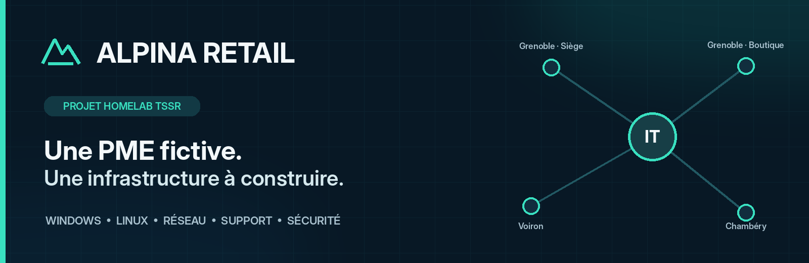
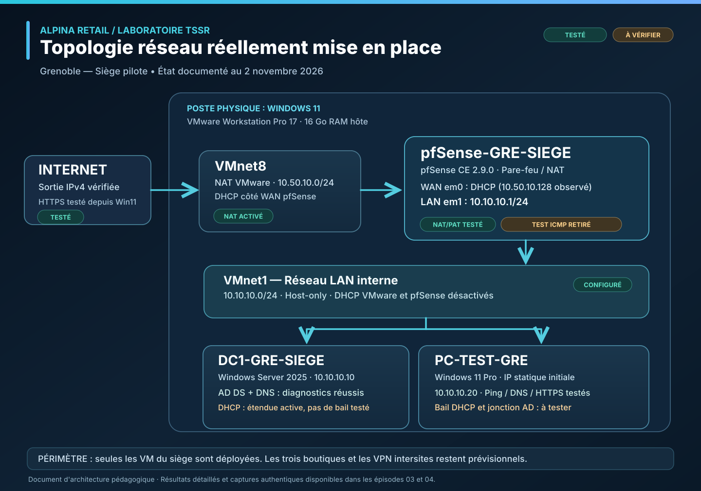
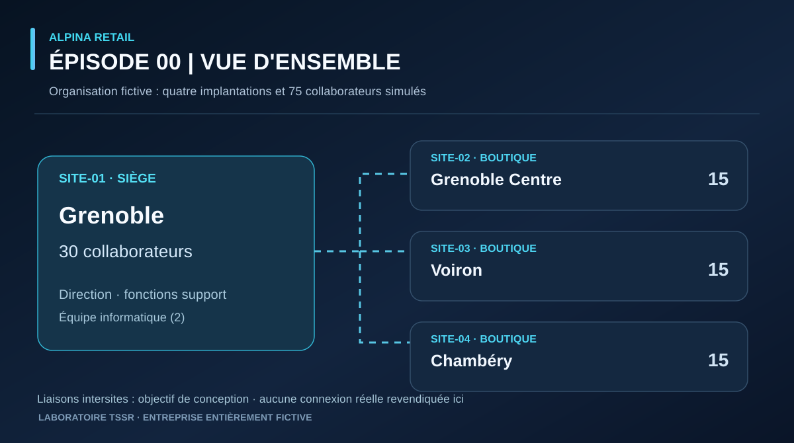

# ALPINA RETAIL — Laboratoire systèmes & réseaux

**Projet personnel TSSR · Infrastructure multisite fictive · Documentation technique et preuves de validation**

Je conçois, déploie et dépanne progressivement une infrastructure informatique inspirée des besoins d'une PME du prêt-à-porter. Le projet associe **architecture réseau, Windows Server, Active Directory, DNS, DHCP, pfSense, virtualisation et support utilisateurs**.

> **À propos du périmètre :** ALPINA RETAIL est une **entreprise entièrement fictive**. Les quatre sites et leurs 75 collaborateurs sont simulés ; seules certaines machines du **laboratoire du siège de Grenoble** sont réellement déployées. Chaque résultat annoncé comme validé renvoie à une manipulation documentée.

## Le projet en bref

| Entreprise simulée | Laboratoire personnel | Progression |
|---|---|---|
| **4 sites** · 75 collaborateurs fictifs | **Windows 11** · VMware Workstation · **16 Go de RAM sur l'hôte** | **Épisodes 00 à 05 documentés**, déploiement en cours |

**Ce qui est déjà vérifié :**

- **Réseau et sécurité :** pfSense CE 2.9.0 configuré ; LAN/WAN, accès Internet depuis Windows 11, NAT/PAT observé, filtrage ICMP ciblé testé puis retiré, sauvegarde de configuration chiffrée conservée hors GitHub.
- **Windows Server et AD DS :** Windows Server 2025, forêt `ironman.test`, promotion de `DC1-GRE-SIEGE`, tests `dcdiag` ciblés réussis ; partages `SYSVOL` et `NETLOGON` accessibles depuis Windows 11 et découverte du DC par `nltest /dsgetdc:ironman.test` réussie et canal sécurisé vérifié par PowerShell (`True`) et lecture de `GPT.INI` depuis SYSVOL (`Version=3`) ; captures fournies en conversation, pas encore déposées sur GitHub.
- **DNS et dépannage :** résolution des noms internes et externes ; diagnostic du message `Server: UnKnown`, création d'une zone inversée et d'un enregistrement PTR, contre-test réussi.
- **DHCP :** serveur autorisé dans Active Directory, étendue `DHCP-GRE-SIEGE` active ; **bail `10.10.10.100/24` de huit jours reçu et options vérifiées sur le client Windows 11**.

[**Voir les preuves pfSense — épisode 03**](docs/episode-03/README.md) · [**Voir les 40 captures Windows Server / AD / DNS / DHCP / GPO — épisode 04**](docs/episode-04/README.md)

## Architecture actuelle du laboratoire

La topologie suivante décrit les composants **créés dans VMware**, et non les futurs réseaux de toutes les boutiques.

*Schéma de synthèse au 3 novembre 2026 — équipement du laboratoire réellement créé. **DHCP client, jonction AD et application de la GPO vérifiés** ; verrouillage automatique observé par l'auteur sans capture ni mesure chronométrée précise. [Ouvrir le schéma vectoriel en grand](docs/topologie-laboratoire-siege.svg).*

*Le poste `PC-TEST-GRE`, initialement configuré en statique sur `10.10.10.20`, utilise maintenant un **bail DHCP `10.10.10.100` délivré par DC1**. Les trois VM ont été allumées simultanément pour les essais du 3 novembre, malgré les 16 Go de RAM de l'hôte.*

### Repères d'adressage du siège

| Composant | Configuration | État |
|---|---|---|
| pfSense LAN | `10.10.10.1/24` | Configuré et testé |
| DC1 — AD DS / DNS | `10.10.10.10/24` | Configuré et testé |
| PC-TEST-GRE | `10.10.10.100/24` (DHCP ; statique initiale `10.10.10.20`) | Bail, DNS, jonction AD, sessions et GPO vérifiés |
| Étendue Windows DHCP | `10.10.10.100` → `10.10.10.199` | Active ; bail client de 8 jours confirmé |

**À distinguer :** la connexion entre les quatre sites, les VPN et les autres serveurs de l'architecture cible sont pour le moment des **éléments de conception**, pas un environnement multisite opérationnel.

## Journal de bord — choisir un épisode

| Épisode | Sujet | Livrables et validation |
|---|---|---|
| **00** | [Présentation du projet](#vue-densemble-de-lentreprise-fictive) | Contexte, sites et objectifs de la maquette |
| **01** | [Organisation et organigramme](docs/episode-01/README.md) | Répartition des 75 collaborateurs simulés, organigramme et [dossier PDF](docs/episode-01/Alpina_Retail_Organisation_Episode_01.pdf) |
| **02** | [Cahier des charges informatique](docs/episode-02/README.md) | Besoins métier, architecture cible, droits d'accès et limites du laboratoire |
| **03** | [Pare-feu pfSense et poste Windows 11](docs/episode-03/README.md) | Installation, adressage, NAT/PAT, filtrage ICMP, tests réseau et sauvegarde chiffrée |
| **04** | [Windows Server, AD DS, DNS et DHCP](docs/episode-04/README.md) | DC1, dépannage DNS, DHCP réel sur Windows 11, jonction à `ironman.test`, utilisateur AD et première GPO (application vérifiée ; verrouillage ensuite observé par l'auteur sans capture) |
| **05** | [FS1 — Serveur de fichiers Debian Linux](docs/episode-05/README.md) | Installation Debian 12, connexion console et `hostnamectl` validés ; réseau, SSH, Samba et intégration AD restent à vérifier |

**Preuves visuelles :** [épisode 03 — 8 captures authentiques et 2 schémas pédagogiques](docs/episode-03/images/README.md) · [épisode 04 — 40 captures authentiques Windows Server / AD DS / DNS / DHCP / GPO](docs/episode-04/images/README.md).

## Vue d'ensemble de l'entreprise fictive

*Schéma de conception — entreprise fictive de 75 collaborateurs : Grenoble (siège, 30), Grenoble Centre (15), Voiron (15) et Chambéry (15). Les liaisons intersites sont des objectifs futurs.*

Les collaborateurs sont principalement représentés par des **besoins métier, des rôles et, progressivement, des comptes de test**. Il n'est pas prévu de démarrer 75 postes ou de simuler 75 personnes en activité simultanément.

## Démarche TSSR et compétences mobilisées

Chaque épisode technique suit la même logique :

**Besoin → architecture → configuration → vérification → diagnostic → documentation.**

Les compétences travaillées comprennent l'administration Windows Server, AD DS, DNS, DHCP, la virtualisation, les réseaux IPv4, le routage/NAT, les règles de filtrage et le dépannage d'incidents.

**Exemple documenté :** dans l'[épisode 04](docs/episode-04/README.md), un test `nslookup` affichait initialement `Server: UnKnown` et un délai d'attente. L'inspection DNS a révélé l'absence de zone inversée et de PTR ; après leur création, les recherches directe et inverse ont réussi sans le message initial. Les captures **avant / après** sont présentes dans le dossier de l'épisode.

> **Rigueur de validation :** une configuration affichée comme active ne remplace pas un test de fonctionnement côté client. Les erreurs, limites et étapes non vérifiées sont conservées dans les comptes rendus.

## Prochains objectifs

- [x] Définir l'entreprise fictive, son organisation et ses besoins informatiques.
- [x] Installer pfSense et valider la connectivité IP, le NAT/PAT et un scénario de filtrage.
- [x] Déployer `DC1-GRE-SIEGE`, créer `ironman.test` et vérifier les services AD DS / DNS ciblés.
- [x] Créer et activer l'étendue DHCP du siège ; contrôler sa plage et ses options.
- [x] Confirmer la durée du bail de **8 jours** et l'attribution DHCP à `PC-TEST-GRE` (`ipconfig /all`).
- [x] Joindre Windows 11 au domaine, authentifier des comptes AD et vérifier l'application d'une GPO ordinateur à 900 secondes.
- [x] Observer le verrouillage automatique sur `PC-TEST-GRE` (retour de l'auteur du 03/11/2026 ; pas de capture ni de chronométrage précis).
- [x] Vérifier depuis Windows 11 les partages `SYSVOL` et `NETLOGON` (captures transmises en conversation, non encore déposées sur GitHub).
- [x] Vérifier la découverte du contrôleur de domaine avec `nltest` depuis Windows 11 (`DC1-GRE-SIEGE`, `10.10.10.10`).
- [x] Vérifier le canal sécurisé de `PC-TEST-GRE` avec `Test-ComputerSecureChannel -Verbose` : `True` le 03/11/2026 (capture en conversation, non encore déposée sur GitHub).
- [x] Lire depuis Windows 11 le fichier `GPT.INI` de la Default Domain Policy via SYSVOL (`[General]`, `Version=3` ; capture fournie dans la conversation, non encore déposée sur GitHub).
- [ ] Approfondir les diagnostics AD DS et les contrôles des autres fichiers de stratégies.
- [x] Installer Debian 12 sur `FS1-GRE-SIEGE`, réussir la connexion console et vérifier l'identité via `hostnamectl` (capture en conversation, non encore sur GitHub).
- [ ] Configurer le réseau de FS1, SSH, Samba et l'intégration AD puis tester les accès depuis Windows 11.
- [ ] Poursuivre la conception et le déploiement progressif des autres serveurs, des sauvegardes, de la supervision et des futurs VPN intersites.

## À propos

**Auteur : Vincent Scannella — Technicien Supérieur Systèmes et Réseaux (TSSR).**

Ce dépôt est un **portfolio de mise en pratique** destiné à montrer une méthode de travail : installer, vérifier, diagnostiquer et produire une documentation exploitable. Les données, utilisateurs et sites de l'entreprise sont fictifs ; les captures de laboratoire sont authentiques et sélectionnées pour ne pas divulguer de secrets.

[Profil LinkedIn](https://fr.linkedin.com/in/vincent-scannella)
