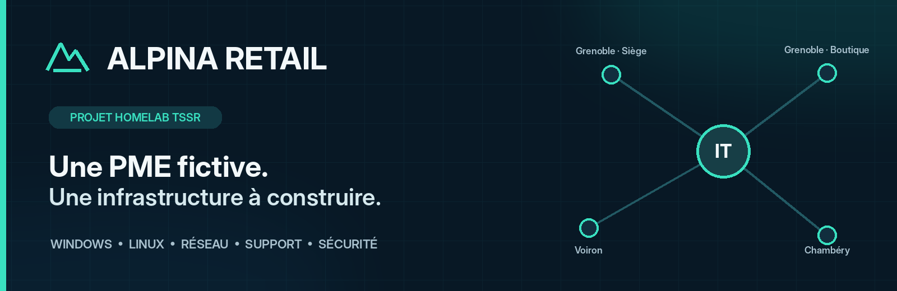
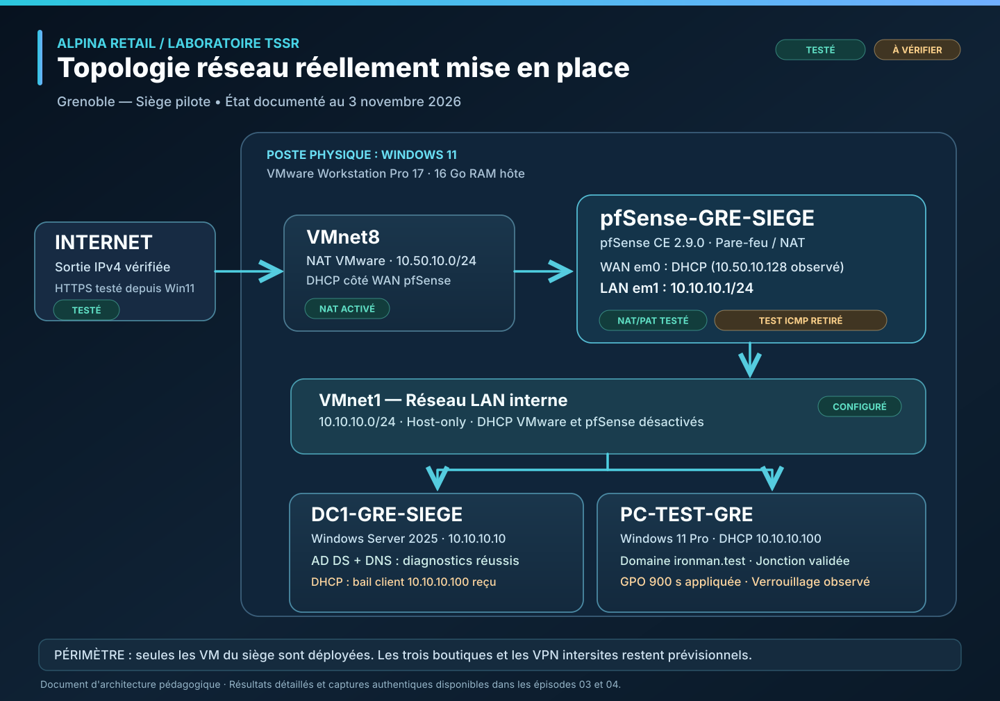
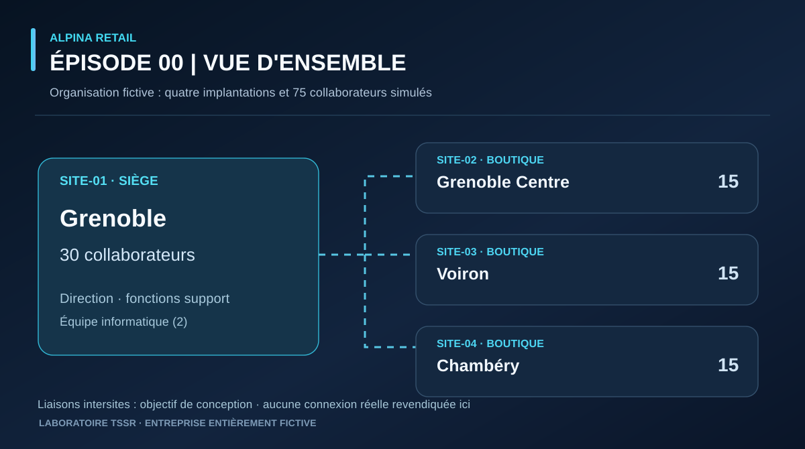

# ALPINA RETAIL — Laboratoire systèmes & réseaux

**Projet personnel TSSR · Infrastructure multisite fictive · Documentation technique et preuves de validation**

Je conçois, déploie et dépanne progressivement une infrastructure informatique inspirée des besoins d'une PME du prêt-à-porter. Le projet associe **architecture réseau, Windows Server, Active Directory, DNS, DHCP, pfSense, virtualisation et support utilisateurs**.

> **À propos du périmètre :** ALPINA RETAIL est une **entreprise entièrement fictive**. Les quatre sites et leurs 75 collaborateurs sont simulés ; seules certaines machines du **laboratoire du siège de Grenoble** sont réellement déployées. Chaque résultat annoncé comme validé renvoie à une manipulation documentée.

## Le projet en bref

| Entreprise simulée | Laboratoire personnel | Progression |
|---|---|---|
| **4 sites** · 75 collaborateurs fictifs | **Windows 11** · VMware Workstation · **16 Go de RAM sur l'hôte** | **Épisodes 00 à 10 : réalisations documentées** ; épisode 11 : étude de cas simulée ; épisode 12 : GLPI préparé, non installé. Windows CMA validé sur DC1 ; ICMP pfSense vérifié |

**Ce qui est déjà vérifié :**

- **Réseau et sécurité :** pfSense CE 2.9.0 configuré ; LAN/WAN, accès Internet depuis Windows 11, NAT/PAT observé, filtrage ICMP ciblé testé puis retiré, sauvegarde de configuration chiffrée conservée hors GitHub.
- **Windows Server et AD DS :** Windows Server 2025, forêt `ironman.test`, promotion de `DC1-GRE-SIEGE`, tests `dcdiag` ciblés réussis ; partages `SYSVOL` et `NETLOGON` accessibles depuis Windows 11 et découverte du DC par `nltest /dsgetdc:ironman.test` réussie et canal sécurisé vérifié par PowerShell (`True`) et lecture de `GPT.INI` depuis SYSVOL (`Version=3`) ; captures de ces derniers contrôles non publiées.
- **DNS et dépannage :** résolution des noms internes et externes ; diagnostic du message `Server: UnKnown`, création d'une zone inversée et d'un enregistrement PTR, contre-test réussi.
- **DHCP :** serveur autorisé dans Active Directory, étendue `DHCP-GRE-SIEGE` active ; **bail `10.10.10.100/24` de huit jours reçu et options vérifiées sur le client Windows 11**.
- **Debian FS1 (épisode 05) :** Debian 12 sur `VMnet1` (`10.10.10.30/24`) ; AD `ironman.test` joint ; Winbind/NSS reconnaît utilisateurs et groupes AD ; groupe `GG_FS1_COMMUN_RW` et permissions Linux `2770` en place ; **partage `COMMUN` accessible en lecture/écriture depuis Windows 11**, contenu relu sur Debian, propriétaire/groupe et permissions `660` observés ; **refus SMB `NT_STATUS_ACCESS_DENIED`** obtenu avec un compte non autorisé le 09/11/2026. L'accès SSH de FS1 est renforcé par clé ED25519 ; Samba impose désormais la signature serveur et le chiffrement SMB3 du partage COMMUN (SMB 3.1.1, `Encrypted=True` côté Windows 11) ; le durcissement global reste en cours.

[**Voir l'étude de cas simulée FS1/Centreon — épisode 11**](docs/episode-11/README.md) · [**Voir la GPO du lecteur COMMUN — épisode 08**](docs/episode-08/README.md) · [**Voir la supervision Bash — épisode 09**](docs/episode-09/README.md) · [**Voir Centreon et le contrôle ICMP pfSense — épisode 10**](docs/episode-10/README.md)

[**Voir les preuves pfSense — épisode 03**](docs/episode-03/README.md) · [**Voir les 40 captures Windows Server / AD / DNS / DHCP / GPO — épisode 04**](docs/episode-04/README.md)

## Architecture actuelle du laboratoire

La topologie suivante décrit les composants **créés dans VMware**, et non les futurs réseaux de toutes les boutiques.

*Schéma historique de synthèse au 3 novembre 2026 — il ne représente pas encore FS1 ni l'appliance Centreon importée le 10 novembre. Équipement du laboratoire réellement créé à cette date. **DHCP client, jonction AD et application de la GPO vérifiés** ; verrouillage automatique observé par l'auteur sans capture ni mesure chronométrée précise. [Ouvrir le schéma vectoriel en grand](docs/topologie-laboratoire-siege.svg).*

*Le poste `PC-TEST-GRE`, initialement configuré en statique sur `10.10.10.20`, utilise maintenant un **bail DHCP `10.10.10.100` délivré par DC1**. Les trois VM ont été allumées simultanément pour les essais du 3 novembre, malgré les 16 Go de RAM de l'hôte.*

### Repères d'adressage du siège

| Composant | Configuration | État |
|---|---|---|
| pfSense LAN | `10.10.10.1/24` | Configuré et testé |
| DC1 — AD DS / DNS | `10.10.10.10/24` | Configuré et testé |
| PC-TEST-GRE | `10.10.10.100/24` (DHCP ; statique initiale `10.10.10.20`) | Bail, DNS, jonction AD, sessions et GPO vérifiés |
| FS1 — Debian 12 | `10.10.10.30/24` (statique, VMnet1) | AD/Winbind et partage Samba validés ; SSH par clé ED25519 ; COMMUN chiffré via SMB 3.1.1 confirmé par Windows 11 le 09/11 |
| Étendue Windows DHCP | `10.10.10.100` → `10.10.10.199` | Active ; bail client de 8 jours confirmé |
| Centreon — VM Debian 13 | `10.10.10.40` | ICMP pfSense/DC1 OK ; CPU/RAM/disque de DC1 supervisés via CMA ; tableau de bord enregistré le 16/11/2026 ; alertes internes Centreon à diagnostiquer |

**À distinguer :** la connexion entre les quatre sites, les VPN et les autres serveurs de l'architecture cible sont pour le moment des **éléments de conception**, pas un environnement multisite opérationnel.

## Journal de bord — choisir un épisode

| Épisode | Sujet | Livrables et validation |
|---|---|---|
| **00** | [Présentation du projet](#vue-densemble-de-lentreprise-fictive) | Contexte, sites et objectifs de la maquette |
| **01** | [Organisation et organigramme](docs/episode-01/README.md) | Répartition des 75 collaborateurs simulés, organigramme et [dossier PDF](docs/episode-01/Alpina_Retail_Organisation_Episode_01.pdf) |
| **02** | [Cahier des charges informatique](docs/episode-02/README.md) | Besoins métier, architecture cible, droits d'accès et limites du laboratoire |
| **03** | [Pare-feu pfSense et poste Windows 11](docs/episode-03/README.md) | Installation, adressage, NAT/PAT, filtrage ICMP, tests réseau et sauvegarde chiffrée |
| **04** | [Windows Server, AD DS, DNS et DHCP](docs/episode-04/README.md) | DC1, dépannage DNS, DHCP réel sur Windows 11, jonction à `ironman.test`, utilisateur AD et première GPO (application vérifiée ; verrouillage ensuite observé par l'auteur sans capture) |
| **05** | [FS1 — Serveur de fichiers Debian Linux](docs/episode-05/README.md) | Samba/AD/Winbind ; partage `[COMMUN]` en lecture/écriture depuis Windows 11, accès non autorisé refusé ; [22 captures](docs/episode-05/images/README.md) |
| **06** | [Durcissement de l'infrastructure — siège Grenoble](docs/episode-06/README.md) | SSH/SMB, pare-feu Windows, comptes AD et règles pfSense renforcés ; **incident DNS externe résolu par redirecteur pfSense** ; [16 captures](docs/episode-06/images/README.md). Filtrage IPv4 restrictif à poursuivre. |
| **07** | [FS1 — Sauvegarder et restaurer le partage Samba](docs/episode-07/README.md) | Disque dédié monté par UUID ; sauvegarde `tar.gz` et restauration testées ; script Bash et cron quotidien ; copie SCP vers DC1 avec hash SHA-256 identique ; [10 captures](docs/episode-07/images/README.md). Exécution automatique réelle et copie hors hôte à vérifier. |
| **08** | [Déploiement GPO du lecteur réseau COMMUN](docs/episode-08/README.md) | Lecteur `P:` déployé par GPO ciblée sur `GG_FS1_COMMUN_RW` ; écriture depuis Windows 11 confirmée sur Debian ; [5 captures](docs/episode-08/images/README.md). Contre-test hors groupe à réaliser. |
| **09** | [Supervision Bash / cron et préparation de Centreon](docs/episode-09/README.md) | [Script Bash documenté](docs/episode-09/surveillance-alpina.sh) : ICMP, services et disque de sauvegarde ; six tests manuels `OK`, cron toutes les 5 minutes ; [4 captures](docs/episode-09/images/README.md) |
| **10** | [Centreon — supervision réelle de pfSense et DC1](docs/episode-10/README.md) | ICMP pfSense/DC1 OK ; CPU/RAM/disque C: de DC1 **validés via Windows CMA le 16/11/2026** ; 6 alertes critiques et 8 états inconnus à diagnostiquer sur Centreon-central ; [six captures inventoriées](docs/episode-10/images/README.md), PNG non encore publiés |
| **11** | [FS1 — supervision Linux avec Centreon (simulation)](docs/episode-11/README.md) | **Étude de cas non exécutée** : architecture SNMPv3, services envisagés, tests d'acceptation et dépannage ; aucune mesure ni capture revendiquée. |
| **12** | [GLPI — préparation de l'outil de support](docs/episode-12/README.md) | **Planifié, pas encore installé** : architecture, prérequis, sécurité et scénario de ticket à tester. |

**Preuves visuelles :** [épisode 08 — 5 captures GPO/SMB](docs/episode-08/images/README.md) · [épisode 09 — 4 captures supervision/Centreon](docs/episode-09/images/README.md) · [épisode 07 — 10 captures authentiques de la sauvegarde et restauration FS1](docs/episode-07/images/README.md) · [épisode 03 — 8 captures authentiques et 2 schémas pédagogiques](docs/episode-03/images/README.md) · [épisode 04 — 40 captures Windows Server / AD DS / DNS / DHCP / GPO](docs/episode-04/images/README.md) · [épisode 05 — 22 captures authentiques Debian / réseau / DNS / AD / SMB](docs/episode-05/images/README.md).

## Vue d'ensemble de l'entreprise fictive

*Schéma de conception — entreprise fictive de 75 collaborateurs : Grenoble (siège, 30), Grenoble Centre (15), Voiron (15) et Chambéry (15). Les liaisons intersites sont des objectifs futurs.*

Les collaborateurs sont principalement représentés par des **besoins métier, des rôles et, progressivement, des comptes de test**. Il n'est pas prévu de démarrer 75 postes ou de simuler 75 personnes en activité simultanément.

## Démarche TSSR et compétences mobilisées

Chaque épisode technique suit la même logique :

**Besoin → architecture → configuration → vérification → diagnostic → documentation.**

Les compétences travaillées comprennent l'administration Windows Server, AD DS, DNS, DHCP, la virtualisation, les réseaux IPv4, le routage/NAT, les règles de filtrage et le dépannage d'incidents.

**Exemple documenté :** dans l'[épisode 04](docs/episode-04/README.md), un test `nslookup` affichait initialement `Server: UnKnown` et un délai d'attente. L'inspection DNS a révélé l'absence de zone inversée et de PTR ; après leur création, les recherches directe et inverse ont réussi sans le message initial. Les captures **avant / après** sont présentes dans le dossier de l'épisode.

> **Rigueur de validation :** une configuration affichée comme active ne remplace pas un test de fonctionnement côté client. Les erreurs, limites et étapes non vérifiées sont conservées dans les comptes rendus.

## Jalon du 16 novembre 2026 — Centreon et prochaine étape GLPI

Le [tableau de bord Centreon](docs/episode-10/README.md) présente les performances CPU, RAM et disque C: de DC1 ainsi que l'état des hôtes du siège. La connexion CMA et les quatre services Windows (CPU, MEMORY, DISK-C, ICMP) ont été vérifiés. **Les alertes de Centreon-central ne sont pas masquées ni résolues.**

Le dossier [de référence](docs/suivi/etat-2026-11-16.md) distingue le travail réellement validé, les simulations et les travaux à terminer. La prochaine étape prévue est [GLPI (épisode 12)](docs/episode-12/README.md), non installé à ce jour.

## Prochains objectifs

- [ ] Approfondir les diagnostics AD DS et les contrôles des autres fichiers de stratégies.
- [ ] Poursuivre le filtrage IPv4 restrictif sur pfSense.
- [ ] Tester le mappage GPO avec un utilisateur hors du groupe `GG_FS1_COMMUN_RW`.
- [ ] Vérifier une exécution cron de la version enrichie de surveillance et réaliser un test `ALERTE` non destructif.
- [ ] Fiabiliser les alertes MariaDB/processus/swap de Centreon-central (6 CRITICAL, 8 UNKNOWN au 16/11) ; superviser réellement FS1 et PC-TEST si le laboratoire est repris.
- [ ] Ajouter à GitHub les six captures authentiques préparées pour l'épisode 10, après contrôle de confidentialité.
- [ ] Installer GLPI sur une VM dédiée et tester le cycle d'un ticket ; [épisode 12 — préparation](docs/episode-12/README.md).
- [ ] Vérifier l'exécution automatique réelle de la sauvegarde cron à 02 h et prévoir une copie hors de l'hôte VMware ; poursuivre les futurs VPN intersites.

**36 objectifs déjà atteints :** [voir l'historique complet](docs/suivi/objectifs.md).

## À propos

**Auteur : Vincent Scannella — Technicien Supérieur Systèmes et Réseaux (TSSR).**

Ce dépôt est un **portfolio de mise en pratique** destiné à montrer une méthode de travail : installer, vérifier, diagnostiquer et produire une documentation exploitable. Les données, utilisateurs et sites de l'entreprise sont fictifs ; les captures de laboratoire sont authentiques et sélectionnées pour ne pas divulguer de secrets.

[Profil LinkedIn](https://fr.linkedin.com/in/vincent-scannella)
