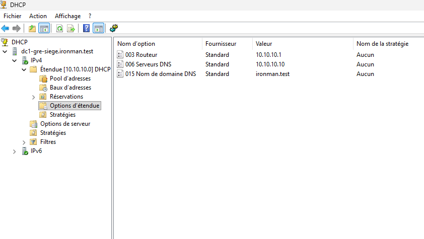

# ALPINA RETAIL — Guide des captures d'écran et des publications

> **Règle éditoriale du projet :** les prochaines documentations GitHub et publications LinkedIn doivent être illustrées par de **véritables captures d'écran du laboratoire**, en complément des explications techniques. L'objectif est de permettre au lecteur, notamment à un recruteur, de distinguer ce qui a été réellement mis en œuvre et vérifié de ce qui reste à faire.

## 1. À chaque étape technique validée

1. **Prévoir la preuve dès le test**, avant de fermer la fenêtre ou de supprimer une règle temporaire.
2. Capturer l'écran pertinent : configuration, commande exécutée, sortie du test, état d'un service ou événement de journal.
3. Conserver le contexte permettant de comprendre la preuve (machine, outil, commande, source/destination, résultat), sans exposer de secret.
4. Vérifier que la capture correspond exactement au résultat décrit : **jamais de succès inventé**, jamais de capture illustrative présentée comme une preuve réelle.
5. Préciser la date et, si utile, les limites du test, notamment lorsqu'aucune trace de journalisation n'existe.

## 2. GitHub : documentation détaillée

- Créer lorsque nécessaire un dossier `docs/episode-XX/images/` et utiliser des noms explicites comme `pfsense-regles-lan.png` ou `win11-test-dns.png`.
- Intégrer les images en Markdown, près du paragraphe ou du tableau qu'elles étayent.
- Ajouter une légende courte : **objectif → manipulation → résultat observé**.
- Privilégier quelques captures réellement utiles plutôt que de nombreuses images redondantes.
- Conserver la documentation textuelle, les commandes et les conclusions : **une capture ne remplace pas une explication**.

Exemple de syntaxe basé sur un fichier **réellement présent** dans notre dépôt (dans ce cas, depuis le dossier `docs/`) :

```md


*DC1-GRE-SIEGE — passerelle 10.10.10.1, DNS 10.10.10.10 et suffixe ironman.test vérifiés dans la console DHCP.*
```

## 3. LinkedIn : sélection pédagogique

- Prévoir une courte sélection de **2 à 4 captures marquantes**, suivant le format de la publication.
- Mettre en avant un récit lisible : **problème / solution / vérification / résultat**.
- Utiliser des annotations légères si elles améliorent la lisibilité (flèches, zones encadrées), sans altérer le résultat.
- Fournir le lien vers le dossier GitHub pour les détails et preuves complémentaires.
- Ne présenter comme réalisé que ce qui l'a réellement été.

## 4. Contrôle de sécurité avant publication

- **Masquer systématiquement** les mots de passe, tokens, clés, cookies, identifiants de session, contenus privés, noms ou coordonnées de personnes réelles et détails sensibles.
- Vérifier les onglets du navigateur, notifications, URL, lignes de commande, fenêtres en arrière-plan et métadonnées si nécessaire.
- Les adresses privées du laboratoire fictif peuvent être montrées si elles ne divulguent aucun autre environnement réel.
- Ne **jamais** placer un export de configuration pfSense complet dans le dépôt public : il peut contenir des données sensibles.

## 5. Application au projet

- **Épisodes 00, 01 et 02 — conception :** schémas explicatifs vectoriels, clairement identifiés comme *entreprise fictive* et *architecture cible*, sans les présenter comme des captures d'un système fonctionnel. Le dépôt comprend une vue multisite en épisode 00, l'organigramme et la répartition des effectifs en épisode 01, et deux schémas prévisionnels en épisode 02.
- **Épisode 03 — pfSense et Windows 11 :** **8 captures PNG authentiques** publiées (dont la traduction NAT/PAT, la règle ICMP avant application, les expirations du ping et la sauvegarde), complétées par **2 schémas SVG pédagogiques**. Les tests ICMP avant/pendant/après et HTTPS sont documentés, mais **aucune preuve de journal de filtrage** n'a été obtenue ; ne jamais en inventer. Des captures complémentaires LAN/WAN ou de connectivité pourront être ajoutées si leurs originaux sont disponibles.
- **Épisode 04 — Windows Server, AD DS, DNS et DHCP :** **23 captures PNG authentiques** publiées, dont le dépannage DNS avant/après, les diagnostics AD/DNS et les options/plages DHCP. L'attribution DHCP côté Windows 11, l'authentification au domaine et les GPO **restent à vérifier**.
- **Épisodes techniques ultérieurs :** préparer les captures au moment de chaque manipulation et contrôle, en indiquant si les résultats sont validés ou en attente.

**Principe :** des captures réelles, contextualisées, lisibles et expurgées de toute information sensible renforcent la crédibilité d'un laboratoire professionnel.

## 6. Règle de suivi : captures et jalons LinkedIn

Cette règle s'applique **à chaque futur épisode**, y compris pendant les phases de dépannage :

1. Avant ou juste après chaque manipulation importante, **indiquer à l'auteur quelle capture réaliser** (écran de paramétrage, état initial, erreur, test, correction, test final).
2. Après une vérification réussie ou un diagnostic utile, **actualiser le README technique** avec la commande complète, la configuration observée et les limites du résultat.
3. **Vérifier la présence réelle du PNG dans GitHub avant d'ajouter son lien Markdown.** Si un fichier image n'est pas encore téléversé, signaler « capture en attente » et accompagner l'auteur pour son ajout, plutôt que d'annoncer son intégration.
4. Conserver, pour un incident, des captures **avant / après**, sans confondre une hypothèse de panne avec une cause démontrée.
5. **Signaler explicitement quand un nouveau jalon mérite une publication LinkedIn**, sans multiplier les posts pour des opérations intermédiaires. Le projet doit présenter des réalisations techniques démontrées, pas seulement une installation.
6. Avant toute publication, confronter son texte aux preuves réellement obtenues, joindre un carrousel de captures authentiques et vérifier la date déjà programmée pour éviter les doublons.

### Prochain jalon éditorial envisagé — Épisode 04

**Sujet :** Windows Server 2025, domaine Active Directory `ironman.test`, DNS et dépannage de la résolution inverse.

**Déjà vérifié le 2 novembre 2026 :** VM créée ; adressage IP statique ; connectivité pfSense et Internet en IPv4 ; promotion du domaine ; `dcdiag /test:Advertising` réussi ; enregistrement SRV LDAP retourné ; zone inversée et PTR créés ; disparition du message `Server: UnKnown` au contre-test ; `dcdiag /test:DNS` réussi dans les résultats visibles ; résolution du nom externe `www.microsoft.com` via DC1 réussie.

**Déjà ajouté depuis les premiers diagnostics :** les partages `SYSVOL` et `NETLOGON` ont été observés dans `net share`, `dcdiag /test:Services` a réussi et l'étendue `DHCP-GRE-SIEGE` est configurée et active ; les options 003/006/015 et la plage `10.10.10.100–199` sont vérifiées dans la console.

**Encore utile pour la publication :** vérifier la durée du bail, l'attribution DHCP réelle à `PC-TEST-GRE` via `ipconfig /all`, puis la jonction au domaine et l'ouverture d'une session de test. **Ne pas présenter comme validés** l'accès client à `SYSVOL`/`NETLOGON`, les GPO ou l'authentification tant que les essais ne sont pas réalisés.

**Calendrier :** la publication pfSense/Windows 11 de l'épisode 03 est déjà programmée pour le **10 novembre 2026 à 12 h 15**. Pour l'épisode 04, ne fixer une nouvelle date que lorsque le contenu, les preuves visuelles et le diagnostic auront été validés ; éviter un chevauchement inutile avec la publication programmée.

**Images de l'épisode 04 :** **23 captures authentiques** vérifiées dans `docs/episode-04/images/` et toutes intégrées dans le README de l'épisode, dont les comparaisons DNS avant/après et la configuration de l'étendue DHCP. La prochaine preuve attendue est l'obtention d'un bail DHCP par `PC-TEST-GRE`, puis les tests de domaine côté client.

## 7. Standard permanent de mise en page — tous les prochains épisodes

Le **modèle de référence**, à copier puis adapter, est [`docs/MODELE_EPISODE.md`](MODELE_EPISODE.md). **Ne jamais modifier un épisode historique simplement pour lui ajouter une fonction encore non testée :** les évolutions doivent être horodatées et rattachées au bon épisode.

### Structure éditoriale commune

1. **Un seul titre principal `#`** : `ALPINA RETAIL — Épisode XX : [sujet]`, sans promesse marketing.
2. **En-tête court** : date des opérations, périmètre du laboratoire, statut réellement atteint. Ne pas coller une longue chronologie dans le bloc de statut.
3. **Section « En bref »** immédiatement après : tableau *service / résultat réel / limite ou test restant*. La première lecture doit permettre à un recruteur de comprendre le périmètre en moins d'une page.
4. **Sommaire avec ancres vérifiées**, puis **navigation** vers l'accueil, l'épisode précédent et le suivant **seulement s'il existe**.
5. **Corps technique** : besoin → architecture → configuration chronologique → commandes ou tests → diagnostic/contre-test → limites → captures → prochaines étapes.
6. **Tableaux Markdown réels**, titres hiérarchisés, listes de longueur raisonnable, commandes en blocs de code et vocabulaire technique clair. Préférer une synthèse avant un journal détaillé quand la documentation devient longue.
7. **Navigation finale** et liens directs vers les captures, la documentation précédente et les références pertinentes.

### Différencier trois types de visuels

- **Capture réelle** : preuve de configuration ou de résultat, issue du laboratoire. Nom descriptif, légende fidèle et localisation près du test concerné.
- **Schéma explicatif** : SVG/diagramme créé pour aider à comprendre un réseau, une procédure ou un incident. La légende mentionne qu'il ne prouve **pas** qu'un service a été exécuté.
- **Capture préparée ou transmise** : ne devient une image « publiée » **qu'après** vérification de son existence dans la branche `main`. Avant cela, écrire **« capture en attente »**.

Par exemple, **« étendue DHCP active »** ne signifie pas **« bail DHCP attribué au client »** ; de même, **« règle ICMP visible avant Apply Changes »** ne démontre pas son application.

### Journal de publication et maintenance

- Mettre à jour la documentation **au moment d'un jalon technique vérifié** ; éviter les commits trompeurs pour chaque clic dans un assistant.
- Ajouter, corriger ou compléter les pages déjà publiées sans supprimer l'historique des résultats réellement observés, ni masquer une panne.
- Lorsqu'un épisode a évolué après sa date initiale, distinguer **l'état à l'époque** et **les validations ultérieures** ; ne pas rétroprojeter un nouveau serveur ou un nouveau réseau dans la topologie passée.
- Pour les publications LinkedIn : choisir **2 à 4 captures techniques pertinentes**, vérifier leur lisibilité et leur fidélité, et publier à un jalon significatif sans chevaucher les publications déjà programmées.
- Les liens personnels ou externes peuvent changer ; les vérifier avant réutilisation dans des posts ou documents de candidature.

## 8. Liste de contrôle qualité avant chaque publication GitHub

- [ ] **Exactitude** : date, nom de VM, interfaces, réseau, rôles et commandes conformes aux observations.
- [ ] **Tests** : chaque succès mentionné possède un résultat identifiable ; les étapes « configuré », « actif », « vérifié côté client » sont distinguées.
- [ ] **Diagnostic** : lorsqu'une panne est décrite, hypothèse, fait constaté, correction et contre-test ne sont pas confondus.
- [ ] **Confidentialité** : aucun secret, mot de passe, jeton, export de configuration ou donnée personnelle dans le README, le code, les captures et les éventuelles métadonnées.
- [ ] **Images** : aucun lien vers une image manquante ; captures authentiques et schémas pédagogiques clairement distingués ; légendes exactes.
- [ ] **Lisibilité** : un titre `#`, sommaire utilisable, tableau « En bref », titres cohérents, commandes formatées, navigation.
- [ ] **Liens** : vérifier que toutes les images/PDF et les cibles Markdown internes existent sur `main` ; contrôler les ancres.
- [ ] **Synchronisation** : mise à jour du README de l'épisode, de l'inventaire `images/README.md` et du portfolio d'accueil si le statut ou le nombre de preuves change.
- [ ] **Publication** : procéder au commit, **relire le document après enregistrement** et signaler honnêtement toute vérification de rendu non réalisée.
- [ ] **Continuité** : inscrire le prochain test concret et l'état des preuves pour une reprise sans ambiguïté.

**Règle du projet :** appliquer ces critères à **chaque nouvel épisode**. Tout écart volontaire doit être justifié dans le compte rendu, plutôt que de sacrifier l'exactitude pour le visuel.
