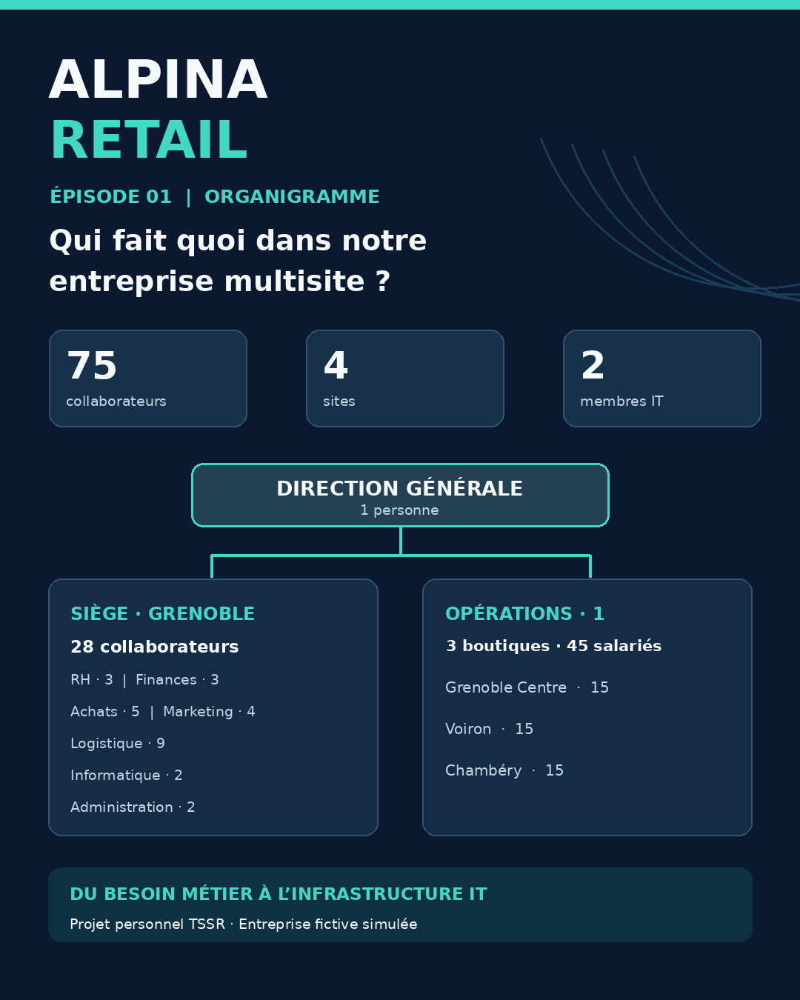
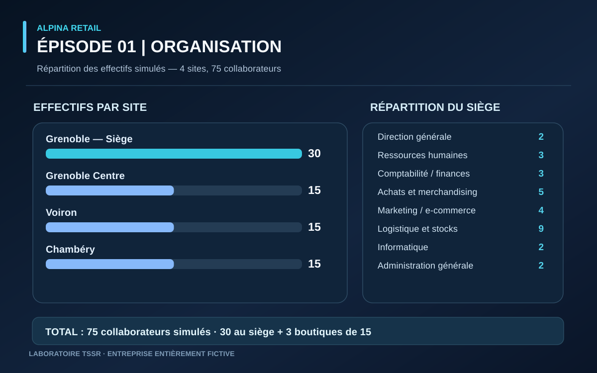

ALPINA RETAIL — Épisode 01

Organisation et organigramme de l’entreprise

Projet personnel TSSR — Vincent Scannella

Statut : Organisation validée — 01/11/2026

## Documents de référence — Épisode 01

### Vue synthétique de l'organisation

### Dossier complet

[Consulter l'organigramme et le dossier d'organisation (PDF)](Alpina_Retail_Organisation_Episode_01.pdf)

ALPINA RETAIL est une entreprise fictive créée pour simuler un environnement informatique professionnel. Aucune infrastructure technique n’a encore été déployée.

1. Contexte

ALPINA RETAIL est une PME fictive spécialisée dans la vente de prêt-à-porter et d’accessoires.

L’entreprise dispose de quatre sites et de 75 collaborateurs simulés.

L’objectif de cet épisode est de définir son organisation, ses responsabilités hiérarchiques et ses premiers besoins informatiques.

2. Implantation des sites

Site	Localisation	Effectif
SITE-01	Grenoble — Siège	30
SITE-02	Grenoble Centre — Boutique	15
SITE-03	Voiron — Boutique	15
SITE-04	Chambéry — Boutique	15
TOTAL	4 sites	75

### Répartition des collaborateurs par site

*Schéma de conception — effectifs simulés par site et répartition des 30 collaborateurs du siège. Il ne représente pas des salariés réels ni des comptes AD déjà créés.*

3. Organisation du siège

Service	Collaborateurs
Direction générale	2
Ressources humaines	3
Comptabilité et finances	3
Achats et merchandising	5
Marketing et e-commerce	4
Logistique et stocks	9
Informatique	2
Administration générale	2
TOTAL	30

La direction comprend un directeur général et un directeur des opérations commerciales.

4. Organisation des boutiques

Chaque boutique comprend :

* 1 responsable de magasin
* 1 responsable adjoint
* 9 conseillers de vente
* 2 employés de caisse
* 2 employés de stock et logistique

Total : 15 collaborateurs par boutique.

Les trois responsables de magasin sont supervisés par le directeur des opérations.

5. Service informatique

Le service informatique est composé de deux personnes.

Responsable informatique

* Pilotage des projets informatiques
* Gestion des priorités et des budgets
* Politique de sécurité
* Validation des changements sensibles

Technicien systèmes et réseaux

* Assistance et support utilisateurs
* Administration Windows Server et Linux
* Gestion des comptes Active Directory
* Maintenance des équipements
* Diagnostic et résolution des incidents
* Supervision et sauvegardes
* Documentation des interventions

Le support des boutiques sera assuré principalement à distance depuis le siège.

6. Premiers besoins informatiques

L’organisation de l’entreprise fait apparaître plusieurs besoins :

* Gestion centralisée des utilisateurs et de leurs accès
* Séparation des droits selon les services et les fonctions
* Partage sécurisé des documents
* Connectivité entre les quatre sites
* Gestion et suivi des incidents
* Sauvegarde et protection des données
* Supervision des équipements et des services

Ces besoins devront être précisés dans le cahier des charges informatique.

7. Application aux compétences TSSR

Cette étape permettra de préparer les travaux techniques suivants :

* Conception des unités d’organisation Active Directory
* Création des comptes et groupes de sécurité
* Définition des habilitations
* Mise en place des GPO
* Administration des ressources partagées
* Organisation du support utilisateurs
* Conception de l’infrastructure multisite

L’organigramme RH ne sera pas automatiquement reproduit dans Active Directory : la structure technique devra répondre aux besoins d’administration et de sécurité.

8. Avancement

* [x]	Identité de l’entreprise
* [x]	Implantation des quatre sites
* [x]	Répartition des 75 collaborateurs
* [x]	Organisation hiérarchique
* [x]	Définition du service informatique
* [ ]	Cahier des charges informatique
* [ ]	Architecture systèmes et réseaux
* [ ]	Déploiement technique
* [ ]	Vérifications et tests

9. Prochaine étape

Épisode 02 — Cahier des charges informatique

Identifier précisément les besoins des utilisateurs, les équipements nécessaires, les applications métier et les contraintes techniques et de sécurité.

⸻

Auteur : Vincent Scannella

Technicien Supérieur Systèmes et Réseaux (TSSR)

Retour au projet ALPINA RETAIL
