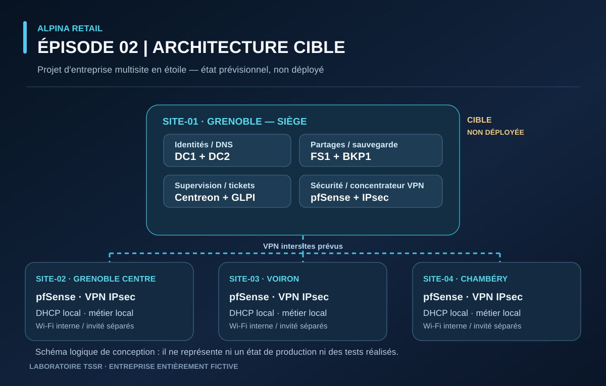
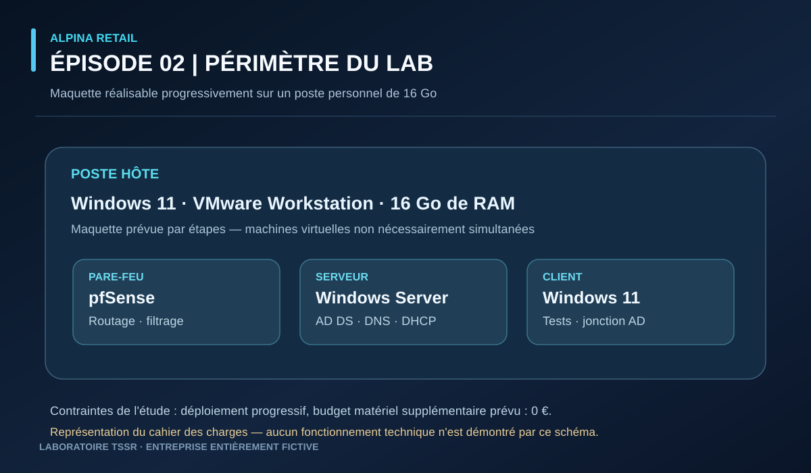

# ALPINA RETAIL — Épisode 02 : Cahier des charges informatique

> **Statut de l'épisode :** cahier des charges de conception validé ; aucun système n'a été déployé **dans cette étape de conception**.  
> **Évolution du projet :** les premières mises en œuvre ont ensuite été documentées dans l'[épisode 03 — pfSense](../episode-03/README.md) et l'[épisode 04 — Windows Server](../episode-04/README.md).  
> **Nature du projet :** entreprise fictive et laboratoire TSSR personnel.  
> **Contraintes de l'étude :** VMware Workstation sur Windows 11, 16 Go de RAM, budget supplémentaire prévu de 0 €.

## En bref

| Entreprise de référence | Contenu de cet épisode | Réalisation technique |
|---|---|---|
| **4 sites · 75 utilisateurs simulés** | Architecture cible, droits d'accès, inventaire, continuité et périmètre d'une maquette | **Aucune validation technique revendiquée dans l'épisode 02** ; voir les épisodes 03 et 04 pour les réalisations ultérieures |

**Sommaire :** [Contexte](#1-contexte-et-objectif) · [Besoins](#2-besoins-informatiques-retenus) · [Architecture cible](#3-architecture-cible-de-lentreprise-prévisionnelle) · [Habilitations](#4-politique-daccès-aux-fichiers) · [Inventaire](#5-inventaire-métier-simulé) · [Laboratoire 16 Go](#6-périmètre-réellement-réalisable-avec-16-go-de-ram) · [Méthode de validation](#7-méthode-de-validation-tssr)

**Navigation :** [Accueil / épisode 00](../../README.md) · [Épisode précédent : 01](../episode-01/README.md) · [Épisode suivant : 03](../episode-03/README.md)

## 1. Contexte et objectif

ALPINA RETAIL est une entreprise **entièrement fictive** de prêt-à-porter et accessoires. Elle compte **75 collaborateurs simulés** répartis sur quatre sites :

| Site | Implantation | Effectif |
|---|---|---:|
| SITE-01 | Grenoble — siège | 30 |
| SITE-02 | Grenoble Centre — boutique | 15 |
| SITE-03 | Voiron — boutique | 15 |
| SITE-04 | Chambéry — boutique | 15 |

L'objectif est de concevoir une infrastructure multisite cohérente, puis d'en **implémenter et tester une maquette réaliste à l'échelle d'un laboratoire TSSR**. Les utilisateurs, ventes et incidents sont simulés.

[Consulter l'épisode 01 — Organisation et organigramme](../episode-01/README.md).

## 2. Besoins informatiques retenus

- Comptes et habilitations centralisés, adaptés aux fonctions et aux sites.
- Réseau des boutiques relié au siège par des VPN chiffrés ; accès invité isolé.
- Ressources communes au siège, notamment les fichiers partagés.
- Support à distance, gestion des incidents et supervision.
- Protection des données, sauvegardes et procédures de restauration.
- Continuité locale des ventes et des stocks en cas de coupure VPN, **sous réserve d'une application métier adaptée**.

## 3. Architecture cible de l'entreprise (prévisionnelle)

*Schéma logique **prévisionnel** — les serveurs `DC1`, `DC2`, `FS1`, `BKP1`, les VPN intersites et les ressources des boutiques sont des choix de conception. Cette image ne prouve aucun déploiement ni aucune liaison VPN opérationnelle.*

| Domaine | Décisions de conception |
|---|---|
| Identités | Domaine Active Directory commun aux quatre sites ; deux contrôleurs `DC1` et `DC2` au siège avec DNS et réplication |
| DHCP | Windows Server au siège ; service DHCP local sur pfSense dans chaque boutique |
| Réseau et sécurité | Pare-feu pfSense, VPN IPsec en étoile autour du siège, Wi-Fi interne et invité séparés sur les quatre sites |
| Fichiers | Serveur Windows `FS1`, partages SMB, groupes AD et permissions NTFS |
| Administration | Comptes standards et comptes administratifs séparés ; délégation N1/N2 au technicien ; Windows LAPS |
| Accès distants | Accès administratifs nominatifs avec MFA, droits limités et journalisation |
| Mises à jour | WSUS prévu pour les serveurs Windows ; Windows Update piloté par GPO pour les postes |
| Sauvegardes | Stratégie 3-2-1 ; `BKP1`, Veeam Community Edition et Windows Server Backup prévus sous réserve de compatibilité ; copie externe S3 immuable prévue pour l'architecture cible |
| Supervision et tickets | Centreon pour la supervision, GLPI pour le suivi des incidents |
| Applications boutiques | Serveur métier local par boutique, autonomie des caisses et des stocks, synchronisation sécurisée et contrôle des doublons — **besoin métier, pas développement prévu dans le laboratoire TSSR** |
| Continuité électrique | Onduleurs pour les équipements critiques, autonomie cible de 30 minutes et arrêt contrôlé avec réserve de 10 minutes ; dimensionnement non réalisé |

### Objectifs de reprise retenus (à démontrer)

| Service | RPO cible | RTO cible | Périmètre |
|---|---:|---:|---|
| `FS1` | 4 h | 8 h | Panne courante du serveur |
| AD/DNS (`DC1` et `DC2`) | 24 h | 8 h | Perte simultanée des deux contrôleurs |
| Serveurs métier locaux | 15 min | 4 h | Panne du serveur local d'une boutique |

Ces valeurs sont des **objectifs de conception**, non des résultats de tests ni des garanties. La réussite d'une tâche de sauvegarde ne suffit pas à prouver une restauration.

## 4. Politique d'accès aux fichiers

Les autorisations prévues respectent le **principe du moindre privilège** :

- Chaque boutique accède à ses dossiers et aux procédures communes, sans accès automatique aux autres boutiques.
- Les conseillers de vente et employés de caisse consultent les procédures communes en lecture seule.
- Les employés de stock peuvent modifier le dossier `RECEPTIONS` de leur propre boutique.
- Le directeur des opérations peut lire les dossiers de reporting des trois boutiques.
- Les dossiers sensibles (`REMUNERATION`, `TRESORERIE`, `CONTRATS_FOURNISSEURS`, etc.) sont réservés aux fonctions autorisées.
- Le directeur général accède aux synthèses consolidées et à ses documents de direction, sans accès automatique aux dossiers sensibles.
- Le technicien TSSR dispose d'une administration déléguée, **sans privilèges Domain Admin permanents**.

Une **matrice détaillée d'habilitations** sera publiée séparément avant la configuration des groupes et des permissions.

## 5. Inventaire métier simulé

- **Siège :** 24 postes Windows (20 fixes et 4 portables), 3 imprimantes multifonctions, 3 terminaux d'inventaire Wi-Fi et 1 imprimante réseau d'étiquettes.
- **Chaque boutique :** 2 caisses, 1 PC administratif partagé, 1 PC de stock partagé avec douchette USB, 2 imprimantes de tickets et 1 multifonction réseau.
- **Total prévu :** 30 postes Windows hors caisses, 6 caisses (soit 36 postes et caisses au total), et 13 imprimantes spécialisées ou multifonctions.

Cet inventaire représente **l'entreprise fictive**, pas le nombre de machines virtuelles à démarrer.

## 6. Périmètre réellement réalisable avec 16 Go de RAM

*Schéma de dimensionnement et de progression — laboratoire imaginé sur un poste Windows 11 de 16 Go de RAM, sans prétendre que toutes les machines virtuelles sont simultanément actives.*

Le laboratoire utilisera **VMware Workstation**, sans achat ni abonnement obligatoire. Nous simulerons les quatre sites **progressivement**, sans allumer tous les serveurs et postes simultanément.

**Premier lot envisagé lors de la conception :**

1. Préparer le plan IP, les sous-réseaux et les interfaces VMware/pfSense.
2. Installer et configurer `DC1` (Windows Server, AD DS, DNS).
3. Mettre en place pfSense et un client Windows de test.
4. Valider connectivité, résolution DNS, jonction au domaine et authentification.
5. Ajouter ensuite `DC2`, `FS1`, les GPO, les groupes et les permissions, **un service à la fois**.
6. Étendre progressivement les exercices au VPN intersites, à Linux, GLPI, Centreon et aux sauvegardes selon les ressources disponibles.

*Précision chronologique :* les étapes réelles ont ensuite commencé par [pfSense et Windows 11](../episode-03/README.md), puis [DC1, AD DS, DNS et DHCP](../episode-04/README.md). Cet ordre d'exécution diffère de l'ordre de la liste prévisionnelle ci-dessus ; les validations réelles figurent dans leurs épisodes respectifs.

**Hors du périmètre initial du laboratoire :** déployer 75 postes, développer un logiciel de caisse, reproduire une infrastructure bancaire, garantir une vraie haute disponibilité matérielle ou utiliser un stockage cloud payant. Ces éléments restent des besoins métier ou des simulations encadrées.

## 7. Méthode de validation TSSR

Pour chaque réalisation : **besoin → configuration → vérification → panne simulée → dépannage → documentation**.

Les livrables futurs comprendront, selon les étapes : plan IP, schémas réseau, extraits de configuration sans secrets, commandes de vérification, captures d'écran anonymisées, tickets GLPI fictifs et résultats de tests de restauration.

**Bilan de l'épisode 02 :** les exigences métier, l'architecture cible et le périmètre du laboratoire ont été définis. **Ce document est un livrable de conception, pas un procès-verbal de mise en service.**

**Suivi de la réalisation :** pfSense, le premier contrôleur de domaine, DNS et une étendue DHCP ont ensuite fait l'objet de travaux documentés dans les épisodes 03 et 04. Les VPN intersites, les ressources complètes des boutiques et les autres serveurs de l'architecture cible **ne sont pas revendiqués comme opérationnels** ici.

---

**Auteur :** Vincent Scannella — Technicien Supérieur Systèmes et Réseaux (TSSR).  
**Dépôt du projet :** https://github.com/vincent-scannella/alpina-retail-tssr  
**Usage :** projet pédagogique fictif, documentation publique sans mots de passe, secrets ni données personnelles.

[Retour à l'accueil](../../README.md) · [Épisode 01 — Organisation](../episode-01/README.md) · [Épisode 03 — pfSense](../episode-03/README.md)