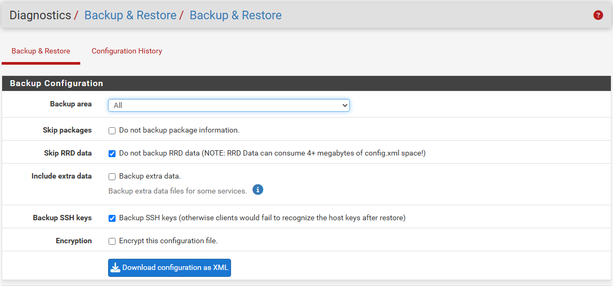
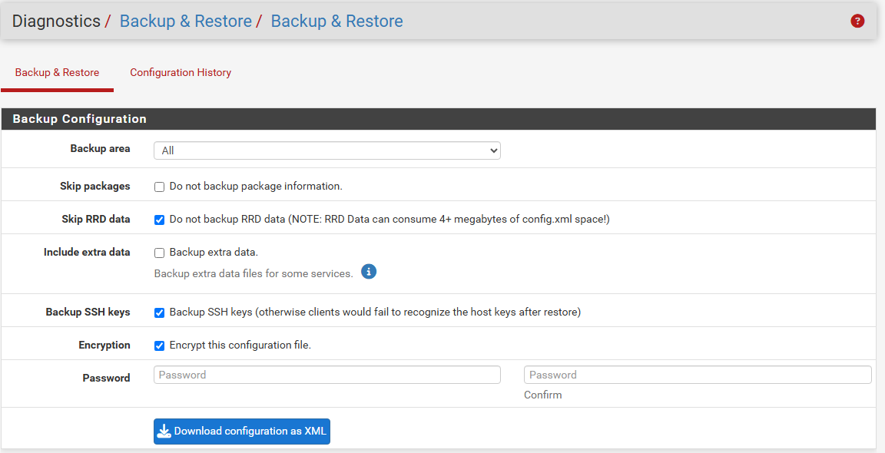
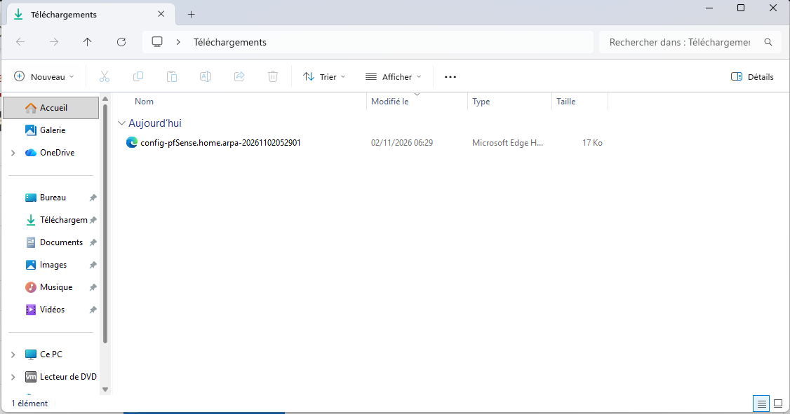
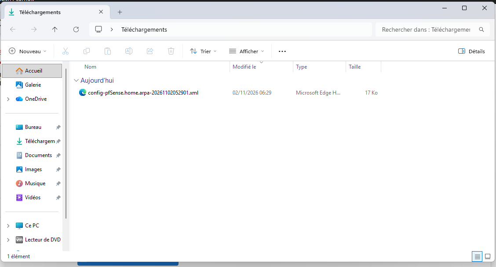
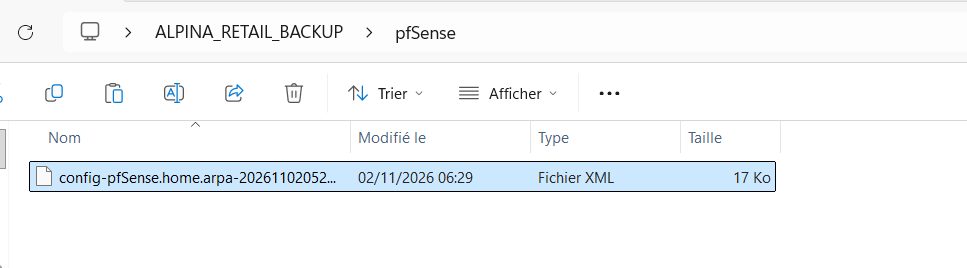

# ALPINA RETAIL — Épisode 03 : Installation du pare-feu pfSense au siège de Grenoble

> **Date :** 1er novembre 2026  
> **Statut :** installation, redémarrage et configuration initiale vérifiés ; tests IP et DNS réussis depuis pfSense **et depuis un poste Windows 11 sur le LAN**. Accès à l'administration Web pfSense et changement du mot de passe administrateur confirmés ; navigation HTTPS vers `www.microsoft.com` validée depuis le client Windows ; règles LAN et NAT sortant automatique examinés ; **traduction NAT/PAT confirmée dans la table des états** ; premier test de blocage ICMP ciblé observé (ping `8.8.8.8` : 100 % de perte après activation). Navigation HTTPS externe toujours fonctionnelle après blocage ICMP, puis **rétablissement du ping après suppression de la règle temporaire** (confirmé par l'auteur) ; aucune preuve par journal de cette règle, faute d'activation de la journalisation. Sauvegarde pfSense chiffrée téléchargée le 2 novembre 2026, puis copiée de la VM Windows 11 vers l'hôte Windows physique ; présence et taille apparente contrôlées, restauration non testée.  
> **Projet :** laboratoire personnel TSSR simulant une entreprise entièrement fictive.

## 1. Contexte et objectif

ALPINA RETAIL est une entreprise fictive de prêt-à-porter et d'accessoires, composée de 75 collaborateurs simulés sur quatre sites : un siège à Grenoble et trois boutiques.

Après l'organisation de l'entreprise (épisode 01) et la rédaction du cahier des charges informatique (épisode 02), cette étape marque le début du déploiement technique.

**Objectif :** installer un pare-feu au siège, séparer le réseau WAN du LAN et préparer le routage, le filtrage et les futurs VPN intersites.

Cet épisode concerne uniquement le pare-feu du siège. L'infrastructure multisite complète n'est pas encore déployée.

## 2. Environnement de laboratoire

| Élément | Configuration |
|---|---|
| Système hôte | Windows 11 |
| Hyperviseur | VMware Workstation Pro 17 |
| Mémoire physique de l'hôte | 16 Go |
| Machine virtuelle | pfSense-GRE-SIEGE |
| Système installé | pfSense Community Edition 2.9.0 |
| Processeur | 2 vCPU |
| Mémoire virtuelle | 2 Go |
| Disque virtuel | 20 Go |
| Système de fichiers | ZFS |
| Partitionnement | GPT |
| Stockage ZFS | Stripe sur un seul disque, sans redondance |

Les ressources sont adaptées à un laboratoire personnel et ne constituent pas un dimensionnement de production pour 75 collaborateurs.

## 3. Architecture réseau

```text
              INTERNET
                 |
          PC hôte Windows
                 |
      VMnet8 — NAT VMware
          10.50.10.0/24
                 |
       WAN em0 — DHCP
        10.50.10.128/24
                 |
        pfSense-GRE-SIEGE
                 |
       LAN em1 — Statique
          10.10.10.1/24
                 |
       VMnet1 — Host-only
          10.10.10.0/24
                 |
       PC-TEST-GRE — Windows 11 Pro
          10.10.10.20/24
```

### Configuration WAN

- Interface pfSense : `em0`
- Réseau VMware : `VMnet8`
- Mode : NAT
- Adressage : DHCP
- Adresse observée : `10.50.10.128/24`
- Serveur DHCP VMware : activé

L'adresse WAN est une adresse privée, attribuée dynamiquement. Elle peut changer lors d'un renouvellement DHCP.

### Configuration LAN

- Interface pfSense : `em1`
- Réseau VMware : `VMnet1`
- Mode : Host-only
- Réseau : `10.10.10.0/24`
- Passerelle prévue : `10.10.10.1`
- DHCP pfSense : désactivé
- DHCP VMware sur VMnet1 : désactivé et vérifié

Le service DHCP du LAN sera ultérieurement assuré par Windows Server, conformément au cahier des charges.

## 4. Installation et configuration réalisées

1. Préparation des réseaux virtuels VMware.
2. Configuration de VMnet8 en NAT avec DHCP VMware.
3. Configuration de VMnet1 en réseau interne isolé, sans DHCP VMware.
4. Création de la VM `pfSense-GRE-SIEGE`.
5. Attribution de 2 vCPU, 2 Go de RAM et 20 Go de stockage.
6. Installation de pfSense CE 2.9.0.
7. Attribution de `em0` au WAN et de `em1` au LAN.
8. Configuration du LAN en `10.10.10.1/24`.
9. Désactivation du DHCP pfSense sur le LAN.
10. Réalisation des tests de connectivité.
11. Arrêt propre de la VM après les premières vérifications.
12. Redémarrage de pfSense et confirmation de la persistance des adresses WAN `10.50.10.128/24` (adresse observée lors du nouveau démarrage) et LAN `10.10.10.1/24`.
13. Installation de Windows 11 Professionnel sur `PC-TEST-GRE` (VMnet1, 2 vCPU, 4 Go de RAM, disque virtuel de 64 Go).
14. Création du compte local de laboratoire `tech.alpina`, sans divulgation du mot de passe.
15. Configuration IPv4 statique de `PC-TEST-GRE` : `10.10.10.20/24`, passerelle `10.10.10.1`, DNS `10.10.10.1`.
16. Vérification des communications LAN, WAN et DNS depuis Windows 11.
17. Accès depuis `PC-TEST-GRE` à la page de connexion Web pfSense sur `https://10.10.10.1`.
18. Connexion réussie à l'administration pfSense et remplacement du mot de passe initial du compte `admin`, confirmé par le message de succès de l'interface. **Aucun mot de passe n'est stocké dans le dépôt.**
19. Vérification depuis `PC-TEST-GRE` de l'affichage du site externe `https://www.microsoft.com` dans Microsoft Edge (résultat confirmé par l'auteur ; pas de mesure de performance consignée).
20. Consultation de **Firewall → Rules → LAN** : règles anti-lockout et autorisations LAN vers toute destination en IPv4 et IPv6 observées, sans modification.
21. Consultation de **Firewall → NAT → Outbound** : mode **Automatic outbound NAT rule generation** sélectionné ; règles automatiques WAN incluant le réseau `10.10.10.0/24` observées, sans modification.
22. Consultation de **Diagnostics → States** : observation simultanée des états LAN et WAN, dont une connexion TCP HTTPS établie dont l'adresse source et le port ont été traduits par pfSense (détails en section 5).
23. Création et application d'une règle `Block` sur l'interface LAN, IPv4, protocole ICMP, sous-type `Echo request`, source `10.10.10.20`, destination `8.8.8.8`, placée **avant** la règle générale `Default allow LAN to any rule`. Règle de test réversible et ciblée.
24. Exécution d'un nouveau `ping 8.8.8.8` depuis `PC-TEST-GRE` : des expirations de délai sont visibles sur capture et l'auteur confirme **100 % de perte** sur quatre requêtes, alors que le même test réussissait auparavant (4/4 reçues). Aucune vérification des journaux du pare-feu n'est encore consignée.
25. Après activation de la règle ICMP, réouverture de `https://www.microsoft.com` depuis `PC-TEST-GRE` : navigation HTTPS **toujours fonctionnelle**, résultat confirmé par l'auteur. Cette comparaison démontre le caractère ciblé du blocage dans ce scénario.
26. Ouverture de **Status → System Logs → Firewall** ; aucune entrée ICMP précise de cette règle n'a pu être établie. L'auteur indique ne pas avoir activé sa journalisation.
27. Suppression de la règle temporaire par l'auteur (au lieu de sa désactivation prévue), suivie d'un nouveau `ping 8.8.8.8` **réussi** depuis `PC-TEST-GRE`. Le retour de la connectivité ICMP après retrait de la règle est donc validé. Aucun résultat chiffré après retrait n'a été transmis.
28. Le **2 novembre 2026**, dans **Diagnostics → Backup & Restore**, sélection de `Backup area: All`, données RRD exclues, informations sur les packages non exclues, clés hôte SSH incluses, données supplémentaires non incluses. Activation de **Encrypt this configuration file**, avec saisie et confirmation d'un mot de passe non communiqué.
29. Téléchargement du fichier `config-pfSense.home.arpa-20261102052901.xml` dans le dossier Téléchargements de `PC-TEST-GRE`, affiché avec une taille arrondie de **17 Ko** dans l'Explorateur Windows.
30. Copie du fichier XML chiffré par le presse-papiers VMware depuis la VM Windows 11 vers le **PC hôte Windows physique**, dans le dossier `ALPINA_RETAIL_BACKUP\pfSense` (chemin de dossier observé dans la capture, sans nom de disque). Une capture du dossier hôte confirme un fichier XML de **17 Ko** (valeur arrondie), avec **16,2 Ko** indiqué dans la barre d'état pour l'élément sélectionné. Aucun secret ni fichier de sauvegarde n'a été publié.

## 5. Tests et résultats observés

| Vérification | Résultat |
|---|---|
| Démarrage de pfSense | Réussi |
| Détection des deux interfaces | Réussie |
| Obtention d'une adresse WAN DHCP | Réussie |
| Configuration du LAN statique | Réussie |
| Ping vers `8.8.8.8` depuis pfSense | Réussi |
| Ping vers `www.google.com` depuis pfSense | Réussi |
| Arrêt propre du système | Effectué |
| Redémarrage et maintien des paramètres d'interface WAN/LAN | Réussi (adresses observées à nouveau dans la console) |
| Installation Windows 11 Pro sur `PC-TEST-GRE` | Réussie |
| Ping `10.10.10.1` depuis Windows 11 | **4 paquets envoyés, 4 reçus, 0 perdu (0 %) ; minimum 1 ms, maximum 6 ms, moyenne 2 ms** |
| Ping `8.8.8.8` depuis Windows 11 | **4 paquets envoyés, 4 reçus, 0 perdu (0 %) ; minimum 19 ms, maximum 20 ms, moyenne 19 ms** |
| `nslookup www.google.fr` depuis Windows 11 | **Réussi ; DNS interrogé : `pfSense.home.arpa` (`10.10.10.1`) ; réponses observées : `172.217.22.131` (IPv4) et `2a00:1450:4007:81b::2003` (IPv6)** |
| Interface d'administration `https://10.10.10.1` depuis le client Windows | Page de connexion affichée, puis session authentifiée confirmée |
| Remplacement du mot de passe de `admin` | Réussi : message « Password changed for user: admin » dans pfSense |
| Navigation vers `https://www.microsoft.com` depuis `PC-TEST-GRE` | Réussie, confirmée par l'auteur ; aucune mesure HTTP détaillée fournie |
| Consultation des règles de filtrage LAN | Anti-lockout, autorisation LAN IPv4 vers toutes destinations, et autorisation LAN IPv6 vers toutes destinations : présentes dans l'interface |
| Mode NAT sortant | **Automatic outbound NAT rule generation** sélectionné ; règles automatiques WAN visibles pour `10.10.10.0/24` |
| Traduction NAT/PAT effectivement observée | **Confirmée** dans Diagnostics → States : `10.10.10.20:54138` (LAN) → `10.50.10.128:26027` (WAN), destination `98.66.133.185:443`, connexion TCP `ESTABLISHED:ESTABLISHED` |
| Filtrage ICMP ciblé vers `8.8.8.8` depuis Windows | **Avant :** 4/4 réponses, 0 % de perte. **Après application de la règle :** expirations de délai visibles et **100 % de perte** confirmé par l'auteur. Aucune preuve par logs, journalisation non activée |
| Rétablissement après suppression de la règle temporaire | **Réussi :** `ping 8.8.8.8` de nouveau fonctionnel depuis `PC-TEST-GRE`, confirmé par l'auteur (sans compteurs détaillés) |
| Navigation HTTPS après application de la règle ICMP | **Réussie :** `https://www.microsoft.com` continue à se charger depuis Windows 11, confirmé par l'auteur. Le blocage ICMP ciblé ne coupe pas les connexions HTTPS de ce test |
| Export de la configuration pfSense (02/11/2026) | Téléchargement du fichier `.xml` confirmé ; option **Encryption** cochée au moment de l'export ; mot de passe non publié |
| Copie de sauvegarde sur le PC physique | Fichier `.xml` présent dans `ALPINA_RETAIL_BACKUP\pfSense`, taille affichée **17 Ko** (16,2 Ko en barre d'état) ; capture à l'appui. **Pas de comparaison d'empreintes ni de restauration testée** |

### Interprétation technique

Le ping vers `8.8.8.8` confirme une connectivité IP sortante depuis pfSense vers cette destination.

Le ping vers `www.google.com` confirme également que la résolution DNS et la connectivité ICMP fonctionnaient au moment du test.

**Mise à jour après déploiement du poste client :** les tests précédemment limités à pfSense sont désormais complétés par des vérifications effectuées **depuis Windows 11 sur VMnet1**. Les deux séries de ping depuis Windows ont réussi avec 0 % de perte sur quatre requêtes chacune. Le test DNS montre que la requête adressée au résolveur pfSense (`10.10.10.1`) retourne des adresses IPv4 et IPv6 pour `www.google.fr`.

**Portée :** ces tests attestent l'accessibilité ICMP de la passerelle et d'une destination extérieure ainsi que la résolution DNS au moment des mesures. La navigation HTTPS vers un site externe a depuis été confirmée par l'auteur. Une traduction NAT/PAT a également été observée dans la table des états de pfSense, sans que cela constitue un audit exhaustif des règles de filtrage ou des protocoles.

Les durées et pertes chiffrées ci-dessus proviennent de la capture des sorties Windows fournie par l'auteur. Aucun secret n'est consigné.

### Observations du filtrage et du NAT, puis test de blocage ICMP ciblé

- **Règles LAN :** la règle anti-lockout préserve les accès d'administration pfSense en HTTP/HTTPS depuis le LAN ; les règles « Default allow LAN to any » et « Default allow LAN IPv6 to any » sont présentes. La politique LAN initiale est permissive ; une segmentation et des règles minimales adaptées aux usages métiers seront étudiées ultérieurement.
- **NAT sortant :** le mode automatique de pfSense est sélectionné. Les règles automatiques affichées sur le WAN comprennent le réseau LAN `10.10.10.0/24`, avec une règle particulière pour le port 500 et une règle générale vers l'adresse WAN.
- **Topologie laboratoire :** pfSense réalise la traduction de source vers son WAN privé sur VMware VMnet8 ; VMware NAT assure ensuite l'accès vers le réseau extérieur. Il s'agit d'un scénario de double NAT en environnement virtuel, et non d'une adresse WAN publique pour pfSense.
- **Observation directe de NAT/PAT :** la table **Diagnostics → States** affiche une connexion LAN `10.10.10.20:54138 → 98.66.133.185:443` et son état côté WAN `10.50.10.128:26027 (10.10.10.20:54138) → 98.66.133.185:443`. Les deux états sont `ESTABLISHED:ESTABLISHED` et présentent des compteurs de trafic. pfSense a traduit l'IP source privée du poste en son IP WAN privée et modifié le port source : preuve de NAT/PAT actif.
- **Blocage ciblé ICMP :** règle `Block`, interface LAN, IPv4 ICMP `Echo request`, source `10.10.10.20`, destination `8.8.8.8`, placée avant les autorisations générales. Après son application, le ping depuis Windows présente une perte annoncée de 100 %, contre 0 % avant activation : résultat cohérent avec l'effet attendu du filtrage. **Le chargement HTTPS de `www.microsoft.com` reste opérationnel après la règle**, ce qui confirme la sélectivité observée de ce test. La journalisation de cette règle n'a pas été activée et aucune preuve par log n'est revendiquée. Après suppression de cette règle par l'auteur, le ping vers `8.8.8.8` fonctionne de nouveau : **retour au comportement initial confirmé**.
- **Limites :** la table des états confirme NAT/PAT pour une connexion donnée, et la différence avant/après ICMP est observée, mais cela ne constitue pas un audit complet de la politique de filtrage. Le second NAT VMware demeure propre à l'architecture de laboratoire.

### Sauvegarde de configuration — conservation hors dépôt public

Le fichier de sauvegarde de configuration pfSense a été exporté depuis l'interface Web avec **chiffrement activé** puis copié de `PC-TEST-GRE` vers le PC Windows physique. Il reste **exclusivement local** : le fichier XML et son mot de passe ne doivent pas être versés sur GitHub. La concordance des tailles affichées constitue un premier contrôle du transfert, mais **ne remplace pas un contrôle d'intégrité par empreinte ni un essai de restauration**. Conserver une copie de secours supplémentaire sur un support protégé constitue une étape de résilience future.

#### Preuves visuelles — sauvegarde pfSense du 2 novembre 2026

Les cinq captures suivantes proviennent du **laboratoire réel**. Elles illustrent la préparation de l'export, l'activation du chiffrement, la présence du fichier dans la VM et sa copie sur le PC hôte. **Le fichier de sauvegarde XML lui-même n'est pas publié.**

**1. Préparation des paramètres de sauvegarde**



*pfSense — menu Diagnostics → Backup & Restore : sélection du périmètre complet et des options d'export avant chiffrement.*

**2. Activation du chiffrement de la configuration**



*pfSense — option « Encrypt this configuration file » activée. Les champs de mot de passe sont vides sur cette capture, réalisée avant leur saisie ; les secrets ne sont pas exposés.*

**3. Téléchargement du fichier de sauvegarde dans la VM Windows 11**



*PC-TEST-GRE — présence du fichier de configuration dans Téléchargements ; taille d'environ 17 Ko affichée dans l'Explorateur.*

**4. Vérification de l'extension du fichier**



*PC-TEST-GRE — affichage de l'extension `.xml` dans l'Explorateur Windows ; le contenu de la sauvegarde n'est pas affiché.*

**5. Copie de la sauvegarde sur le PC hôte physique**



*Windows 11 hôte — fichier XML présent dans `ALPINA_RETAIL_BACKUP\\pfSense`, avec une taille affichée de 17 Ko (16,2 Ko dans la barre d'état). Ce contrôle ne remplace pas la comparaison d'empreintes ni un test de restauration.*

**Bilan :** export chiffré effectué et copie locale hors de la VM observée. **Aucune restauration n'a encore été testée.**


## 6. Limites de la validation

Les éléments suivants ne sont pas encore validés :

- Vérification et traitement de l'avertissement de confiance du certificat HTTPS de l'interface Web pfSense (le certificat utilisé n'a pas encore été validé par une autorité de confiance sur Windows).
- Navigation HTTP vers un site externe (seul HTTPS a été testé explicitement) ; contrôles complémentaires des comportements TLS/certificats selon les besoins.
- **Journalisation du blocage ICMP :** non réalisée, la journalisation de la règle de test n'ayant pas été activée. Si une nouvelle campagne de tests de filtrage est organisée, activer et contrôler les logs avant le test.
- Attribution DHCP par un futur serveur Windows.
- VPN IPsec entre le siège et les boutiques.
- Persistance d'autres paramètres de configuration après redémarrage (la persistance des adresses WAN/LAN a été observée).
- Intégrité cryptographique de la copie de sauvegarde et **test de restauration pfSense** : non réalisés. Le fichier est visible sur le PC hôte avec une taille cohérente, sans que cela garantisse sa restaurabilité.

Aucun test non réalisé n'est présenté comme réussi.

## 7. Prochaines étapes

- [x] Redémarrer pfSense et vérifier la persistance de l'adressage WAN/LAN.
- [x] Créer un poste client Windows 11 sur VMnet1.
- [x] Configurer temporairement son adressage IPv4 statique (`10.10.10.20/24`).
- [x] Tester la communication avec `10.10.10.1`.
- [x] Vérifier la connectivité IP vers `8.8.8.8` et la résolution DNS depuis le LAN.
- [x] Accéder à l'interface Web de pfSense sur `https://10.10.10.1` et se connecter.
- [x] Remplacer le mot de passe d'origine du compte `admin` (aucun secret publié).
- [x] Vérifier la navigation HTTPS vers `https://www.microsoft.com` depuis le LAN.
- [x] Examiner les règles LAN par défaut sans les modifier.
- [x] Identifier le mode NAT sortant automatique et les règles WAN générées.
- [x] Vérifier les états des connexions et une traduction NAT/PAT réellement observés depuis le poste Windows.
- [x] Créer et appliquer une règle ICMP ciblée, puis constater l'échec du ping vers `8.8.8.8` (100 % de perte annoncée, contre 0 % avant règle).
- [x] Vérifier que la navigation HTTPS externe fonctionne toujours après le blocage ICMP.
- [x] Consulter la page des journaux Firewall ; **trace liée à la règle ICMP non vérifiable**, journalisation de cette règle non activée. À prévoir lors d'un futur test instrumenté.
- [x] Retirer la règle temporaire (supprimée par l'auteur) et **vérifier le rétablissement du ping** vers `8.8.8.8`.
- [x] Exporter une sauvegarde `.xml` avec **Encryption** activée et en conserver une copie sur le PC physique hors dépôt GitHub.
- [ ] Contrôler si nécessaire les empreintes des deux copies et tester ultérieurement la procédure de restauration sur un environnement de test, sans modifier le pfSense de production du laboratoire.
- [ ] Installer Windows Server et préparer les services AD DS, DNS et DHCP.
- [ ] Réaliser des tests de filtrage et des scénarios de dépannage.
- [ ] Préparer les futurs VPN IPsec intersites.
- [x] Ajouter cinq captures authentiques et contextualisées du scénario de sauvegarde pfSense.
- [ ] Ajouter d'autres captures et preuves techniques (installation, NAT/PAT, tests réseau) après vérification et anonymisation.

## 8. Compétences TSSR mobilisées

- Virtualisation avec VMware Workstation.
- Configuration de réseaux virtuels NAT et Host-only.
- Installation d'un système de pare-feu.
- Adressage IPv4 statique et dynamique.
- Identification des interfaces WAN et LAN.
- Diagnostic de connectivité IP avec ICMP.
- Administration Web de pfSense en HTTPS et sécurisation de l'accès `admin`.
- Lecture des règles de pare-feu IPv4/IPv6 et reconnaissance du NAT sortant automatique dans une architecture double NAT de laboratoire.
- Vérification de la résolution DNS avec `nslookup` depuis Windows 11.
- Vérification de la connectivité LAN et WAN depuis un client Windows avec `ping`, relevé du taux de perte et des latences.
- Validation du redémarrage et de la persistance de l'adressage des interfaces.
- Sauvegarde chiffrée et conservation d'un export de configuration pfSense hors de la machine virtuelle.
- Documentation technique et traçabilité des tests, avec captures d'écran authentiques.

## 9. Références du projet

- [Épisode 02 — Cahier des charges informatique](../episode-02/README.md)
- [Retour à la présentation générale](../../README.md)

---

**Auteur :** Vincent Scannella — Technicien Supérieur Systèmes et Réseaux (TSSR).

**ALPINA RETAIL est une entreprise fictive. Ce laboratoire personnel a pour objectif la mise en pratique et la démonstration de compétences techniques.**
