# ALPINA RETAIL — Épisode 04 : Windows Server 2025, Active Directory, DNS et DHCP

> **Date des opérations :** 2 novembre 2026  
> **Statut :** DC1 installé, domaine `ironman.test` créé, services AD DS et DNS contrôlés, dépannage DNS documenté et étendue DHCP active. **Attribution d'un bail client et jonction au domaine non encore validées.**  
> **Périmètre :** laboratoire TSSR personnel au siège fictif de Grenoble.

## En bref

| Domaine technique | Résultat observé | Limite de la validation |
|---|---|---|
| **Windows Server 2025** | VM `DC1-GRE-SIEGE` créée, IPv4 `10.10.10.10/24`, accès à pfSense et ping Internet vérifiés | Performances et résilience non évaluées |
| **Active Directory** | Forêt `ironman.test` créée ; promotion confirmée ; `dcdiag /test:Advertising` et `/test:Services` réussis ; partages `SYSVOL` et `NETLOGON` présents | Authentification et application des GPO depuis un poste client encore à tester |
| **DNS** | SRV LDAP résolu, zone inversée et PTR ajoutés ; `nslookup` vérifié après correction ; `dcdiag /test:DNS` et résolution de nom Internet réussis | Pas d'audit DNS exhaustif |
| **DHCP** | Service autorisé dans AD, étendue `DHCP-GRE-SIEGE` active, options 003/006/015 et plage `10.10.10.100–199` vérifiées | Bail et paramètres effectivement reçus sur `PC-TEST-GRE` à tester |

**Sommaire :** [Architecture](#1-objectif-et-architecture) · [VM Windows Server](#2-machine-virtuelle) · [Journal des manipulations](#3-installation-et-configuration-réellement-effectuées) · [Configuration IPv4](#4-configuration-ipv4-confirmée-depuis-ipconfig-all) · [Tests réseau](#5-tests-réseau-et-résultats) · [Contrôles AD DS/DNS](#6-validations-ad-ds-et-dns) · [Captures](#7-preuves-visuelles-publiées) · [Suite](#8-étapes-restantes)

**Navigation :** [Accueil / épisode 00](../../README.md) · [Épisode précédent : 03 — pfSense](../episode-03/README.md) · [Inventaire des 23 captures](images/README.md)

**Dépannage marquant :** un test `nslookup` obtenait l'adresse de DC1, mais affichait initialement `Server: UnKnown` et un délai d'attente. Une zone inversée et un enregistrement PTR ont été créés ; les contre-tests ont ensuite retrouvé le nom du serveur sans les messages initiaux. Les captures **avant / correction / après** sont intégrées dans le journal technique.

## 1. Objectif et architecture

Créer un premier serveur Windows pour préparer les services d'identité et d'infrastructure du siège d'ALPINA RETAIL.

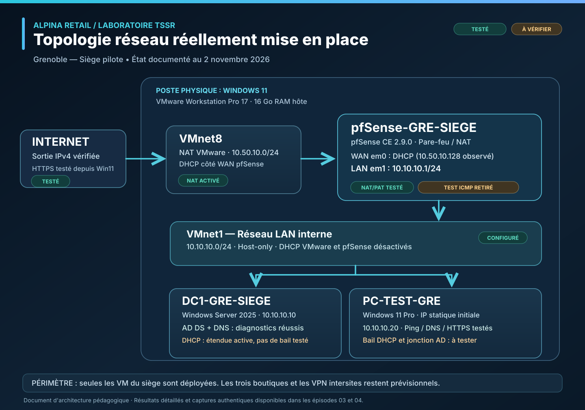

*Topologie synthétique du laboratoire au 2 novembre 2026 : DC1 installé et étendue DHCP active, mais aucun bail client ni jonction au domaine encore validés. [Voir le schéma vectoriel en grand](../topologie-laboratoire-siege.svg).*

La liaison entre la VM Windows et pfSense est assurée par **VMnet1 (Host-only)**. Le WAN pfSense est raccordé au NAT de VMware. Cette architecture représente une maquette, pas un environnement de production.

## 2. Machine virtuelle

| Élément | Configuration observée |
|---|---|
| Hyperviseur | VMware Workstation Pro 17 |
| Hôte | Windows 11, 16 Go RAM physique |
| Nom de VM | `DC1-GRE-SIEGE` |
| Système | **Windows Server 2025 Standard Evaluation**, édition avec interface graphique (« expérience utilisateur ») |
| RAM | 4 Go |
| Processeur | 2 vCPU (1 processeur virtuel × 2 cœurs) |
| Disque virtuel | 80 Go, NVMe |
| Adaptateur réseau | Custom (`VMnet1`) |
| Lecteur virtuel | ISO d'installation de Windows Server 2025 sélectionné |
| Autres VM | `PC-TEST-GRE` arrêté durant l'installation ; pfSense démarré pour les tests réseau |

Le disque de **80 Go** correspond au récapitulatif final de VMware ; une taille de 60 Go avait été évoquée en préparation, mais elle n'est pas celle retenue dans la VM créée.

*Capture — Machine virtuelle DC1 créée dans VMware, avant son premier démarrage.*

## 3. Installation et configuration réellement effectuées

Ce journal conserve les **manipulations réellement effectuées et leurs observations**, dans l'ordre. Les images placées à proximité illustrent les preuves disponibles ; chaque test non réalisé reste signalé.

### 3.1. Préparer Windows Server et le réseau

1. Création de `DC1-GRE-SIEGE` dans VMware Workstation.
2. Sélection du système `Windows Server 2025` et association de son ISO.
3. Configuration de **4 Go RAM, 2 vCPU, 80 Go NVMe et réseau VMnet1**.
4. Démarrage de l'installateur en français.
5. Sélection explicite de **Windows Server 2025 Standard Evaluation (expérience utilisateur)**, plutôt que Server Core.
6. Installation terminée et première ouverture de session avec le compte local `Administrateur`. Le mot de passe n'est pas conservé dans le dépôt.
7. Vérification du Gestionnaire de serveur et de l'édition Windows.
8. Modification du nom **Windows** de la machine, distinct du nom de VM : `DC1-GRE-SIEGE`.
9. Redémarrage et confirmation du nom `DC1-GRE-SIEGE` dans « Serveur local ».

*Capture — Identité de Windows Server confirmée avant l'installation des rôles.*
10. Configuration manuelle de l'interface `Ethernet0` en IPv4 statique.
11. Vérification des paramètres avec `ipconfig /all`.
12. Démarrage de pfSense, puis tests `ping` vers la passerelle et vers une destination extérieure, avec résultats complets consignés ci-dessous.
### 3.2. Installer AD DS et promouvoir le contrôleur de domaine

13. Lancement de **Gestionnaire de serveur → Gérer → Ajouter des rôles et fonctionnalités** ; sélection de l'installation basée sur un rôle et du serveur `DC1-GRE-SIEGE` (`10.10.10.10`).
14. Sélection du rôle **Services de domaine Active Directory (AD DS)** et des fonctionnalités d'administration associées, puis lancement de l'installation.
15. **Installation du rôle AD DS réussie**, attestée par la notification du Gestionnaire de serveur : « Configuration requise. Installation réussie sur DC1-GRE-SIEGE ». L'assistant propose alors **« Promouvoir ce serveur en contrôleur de domaine »**.

*Capture — Rôle AD DS installé ; promotion restant encore à effectuer à cet instant.*
16. Lancement de l'assistant de promotion et sélection de **« Ajouter une nouvelle forêt »** ; domaine racine choisi : **`ironman.test`**, nom DNS de laboratoire distinct du nom de l'entreprise fictive.
17. Options choisies : **niveau fonctionnel de forêt et de domaine Windows Server 2025**, serveur DNS et catalogue global cochés, RODC décoché ; mot de passe DSRM défini par l'auteur, non publié.
18. Avertissement de non-création d'une délégation DNS dans la zone parente : attendu pour cette forêt de laboratoire indépendante, sans délégation parente configurée.
19. Nom NetBIOS confirmé : **`IRONMAN`**. Les paramètres et chemins d'accès ont été parcourus ; aucune valeur de chemin particulière n'est revendiquée faute de capture.
20. Contrôle des prérequis **réussi** : l'assistant indique que « toutes les vérifications de la configuration requise ont donné satisfaction » malgré l'avertissement DNS non bloquant.

*Capture — Les conditions préalables à la promotion de DC1 sont validées.*
21. Promotion lancée, puis **redémarrage de Windows Server**. L'écran de connexion affiche **`IRONMAN\Administrateur`** ; ouverture de session effectuée par l'auteur.
22. Dans **Gestionnaire de serveur → Serveur local**, observation du nom **`DC1-GRE-SIEGE`**, du **domaine `ironman.test`**, de l'adresse **`10.10.10.10`** et du profil de pare-feu **Domaine : actif**. Ces preuves confirment le rattachement à la nouvelle forêt après promotion, **sans valider encore l'ensemble des services AD DS et DNS**.
23. Exécution de **`dcdiag /test:Advertising`** depuis une invite de commandes sur DC1 : l'outil trouve le serveur associé, reconnaît la forêt AD et affiche **« Le test Connectivity de DC1-GRE-SIEGE a réussi »**, puis **« Le test Advertising de DC1-GRE-SIEGE a réussi »**. Aucun échec dans le résultat visible de ce test ciblé ; il ne s'agit pas d'un diagnostic exhaustif du DNS ou de l'annuaire.
### 3.3. Vérifier et dépanner le DNS

24. Exécution de **`nslookup -type=SRV _ldap._tcp.dc._msdcs.ironman.test`** : la réponse contient un enregistrement SRV de priorité `0`, poids `100`, port **`389`**, cible **`dc1-gre-siege.ironman.test`** et l'adresse IPv4 **`10.10.10.10`**. `nslookup` indique `Server: UnKnown` / `Address: ::1` : le nom du serveur interrogé n'est pas affiché, mais la requête SRV a bien obtenu la réponse attendue. La résolution externe et les diagnostics DNS complets restent à vérifier.
25. Exécution de **`nslookup dc1-gre-siege.ironman.test 10.10.10.10`** : le serveur interrogé est affiché comme `Server: UnKnown`, `Address: 10.10.10.10`, précédé de `DNS request timed out` (délai 2 secondes), puis la réponse indique **`Nom: dc1-gre-siege.ironman.test` / `Address: 10.10.10.10`**. La résolution directe demandée est donc obtenue, mais le délai initial et l'absence de nom du serveur DNS nécessitent une vérification, notamment de la zone de recherche inversée et d'un éventuel enregistrement PTR. **À ce stade, la cause n'était pas démontrée.**
26. Inspection de **Gestionnaire DNS → Zones de recherche inversée** : dossier initialement vide. Création de la zone principale IPv4 **`10.10.10.in-addr.arpa`**, intégrée à Active Directory, avec réplication prévue vers les serveurs DNS des contrôleurs de domaine de **`ironman.test`**. La zone apparaît avec l'état **En cours d'exécution**, puis seuls SOA et NS sont observés.
27. Création d'un enregistrement **PTR** associant **`10.10.10.10`** à **`dc1-gre-siege.ironman.test`** dans cette zone. Sa présence est confirmée par la capture du Gestionnaire DNS (enregistrements SOA, NS et PTR).
28. Vérification par **`nslookup 10.10.10.10 10.10.10.10`** : le résultat affiche **`Server: dc1-gre-siege.ironman.test`**, **`Address: 10.10.10.10`**, puis **`Nom: dc1-gre-siege.ironman.test`** et **`Address: 10.10.10.10`**, **sans délai d'attente signalé**. La résolution inverse testée fonctionne après la correction. L'absence du timeout sur ce test ne garantit pas qu'il ne puisse jamais réapparaître.
29. **Contre-test du symptôme initial**, avec exactement **`nslookup dc1-gre-siege.ironman.test 10.10.10.10`** : le résultat affiche **`Serveur : dc1-gre-siege.ironman.test`**, **`Address : 10.10.10.10`**, puis **`Nom : dc1-gre-siege.ironman.test`**, **`Address : 10.10.10.10`**. **Ni `Server: UnKnown` ni `DNS request timed out`** dans la sortie observée. Ce résultat confirme la disparition du symptôme initial dans ce nouveau test, après ajout de la zone inversée et du PTR.
### Dépannage DNS — preuves avant/après

**Constat et analyse initiale**

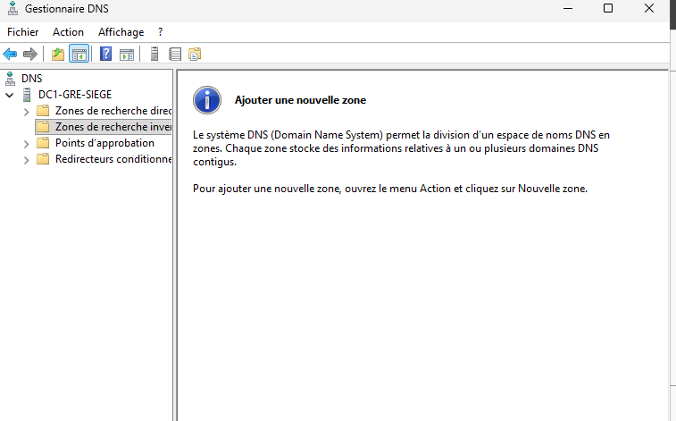

*Avant — Dossier des zones de recherche inversée vide ; la résolution inverse n'est pas configurée.*

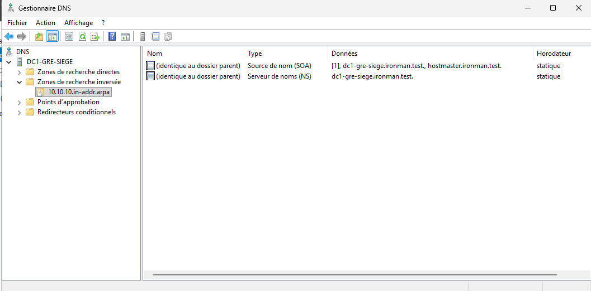

*Configuration intermédiaire — La zone `10.10.10.in-addr.arpa` est créée ; seuls les enregistrements SOA et NS sont visibles.*

**Correction et contre-tests**

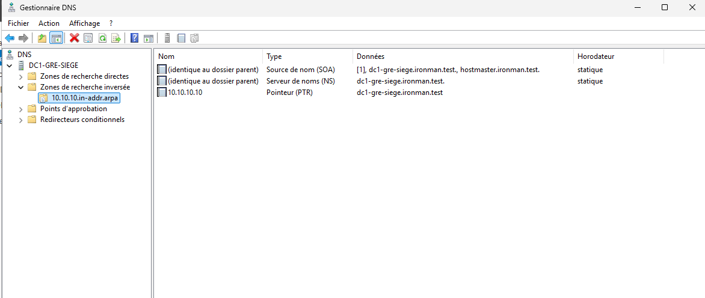

*Correction — PTR présent, associant `10.10.10.10` à `dc1-gre-siege.ironman.test`.*

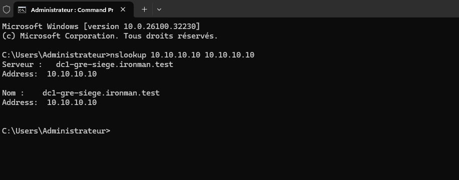

*Contrôle 1 — `nslookup 10.10.10.10 10.10.10.10` retrouve le nom du serveur sans avertissement visible.*

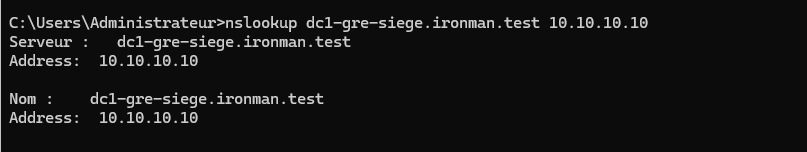

*Contrôle 2 — Nouvelle exécution de la commande directe initialement en anomalie, avec résolution correcte et sans `Server: UnKnown` dans la sortie.*

30. Exécution de **`dcdiag /test:DNS`** : le résultat communiqué indique **`Connectivity` réussi**, puis **`DNS` réussi pour `DC1-GRE-SIEGE`** et **`DNS` réussi pour le domaine `ironman.test`**. Le diagnostic DNS ciblé passe dans les résultats visibles ; ce test ne constitue pas à lui seul une preuve de résolution DNS des noms Internet, qui sera contrôlée séparément.
31. Exécution de **`nslookup www.microsoft.com 10.10.10.10`** : le résolveur est identifié comme **`dc1-gre-siege.ironman.test`** à l'adresse **`10.10.10.10`**. La réponse **non autoritaire** renvoie l'alias `www.microsoft.com-c-3.edgekey.net`, le nom canonique `e13678.dscb.akamaiedge.net`, l'adresse IPv4 **`23.200.213.221`** et plusieurs adresses IPv6. **La résolution DNS externe demandée est réussie**. Le mécanisme exact de récursion (redirecteur ou indications de racine) n'a pas encore été déterminé ; aucun ajout de redirecteur n'est nécessaire pour résoudre cette requête précise.
### Contrôles complémentaires DNS

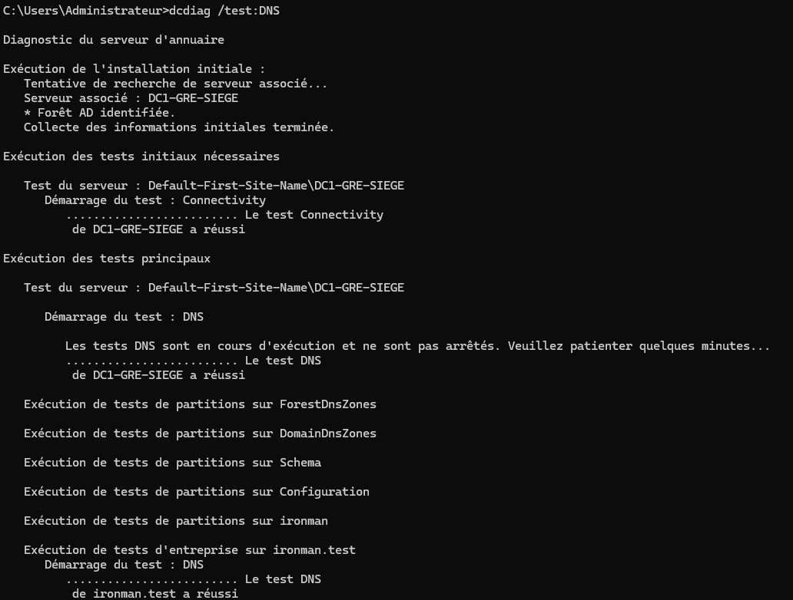

*Le diagnostic ciblé `dcdiag /test:DNS` affiche une réussite pour DC1 et `ironman.test`.*

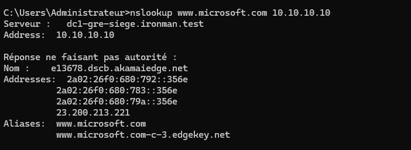

*Le serveur DNS `10.10.10.10` résout `www.microsoft.com` et renvoie des adresses externes ; cela ne démontre pas à lui seul l'accessibilité HTTP.*

32. Exécution de **`net share`** sur `DC1-GRE-SIEGE` : présence des partages administratifs `C$`, `IPC$` et `ADMIN$` ainsi que de **`NETLOGON`** (`C:\WINDOWS\SYSVOL\sysvol\ironman.test\SCRIPTS`) et **`SYSVOL`** (`C:\WINDOWS\SYSVOL\sysvol`). La commande s'est terminée correctement. **La publication locale des partages est vérifiée** ; leur accessibilité depuis un poste client et l'application des GPO n'ont pas encore été testées.
33. Exécution de **`dcdiag /test:Services`** : l'outil affiche **« Le test Connectivity de DC1-GRE-SIEGE a réussi »** et **« Le test Services de DC1-GRE-SIEGE a réussi »**. Aucun échec n'apparaît dans les résultats visibles du diagnostic ciblé. Ce contrôle ne remplace pas l'ensemble des tests Active Directory ni les tests d'authentification depuis un client.
### Contrôles AD DS et partages

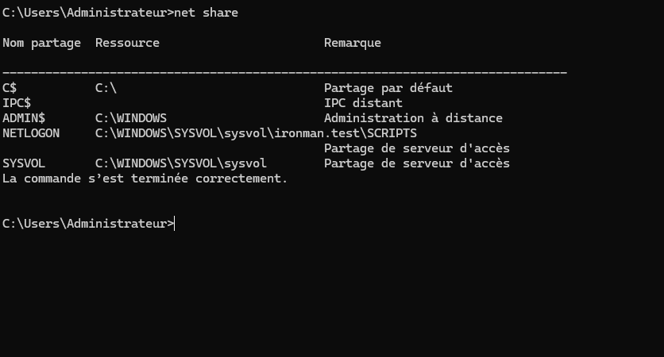

*`net share` confirme que SYSVOL et NETLOGON sont publiés sur DC1 ; leur accès depuis un poste client reste à tester.*

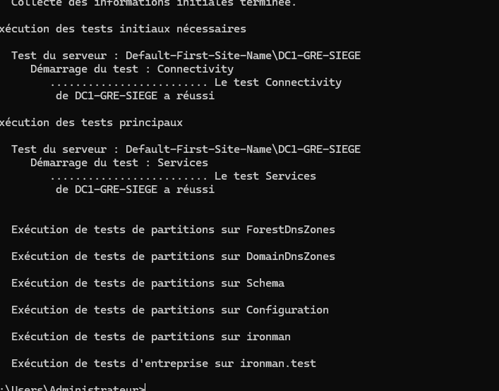

*Le test ciblé `dcdiag /test:Services` réussit, ainsi que son prérequis Connectivity.*

### 3.4. Installer et paramétrer le serveur DHCP

34. Sélection et lancement de l'installation du rôle **Serveur DHCP** sur `DC1-GRE-SIEGE.ironman.test`. La console DHCP s'ouvre ensuite avec les arborescences IPv4 et IPv6, **sans étendue IPv4 créée à ce stade**.
35. Dans la console DHCP, le menu contextuel du serveur propose **« Interdire »** et non « Autoriser » : cette observation indique que le serveur **est déjà autorisé dans Active Directory**. **Aucune distribution de bail DHCP n'a encore été vérifiée** depuis `PC-TEST-GRE`.
36. Création de l'étendue IPv4 **`DHCP-GRE-SIEGE`** sur le réseau **`10.10.10.0/24`**. Paramètres saisis via l'assistant : plage annoncée **`10.10.10.100` à `10.10.10.199`**, masque `/24`, aucune exclusion supplémentaire, retard DHCP `0 ms`, bail prévu de `8 jours`, passerelle `10.10.10.1`, DNS `10.10.10.10`, suffixe DNS `ironman.test`, pas de serveur WINS.
37. La console DHCP montre **« Étendue [10.10.10.0] DHCP-GRE-SIEGE »** avec le statut **« Actif »**. La délivrance effective d'un bail client n'a **pas encore été vérifiée**.
38. Inspection de **DHCP → IPv4 → Étendue [10.10.10.0] → Options d'étendue** : les options observées sont **003 Routeur = `10.10.10.1`**, **006 Serveurs DNS = `10.10.10.10`** et **015 Nom de domaine DNS = `ironman.test`**. Aucun changement nécessaire sur ces trois options ; le bail et les paramètres effectivement reçus par `PC-TEST-GRE` restent à contrôler.
39. Inspection de **DHCP → IPv4 → Étendue [10.10.10.0] → Pool d'adresses** : la plage d'attribution affichée démarre à **`10.10.10.100`** et se termine à **`10.10.10.199`**, soit **100 adresses IPv4**. La plage est bien enregistrée ; **aucun bail client ni succès de renouvellement DHCP n'a encore été démontré**. La durée de bail de 8 jours, choisie dans l'assistant, sera contrôlée dans les propriétés de l'étendue lors de la reprise.

### Preuves de configuration du serveur DHCP

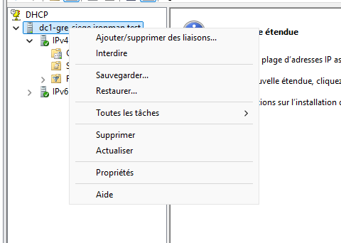

*Autorisation AD — Le menu contextuel propose « Interdire », ce qui indique que le serveur DHCP est actuellement autorisé.*

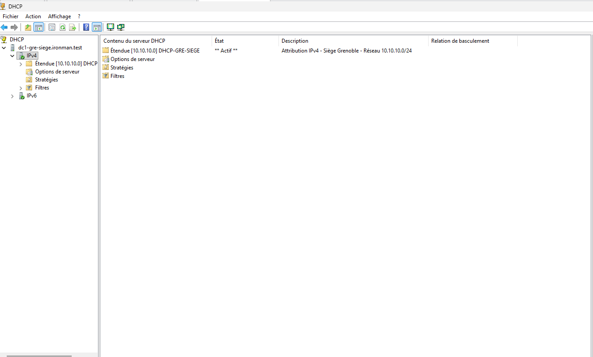

*Activation — L'étendue `DHCP-GRE-SIEGE` du réseau `10.10.10.0/24` est visible avec l'état « Actif ».*

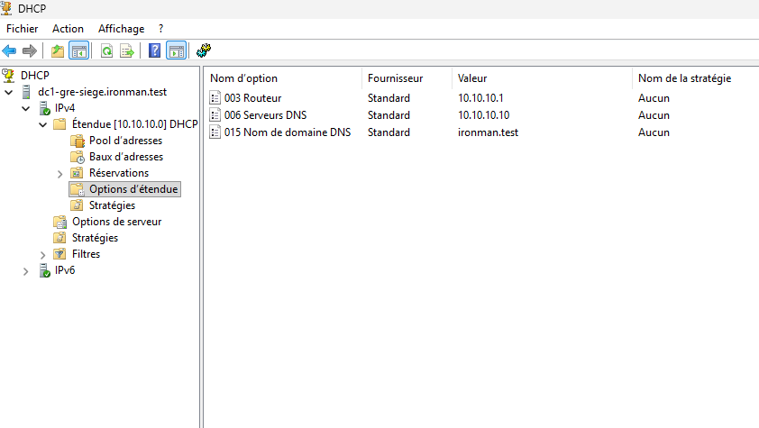

*Options — Routeur `10.10.10.1`, DNS `10.10.10.10` et suffixe de domaine `ironman.test`.*

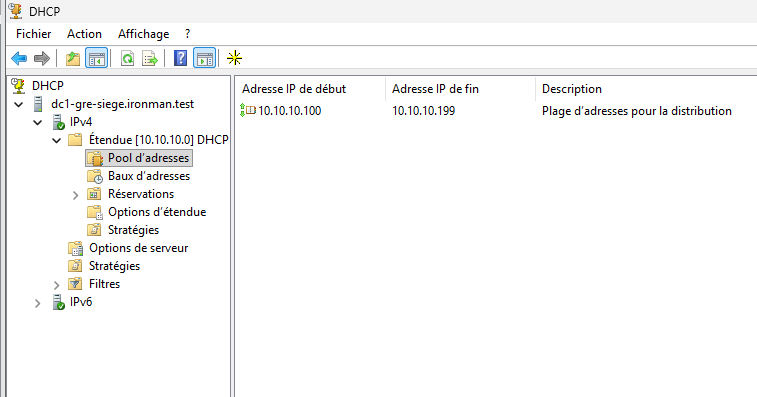

*Pool — `10.10.10.100` à `10.10.10.199` (100 adresses IPv4). Aucun bail effectivement attribué n'est encore prouvé.*

## 4. Configuration IPv4 confirmée depuis `ipconfig /all`

| Paramètre | Valeur observée |
|---|---|
| Nom de l'hôte | `DC1-GRE-SIEGE` |
| Interface | `Ethernet0` |
| DHCP | Désactivé |
| IPv4 | `10.10.10.10` |
| Masque | `255.255.255.0` (/24) |
| Passerelle | `10.10.10.1` |
| DNS préféré | `10.10.10.10` |
| DNS auxiliaire | Aucun indiqué |

**Interprétation au moment de la configuration IPv4, avant la promotion :** l'adresse DNS préférée avait été positionnée sur le futur serveur DNS local, encore non installé à cet instant. **Après la promotion**, les recherches DNS SRV et A présentées ci-dessous ont répondu ; elles ne constituent toutefois pas un audit DNS complet.

*Capture — Configuration IPv4 de DC1 vérifiée par `ipconfig /all` avant l'installation d'AD DS.*

## 5. Tests réseau et résultats

| Test effectué depuis `DC1-GRE-SIEGE` | Paquets envoyés | Reçus | Perte | Mesures observées |
|---|---:|---:|---:|---|
| `ping 10.10.10.1` (pfSense LAN) | 4 | 4 | **0 %** | min 0 ms, max 1 ms, moyenne 0 ms |
| `ping 8.8.8.8` (destination externe) | 4 | 4 | **0 %** | min 20 ms, max 24 ms, moyenne 21 ms |

Les deux sorties de commande ont été transmises par l'auteur sous forme de captures d'écran.

**Conclusion limitée au test :** les réponses ICMP prouvent l'accès à la passerelle et la connectivité IPv4 vers `8.8.8.8` depuis la VM Windows, à travers pfSense. Elles ne prouvent pas à elles seules le fonctionnement du DNS, d'Active Directory ou de tous les protocoles applicatifs.

*Capture — Connectivité IP vers la passerelle et vers `8.8.8.8` : 0 % de perte dans les deux tests.*

## 6. Validations AD DS et DNS

| Élément | Résultat |
|---|---|
| Nouvelle forêt DNS | `ironman.test` (nom saisi dans l'assistant) |
| Nom NetBIOS | `IRONMAN` (confirmé dans l'assistant et à l'écran de connexion) |
| Niveaux fonctionnels choisis | Windows Server 2025 (forêt et domaine) |
| DNS / Catalogue global | Options cochées pendant la promotion ; services à tester séparément |
| Prérequis de promotion | Contrôles préalables satisfaits ; avertissement de délégation DNS non bloquant |
| Redémarrage après promotion | Effectué ; session `IRONMAN\Administrateur` ouverte |
| Domaine visible dans Serveur local | **`ironman.test`** |
| Tests ciblés AD DS | **`dcdiag /test:Advertising` : Connectivity et Advertising réussis** sur `DC1-GRE-SIEGE` |
| Recherche SRV du contrôleur de domaine | **Réussie :** `_ldap._tcp.dc._msdcs.ironman.test` → `dc1-gre-siege.ironman.test`, port `389`, IPv4 `10.10.10.10` |
| Résolution DNS directe de DC1 via `10.10.10.10` | **Avant :** réponse correcte, mais timeout initial et `Server: UnKnown`. **Après PTR :** même commande sans ces messages, avec nom DNS et adresse attendus |
| Recherche DNS inverse après ajout du PTR | **Réussie :** `nslookup 10.10.10.10 10.10.10.10` retrouve `dc1-gre-siege.ironman.test`, sans `Server: UnKnown` ni timeout dans la sortie fournie |
| `dcdiag /test:DNS` | **Réussi dans les résultats fournis :** Connectivity, DNS pour DC1 et DNS pour `ironman.test` |
| Résolution DNS Internet | **Réussie** : `nslookup www.microsoft.com 10.10.10.10` retourne IPv4 `23.200.213.221`, adresses IPv6 et alias associés |
| Partages `SYSVOL` / `NETLOGON` | **Présents et publiés** dans `net share` sur DC1 ; accès à partir d'un client non encore testé |
| Diagnostic `dcdiag /test:Services` | **Réussi** pour DC1 ; le test `Connectivity` a également réussi |
| Autres tests AD DS | **À poursuivre** : accès depuis un client, authentification, SYSVOL et application des GPO |

### Preuves de domaine et diagnostics Active Directory / DNS

*Capture — Après promotion et redémarrage, le Gestionnaire de serveur affiche le domaine `ironman.test` et l'adresse `10.10.10.10`.*

*Capture — `dcdiag /test:Advertising` : les tests ciblés Connectivity et Advertising réussissent.*

*Capture — Découverte du contrôleur de domaine : enregistrement SRV LDAP résolu vers DC1 (port 389).* 

*Capture — Avant correction : la recherche directe aboutit, mais `nslookup` affiche un délai initial et `Server: UnKnown`. Une zone inversée et un PTR ont depuis été créés ; le test inverse après correction est décrit dans le tableau ci-dessus.*

## 7. Preuves visuelles publiées

Les **23 captures authentiques** sont maintenant vérifiées dans `docs/episode-04/images/` et **intégrées dans ce README avec leurs légendes** :

- **01 à 10 — installation et promotion :** paramètres VMware, renommage, réseau, rôle AD DS, domaine, premières requêtes DNS ;
- **11 et 12 — services Active Directory :** partages `SYSVOL` et `NETLOGON`, diagnostic `dcdiag /test:Services` ;
- **13 à 17 — dépannage DNS avant/après :** zone inversée absente, zone créée, ajout du PTR, résolutions inverse et directe après correction ;
- **18 et 19 — validation DNS :** diagnostic `dcdiag /test:DNS`, résolution d'un domaine externe ;
- **20 à 23 — configuration DHCP :** autorisation dans AD, étendue active, options 003/006/015 et plage enregistrée.

[Parcourir le dossier d'images et son inventaire](images/README.md).

**Limites des preuves :** la création de l'étendue et la présence des paramètres ne prouvent pas qu'un client a reçu un bail DHCP. La durée du bail, l'obtention d'une adresse par `PC-TEST-GRE`, son accès aux partages et la jonction au domaine restent à vérifier.

**Confidentialité :** aucun mot de passe administrateur ou DSRM ni export de configuration pfSense n'est publié.

## 8. Étapes restantes

- [x] Créer la VM `DC1-GRE-SIEGE`.
- [x] Installer Windows Server 2025 Standard Evaluation avec interface graphique.
- [x] Renommer Windows et vérifier après redémarrage.
- [x] Configurer et vérifier l'adresse `10.10.10.10/24`.
- [x] Tester le ping vers la passerelle `10.10.10.1` avec 0 % de perte.
- [x] Tester le ping vers `8.8.8.8` avec 0 % de perte.
- [x] Installer le rôle **AD DS** : notification de réussite du Gestionnaire de serveur observée le 02/11/2026.
- [x] Lancer et achever la promotion de DC1 en premier contrôleur de domaine de la nouvelle forêt `ironman.test` : redémarrage et identité de domaine confirmés visuellement.
- [x] Réaliser un premier diagnostic AD DS ciblé : `dcdiag /test:Advertising`, tests Connectivity et Advertising réussis.
- [x] Exécuter `dcdiag /test:DNS` : Connectivity, DNS serveur et DNS domaine réussis dans la sortie fournie.
- [x] Vérifier avec `net share` la publication des partages `SYSVOL` et `NETLOGON` sur DC1.
- [x] Vérifier avec `dcdiag /test:Services` : tests Connectivity et Services réussis.
- [ ] Approfondir les diagnostics AD DS, vérifier l'accès aux partages depuis un client et l'application des GPO.
- [x] Vérifier un enregistrement SRV AD DNS : recherche `_ldap._tcp.dc._msdcs.ironman.test` réussie, cible et port LDAP confirmés.
- [x] Vérifier la résolution directe du nom de DC1 via son serveur DNS à `10.10.10.10` (réponse correcte, avertissement initial à investiguer).
- [x] Inspecter la zone inversée, créer `10.10.10.in-addr.arpa` et le PTR de `10.10.10.10` puis confirmer la résolution inverse réussie.
- [x] Refaire la commande exacte d'origine `nslookup dc1-gre-siege.ironman.test 10.10.10.10` : nom DNS identifié, aucun timeout dans ce test.
- [x] Vérifier la résolution DNS externe via DC1 : `nslookup www.microsoft.com 10.10.10.10` a retourné une réponse valide.
- [ ] Réaliser au besoin des contrôles DNS/AD plus complets après la correction.
- [x] Accéder à la console du rôle DHCP sur DC1 et constater l'autorisation Active Directory (option « Interdire » présente).
- [x] Créer et activer l'étendue `DHCP-GRE-SIEGE` pour `10.10.10.0/24` (statut « Actif » visible dans la console).
- [x] Vérifier dans la console les options d'étendue DHCP 003 (`10.10.10.1`), 006 (`10.10.10.10`) et 015 (`ironman.test`).
- [x] Vérifier dans la console la plage DHCP enregistrée : `10.10.10.100` à `10.10.10.199` (100 adresses).
- [ ] Contrôler la durée du bail puis tester l'attribution réelle d'une adresse DHCP à `PC-TEST-GRE`.
- [ ] Vérifier la jonction d'un poste Windows 11 au domaine, l'authentification et les politiques de groupe.
- [x] Publier et intégrer les **23 captures réelles** dans ce README, avec des légendes et leurs limites.

**Aucun test ou service non réalisé n'est présenté comme réussi.**

---

**Auteur :** Vincent Scannella — Technicien Supérieur Systèmes et Réseaux (TSSR).  
[Retour à l'accueil](../../README.md) · [Épisode 03 — pfSense](../episode-03/README.md) · [Inventaire des captures](images/README.md)
