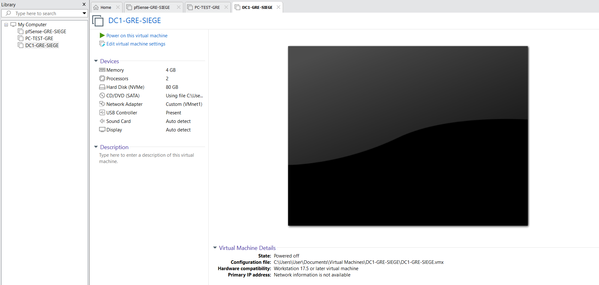
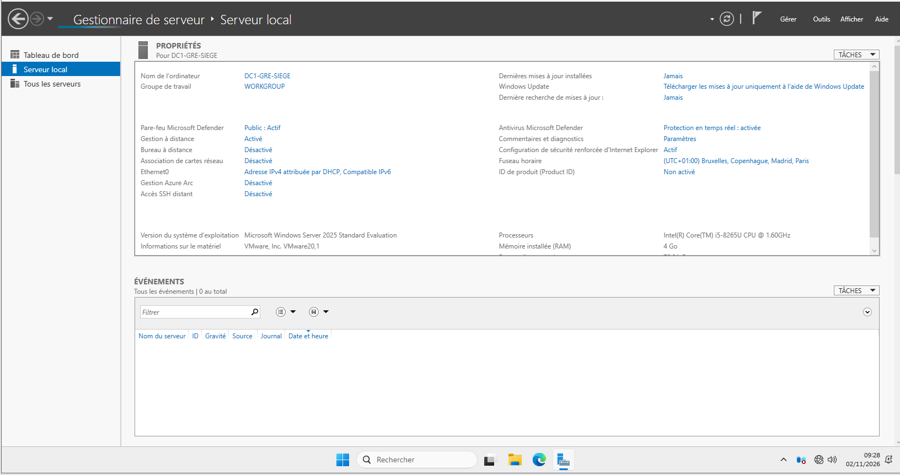
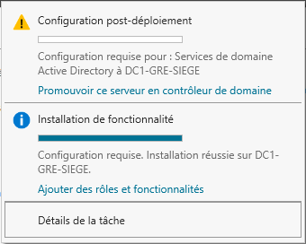
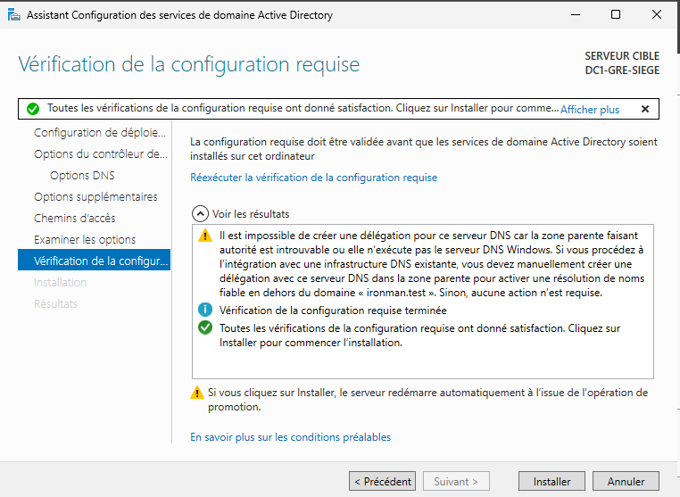
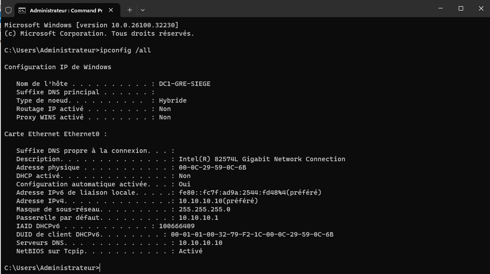
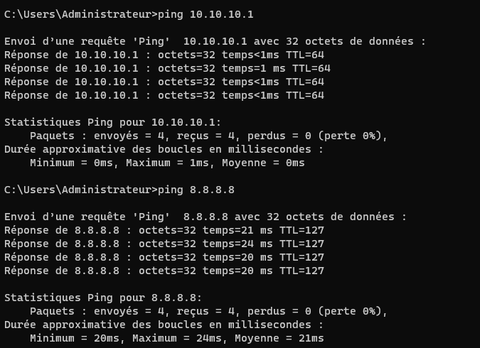
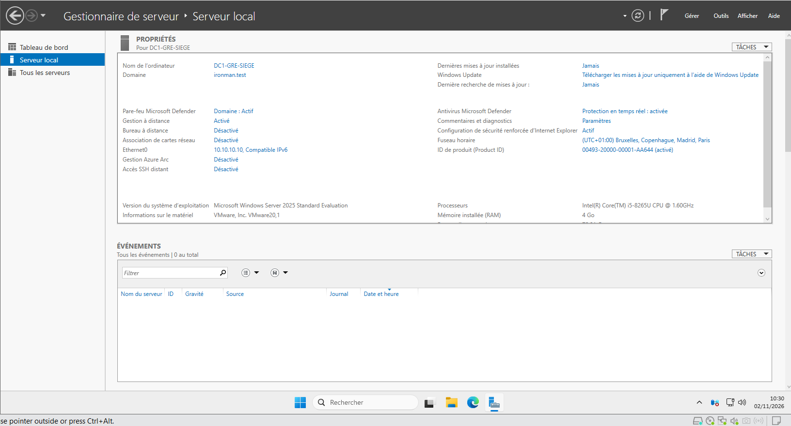
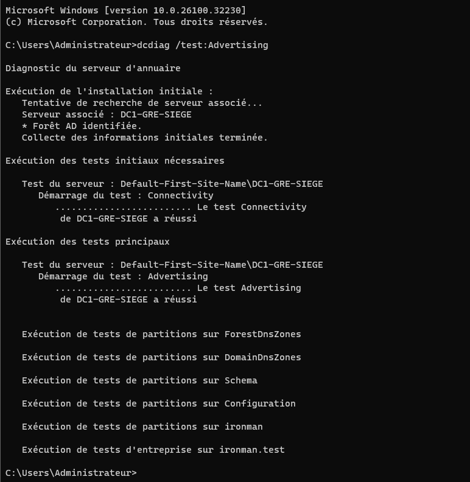
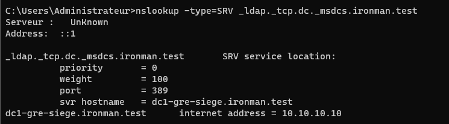
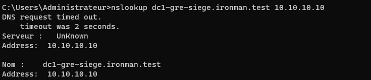

# ALPINA RETAIL — Épisode 04 : Déploiement de Windows Server 2025 au siège de Grenoble

> **Date des opérations :** 2 novembre 2026  
> **Statut :** Windows Server installé, renommé et adressé en IPv4 statique ; connectivité vers pfSense et vers `8.8.8.8` **testée avec succès**. **Rôle AD DS installé, promotion de `DC1-GRE-SIEGE` vers la nouvelle forêt `ironman.test` engagée et redémarrage suivi d'une connexion au domaine `IRONMAN` confirmés. L'identité de domaine apparaît dans « Serveur local ». Le diagnostic ciblé `dcdiag /test:Advertising` a réussi (tests Connectivity et Advertising) ; une requête DNS SRV de découverte LDAP a réussi et renvoie `dc1-gre-siege.ironman.test` / `10.10.10.10` (port 389). Une résolution directe explicite avait retourné `10.10.10.10` mais avec un délai initial et `Server: UnKnown`. Une zone de recherche inversée intégrée à AD et un PTR ont ensuite été créés ; `nslookup 10.10.10.10 10.10.10.10` retourne désormais `dc1-gre-siege.ironman.test` sans message de délai d'attente. La répétition exacte de la recherche directe `nslookup dc1-gre-siege.ironman.test 10.10.10.10` après la correction affiche désormais le nom du DNS et la bonne adresse, sans timeout visible. Le test `dcdiag /test:DNS` a ensuite affiché une réussite pour le contrôleur `DC1-GRE-SIEGE` et pour le domaine `ironman.test`, avec Connectivity réussi. Une requête `nslookup www.microsoft.com 10.10.10.10` a depuis réussi et renvoyé des adresses IPv4/IPv6 externes ; le DHCP reste à installer/configurer. Les tests applicatifs et la santé globale des services restent à poursuivre.**  
> **Contexte :** laboratoire personnel TSSR simulant une entreprise entièrement fictive.

## 1. Objectif et architecture

Créer un premier serveur Windows pour préparer les services d'identité et d'infrastructure du siège d'ALPINA RETAIL.

```text
                   Internet
                       |
                VMware VMnet8 / NAT
                       |
               pfSense-GRE-SIEGE
                  WAN : DHCP
                  LAN : 10.10.10.1/24
                       |
               VMware VMnet1 / LAN
                       |
                  DC1-GRE-SIEGE
                  10.10.10.10/24
```

La liaison entre la VM Windows et pfSense est assurée par **VMnet1 (Host-only)**. Le WAN pfSense est raccordé au NAT de VMware. Cette architecture représente une maquette, pas un environnement de production.

## 2. Machine virtuelle

| Élément | Configuration observée |
|---|---|
| Hyperviseur | VMware Workstation Pro 17 |
| Hôte | Windows 11, 16 Go RAM physique |
| Nom de VM | `DC1-GRE-SIEGE` |
| Système | **Windows Server 2025 Standard Evaluation**, édition avec interface graphique (« expérience utilisateur ») |
| RAM | 4 Go |
| Processeur | 2 vCPU (1 processeur virtuel × 2 cœurs) |
| Disque virtuel | 80 Go, NVMe |
| Adaptateur réseau | Custom (`VMnet1`) |
| Lecteur virtuel | ISO d'installation de Windows Server 2025 sélectionné |
| Autres VM | `PC-TEST-GRE` arrêté durant l'installation ; pfSense démarré pour les tests réseau |

Le disque de **80 Go** correspond au récapitulatif final de VMware ; une taille de 60 Go avait été évoquée en préparation, mais elle n'est pas celle retenue dans la VM créée.



*Capture — Machine virtuelle DC1 créée dans VMware, avant son premier démarrage.*

## 3. Installation et configuration réellement effectuées

1. Création de `DC1-GRE-SIEGE` dans VMware Workstation.
2. Sélection du système `Windows Server 2025` et association de son ISO.
3. Configuration de **4 Go RAM, 2 vCPU, 80 Go NVMe et réseau VMnet1**.
4. Démarrage de l'installateur en français.
5. Sélection explicite de **Windows Server 2025 Standard Evaluation (expérience utilisateur)**, plutôt que Server Core.
6. Installation terminée et première ouverture de session avec le compte local `Administrateur`. Le mot de passe n'est pas conservé dans le dépôt.
7. Vérification du Gestionnaire de serveur et de l'édition Windows.
8. Modification du nom **Windows** de la machine, distinct du nom de VM : `DC1-GRE-SIEGE`.
9. Redémarrage et confirmation du nom `DC1-GRE-SIEGE` dans « Serveur local ».
10. Configuration manuelle de l'interface `Ethernet0` en IPv4 statique.
11. Vérification des paramètres avec `ipconfig /all`.
12. Démarrage de pfSense, puis tests `ping` vers la passerelle et vers une destination extérieure, avec résultats complets consignés ci-dessous.
13. Lancement de **Gestionnaire de serveur → Gérer → Ajouter des rôles et fonctionnalités** ; sélection de l'installation basée sur un rôle et du serveur `DC1-GRE-SIEGE` (`10.10.10.10`).
14. Sélection du rôle **Services de domaine Active Directory (AD DS)** et des fonctionnalités d'administration associées, puis lancement de l'installation.
15. **Installation du rôle AD DS réussie**, attestée par la notification du Gestionnaire de serveur : « Configuration requise. Installation réussie sur DC1-GRE-SIEGE ». L'assistant propose alors **« Promouvoir ce serveur en contrôleur de domaine »**.
16. Lancement de l'assistant de promotion et sélection de **« Ajouter une nouvelle forêt »** ; domaine racine choisi : **`ironman.test`**, nom DNS de laboratoire distinct du nom de l'entreprise fictive.
17. Options choisies : **niveau fonctionnel de forêt et de domaine Windows Server 2025**, serveur DNS et catalogue global cochés, RODC décoché ; mot de passe DSRM défini par l'auteur, non publié.
18. Avertissement de non-création d'une délégation DNS dans la zone parente : attendu pour cette forêt de laboratoire indépendante, sans délégation parente configurée.
19. Nom NetBIOS confirmé : **`IRONMAN`**. Les paramètres et chemins d'accès ont été parcourus ; aucune valeur de chemin particulière n'est revendiquée faute de capture.
20. Contrôle des prérequis **réussi** : l'assistant indique que « toutes les vérifications de la configuration requise ont donné satisfaction » malgré l'avertissement DNS non bloquant.
21. Promotion lancée, puis **redémarrage de Windows Server**. L'écran de connexion affiche **`IRONMAN\Administrateur`** ; ouverture de session effectuée par l'auteur.
22. Dans **Gestionnaire de serveur → Serveur local**, observation du nom **`DC1-GRE-SIEGE`**, du **domaine `ironman.test`**, de l'adresse **`10.10.10.10`** et du profil de pare-feu **Domaine : actif**. Ces preuves confirment le rattachement à la nouvelle forêt après promotion, **sans valider encore l'ensemble des services AD DS et DNS**.
23. Exécution de **`dcdiag /test:Advertising`** depuis une invite de commandes sur DC1 : l'outil trouve le serveur associé, reconnaît la forêt AD et affiche **« Le test Connectivity de DC1-GRE-SIEGE a réussi »**, puis **« Le test Advertising de DC1-GRE-SIEGE a réussi »**. Aucun échec dans le résultat visible de ce test ciblé ; il ne s'agit pas d'un diagnostic exhaustif du DNS ou de l'annuaire.
24. Exécution de **`nslookup -type=SRV _ldap._tcp.dc._msdcs.ironman.test`** : la réponse contient un enregistrement SRV de priorité `0`, poids `100`, port **`389`**, cible **`dc1-gre-siege.ironman.test`** et l'adresse IPv4 **`10.10.10.10`**. `nslookup` indique `Server: UnKnown` / `Address: ::1` : le nom du serveur interrogé n'est pas affiché, mais la requête SRV a bien obtenu la réponse attendue. La résolution externe et les diagnostics DNS complets restent à vérifier.
25. Exécution de **`nslookup dc1-gre-siege.ironman.test 10.10.10.10`** : le serveur interrogé est affiché comme `Server: UnKnown`, `Address: 10.10.10.10`, précédé de `DNS request timed out` (délai 2 secondes), puis la réponse indique **`Nom: dc1-gre-siege.ironman.test` / `Address: 10.10.10.10`**. La résolution directe demandée est donc obtenue, mais le délai initial et l'absence de nom du serveur DNS nécessitent une vérification, notamment de la zone de recherche inversée et d'un éventuel enregistrement PTR. **À ce stade, la cause n'était pas démontrée.**
26. Inspection de **Gestionnaire DNS → Zones de recherche inversée** : dossier initialement vide. Création de la zone principale IPv4 **`10.10.10.in-addr.arpa`**, intégrée à Active Directory, avec réplication prévue vers les serveurs DNS des contrôleurs de domaine de **`ironman.test`**. La zone apparaît avec l'état **En cours d'exécution**, puis seuls SOA et NS sont observés.
27. Création d'un enregistrement **PTR** associant **`10.10.10.10`** à **`dc1-gre-siege.ironman.test`** dans cette zone. Sa présence est confirmée par la capture du Gestionnaire DNS (enregistrements SOA, NS et PTR).
28. Vérification par **`nslookup 10.10.10.10 10.10.10.10`** : le résultat affiche **`Server: dc1-gre-siege.ironman.test`**, **`Address: 10.10.10.10`**, puis **`Nom: dc1-gre-siege.ironman.test`** et **`Address: 10.10.10.10`**, **sans délai d'attente signalé**. La résolution inverse testée fonctionne après la correction. L'absence du timeout sur ce test ne garantit pas qu'il ne puisse jamais réapparaître.
29. **Contre-test du symptôme initial**, avec exactement **`nslookup dc1-gre-siege.ironman.test 10.10.10.10`** : le résultat affiche **`Serveur : dc1-gre-siege.ironman.test`**, **`Address : 10.10.10.10`**, puis **`Nom : dc1-gre-siege.ironman.test`**, **`Address : 10.10.10.10`**. **Ni `Server: UnKnown` ni `DNS request timed out`** dans la sortie observée. Ce résultat confirme la disparition du symptôme initial dans ce nouveau test, après ajout de la zone inversée et du PTR.
30. Exécution de **`dcdiag /test:DNS`** : le résultat communiqué indique **`Connectivity` réussi**, puis **`DNS` réussi pour `DC1-GRE-SIEGE`** et **`DNS` réussi pour le domaine `ironman.test`**. Le diagnostic DNS ciblé passe dans les résultats visibles ; ce test ne constitue pas à lui seul une preuve de résolution DNS des noms Internet, qui sera contrôlée séparément.
31. Exécution de **`nslookup www.microsoft.com 10.10.10.10`** : le résolveur est identifié comme **`dc1-gre-siege.ironman.test`** à l'adresse **`10.10.10.10`**. La réponse **non autoritaire** renvoie l'alias `www.microsoft.com-c-3.edgekey.net`, le nom canonique `e13678.dscb.akamaiedge.net`, l'adresse IPv4 **`23.200.213.221`** et plusieurs adresses IPv6. **La résolution DNS externe demandée est réussie**. Le mécanisme exact de récursion (redirecteur ou indications de racine) n'a pas encore été déterminé ; aucun ajout de redirecteur n'est nécessaire pour résoudre cette requête précise.

### Preuves de l'installation et de la promotion AD DS



*Capture — Nom Windows DC1-GRE-SIEGE confirmé après redémarrage, avant la promotion AD DS.*



*Capture — Installation du rôle AD DS réussie ; la promotion en contrôleur de domaine restait à effectuer à cet instant.*



*Capture — Vérifications préalables satisfaites, avec avertissement non bloquant de délégation DNS pour la nouvelle forêt.*

## 4. Configuration IPv4 confirmée depuis `ipconfig /all`

| Paramètre | Valeur observée |
|---|---|
| Nom de l'hôte | `DC1-GRE-SIEGE` |
| Interface | `Ethernet0` |
| DHCP | Désactivé |
| IPv4 | `10.10.10.10` |
| Masque | `255.255.255.0` (/24) |
| Passerelle | `10.10.10.1` |
| DNS préféré | `10.10.10.10` |
| DNS auxiliaire | Aucun indiqué |

**Interprétation au moment de la configuration IPv4, avant la promotion :** l'adresse DNS préférée avait été positionnée sur le futur serveur DNS local, encore non installé à cet instant. **Après la promotion**, les recherches DNS SRV et A présentées ci-dessous ont répondu ; elles ne constituent toutefois pas un audit DNS complet.



*Capture — Configuration IPv4 de DC1 vérifiée par `ipconfig /all` avant l'installation d'AD DS.*

## 5. Tests réseau et résultats

| Test effectué depuis `DC1-GRE-SIEGE` | Paquets envoyés | Reçus | Perte | Mesures observées |
|---|---:|---:|---:|---|
| `ping 10.10.10.1` (pfSense LAN) | 4 | 4 | **0 %** | min 0 ms, max 1 ms, moyenne 0 ms |
| `ping 8.8.8.8` (destination externe) | 4 | 4 | **0 %** | min 20 ms, max 24 ms, moyenne 21 ms |

Les deux sorties de commande ont été transmises par l'auteur sous forme de captures d'écran.

**Conclusion limitée au test :** les réponses ICMP prouvent l'accès à la passerelle et la connectivité IPv4 vers `8.8.8.8` depuis la VM Windows, à travers pfSense. Elles ne prouvent pas à elles seules le fonctionnement du DNS, d'Active Directory ou de tous les protocoles applicatifs.



*Capture — Connectivité IP vers la passerelle et vers `8.8.8.8` : 0 % de perte dans les deux tests.*

## 5 bis. Promotion en contrôleur de domaine : état observé

| Élément | Résultat |
|---|---|
| Nouvelle forêt DNS | `ironman.test` (nom saisi dans l'assistant) |
| Nom NetBIOS | `IRONMAN` (confirmé dans l'assistant et à l'écran de connexion) |
| Niveaux fonctionnels choisis | Windows Server 2025 (forêt et domaine) |
| DNS / Catalogue global | Options cochées pendant la promotion ; services à tester séparément |
| Prérequis de promotion | Contrôles préalables satisfaits ; avertissement de délégation DNS non bloquant |
| Redémarrage après promotion | Effectué ; session `IRONMAN\Administrateur` ouverte |
| Domaine visible dans Serveur local | **`ironman.test`** |
| Tests ciblés AD DS | **`dcdiag /test:Advertising` : Connectivity et Advertising réussis** sur `DC1-GRE-SIEGE` |
| Recherche SRV du contrôleur de domaine | **Réussie :** `_ldap._tcp.dc._msdcs.ironman.test` → `dc1-gre-siege.ironman.test`, port `389`, IPv4 `10.10.10.10` |
| Résolution DNS directe de DC1 via `10.10.10.10` | **Avant :** réponse correcte, mais timeout initial et `Server: UnKnown`. **Après PTR :** même commande sans ces messages, avec nom DNS et adresse attendus |
| Recherche DNS inverse après ajout du PTR | **Réussie :** `nslookup 10.10.10.10 10.10.10.10` retrouve `dc1-gre-siege.ironman.test`, sans `Server: UnKnown` ni timeout dans la sortie fournie |
| `dcdiag /test:DNS` | **Réussi dans les résultats fournis :** Connectivity, DNS pour DC1 et DNS pour `ironman.test` |
| Résolution DNS Internet | **Réussie** : `nslookup www.microsoft.com 10.10.10.10` retourne IPv4 `23.200.213.221`, adresses IPv6 et alias associés |
| Autres tests AD DS | **À poursuivre** : services d'annuaire, SYSVOL et NETLOGON, jonction d'un client et authentification |

### Preuves de domaine et diagnostics Active Directory / DNS



*Capture — Après promotion et redémarrage, le Gestionnaire de serveur affiche le domaine `ironman.test` et l'adresse `10.10.10.10`.*



*Capture — `dcdiag /test:Advertising` : les tests ciblés Connectivity et Advertising réussissent.*



*Capture — Découverte du contrôleur de domaine : enregistrement SRV LDAP résolu vers DC1 (port 389).* 



*Capture — Avant correction : la recherche directe aboutit, mais `nslookup` affiche un délai initial et `Server: UnKnown`. Une zone inversée et un PTR ont depuis été créés ; le test inverse après correction est décrit dans le tableau ci-dessus.*

## 6. Preuves visuelles publiées

Les **10 captures authentiques** figurent directement dans les sections techniques précédentes, chacune accompagnée d'une légende et replacée dans la chronologie de la manipulation. Elles couvrent :

- la VM VMware et le renommage de DC1 ;
- l'adressage IPv4 et les tests de connectivité ;
- l'installation du rôle AD DS et les prérequis de promotion ;
- la présence du domaine `ironman.test`, le diagnostic `dcdiag` et les recherches DNS **avant création de la zone inverse**.

**Captures supplémentaires à intégrer ultérieurement :** zone inversée initialement vide, zone créée, enregistrement PTR, sorties réussies de `nslookup` après correction, résultat de `dcdiag /test:DNS` et résolution externe de `www.microsoft.com`. Ces images ont été transmises dans le suivi du laboratoire, mais **ne figurent pas encore dans ce dépôt** ; elles doivent être téléversées après contrôle de confidentialité.

[Ouvrir le dossier des images sources](images/README.md).

**Confidentialité :** les captures publiées ne contiennent pas les mots de passe administrateur ou DSRM. Les exports de configuration pfSense restent stockés hors GitHub. Les images documentent uniquement ce qui a été réellement observé.

## 7. Étapes restantes

- [x] Créer la VM `DC1-GRE-SIEGE`.
- [x] Installer Windows Server 2025 Standard Evaluation avec interface graphique.
- [x] Renommer Windows et vérifier après redémarrage.
- [x] Configurer et vérifier l'adresse `10.10.10.10/24`.
- [x] Tester le ping vers la passerelle `10.10.10.1` avec 0 % de perte.
- [x] Tester le ping vers `8.8.8.8` avec 0 % de perte.
- [x] Installer le rôle **AD DS** : notification de réussite du Gestionnaire de serveur observée le 02/11/2026.
- [x] Lancer et achever la promotion de DC1 en premier contrôleur de domaine de la nouvelle forêt `ironman.test` : redémarrage et identité de domaine confirmés visuellement.
- [x] Réaliser un premier diagnostic AD DS ciblé : `dcdiag /test:Advertising`, tests Connectivity et Advertising réussis.
- [x] Exécuter `dcdiag /test:DNS` : Connectivity, DNS serveur et DNS domaine réussis dans la sortie fournie.
- [ ] Approfondir les diagnostics AD DS, vérifier les partages SYSVOL et NETLOGON et le fonctionnement des services.
- [x] Vérifier un enregistrement SRV AD DNS : recherche `_ldap._tcp.dc._msdcs.ironman.test` réussie, cible et port LDAP confirmés.
- [x] Vérifier la résolution directe du nom de DC1 via son serveur DNS à `10.10.10.10` (réponse correcte, avertissement initial à investiguer).
- [x] Inspecter la zone inversée, créer `10.10.10.in-addr.arpa` et le PTR de `10.10.10.10` puis confirmer la résolution inverse réussie.
- [x] Refaire la commande exacte d'origine `nslookup dc1-gre-siege.ironman.test 10.10.10.10` : nom DNS identifié, aucun timeout dans ce test.
- [x] Vérifier la résolution DNS externe via DC1 : `nslookup www.microsoft.com 10.10.10.10` a retourné une réponse valide.
- [ ] Réaliser au besoin des contrôles DNS/AD plus complets après la correction.
- [ ] Configurer ensuite DHCP, conformément à l'architecture de laboratoire.
- [ ] Vérifier la jonction d'un poste Windows 11 au domaine, l'authentification et les politiques de groupe.
- [x] Ajouter et intégrer dans le README les 10 captures réelles de déploiement et de vérification.

**Aucun test ou service non réalisé n'est présenté comme réussi.**

---

**Auteur :** Vincent Scannella — TSSR.  
[Revenir au dépôt du projet](../../README.md) · [Épisode 03 — pfSense](../episode-03/README.md)
