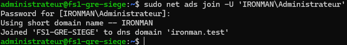
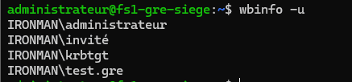
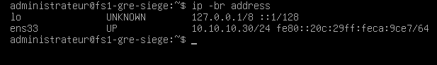
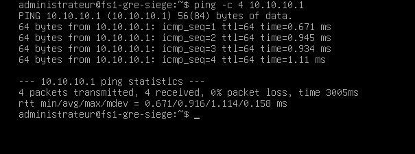
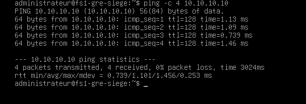
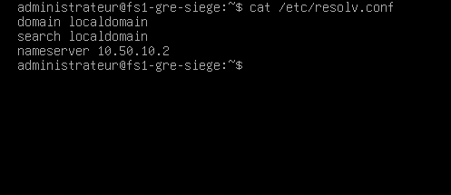
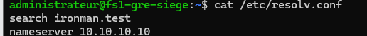
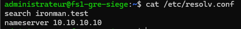

# ALPINA RETAIL — Épisode 05 : FS1, serveur de fichiers Debian Linux

> **Date du premier jalon :** 3 novembre 2026  
> **Statut au 05/11/2026 :** Debian 12 installé et mis à jour ; interface IPv4 statique raccordée à VMnet1 ; communication avec pfSense et DC1, résolution DNS interne et accès SSH après redémarrage vérifiés. **Samba/Winbind installés ; jonction au domaine et relation de confiance confirmées ; `wbinfo -u` retourne les utilisateurs IRONMAN après dépannage Winbind. Correspondance UID/GID et accès SMB non encore validés.**  
> **Périmètre :** laboratoire TSSR personnel, siège fictif de Grenoble. La société et ses utilisateurs sont simulés.

## Objectif métier

Mettre en place un serveur de fichiers Linux pour le siège d'ALPINA RETAIL, accessible à terme depuis des postes Windows via SMB/Samba, avec des droits organisés à l'aide de groupes du domaine Active Directory `ironman.test`. Cette configuration est **l'objectif**, pas un déploiement déjà fonctionnel.

**Évolution du cahier des charges :** le scénario initial de l'[épisode 02](../episode-02/README.md) envisageait un `FS1` sous Windows avec permissions NTFS. Le laboratoire met désormais en œuvre **Debian Linux + Samba** pour démontrer l'administration Linux et l'interopérabilité avec Active Directory. La conception des permissions et ACL sera adaptée et testée avant toute validation.

## 1. Paramètres de laboratoire

| Élément | Valeur / état |
|---|---|
| VM / nom d'hôte | `FS1-GRE-SIEGE` / `fs1-gre-siege` |
| Système observé | Debian GNU/Linux 12 (bookworm) |
| Noyau observé | `6.1.0-54-amd64` |
| Architecture observée | `x86-64` |
| Hyperviseur indiqué par Linux | VMware |
| Connexion locale | Compte de test local `administrateur`, connexion console réussie |
| Ressources ciblées lors de la création | 2 vCPU, 2 Go de RAM, disque virtuel de 40 Go — à recontrôler sur la VM recréée |
| Domaine DNS renseigné pendant l'installation | `ironman.test` (ne constitue **pas** une jonction au domaine Active Directory) |
| Réseau actuel | **VMnet1**, interface `ens33` **UP** avec IPv4 statique `10.10.10.30/24` (commande `ip -br address` observée le 05/11) |
| Réseau d'installation | VMnet8 (NAT), adresse DHCP provisoire `10.50.10.131/24`, abandonné après mises à jour et bascule sur VMnet1 |
| Routage / DNS configuré | Passerelle `10.10.10.1` (pfSense) ; DNS `10.10.10.10` (DC1) ; recherche `ironman.test`. La route par défaut n'a pas encore été relevée séparément. |
| SSH | Connexion distante `ssh administrateur@10.10.10.30` depuis Windows Server fonctionnelle et reprise après redémarrage, le 05/11 ; durcissement restant |
| Samba / intégration AD | Samba, Winbind et Kerberos installés ; `net ads join` réussi ; `net ads testjoin` → `Join is OK` (retour de l'auteur) ; **`wbinfo -u` liste les utilisateurs IRONMAN** après redémarrage Winbind ; UID/GID et partages à tester |

Les mots de passe et les identifiants de machine ne sont pas publiés.

## 2. Journal des manipulations validées

1. Première tentative d'installation de Debian 12 : une session GNOME a été observée. Cette VM a été supprimée à la demande de l'auteur pour reprendre de zéro.
2. Recréation de `FS1-GRE-SIEGE`, puis installation de Debian 12 en mode console. La sélection de logiciels demandée était **SSH + utilitaires usuels**, sans environnement de bureau. Le détail final des paquets installés reste à vérifier.
3. Démarrage de l'OS confirmé par la console `tty1` : `Debian GNU/Linux 12 fs1-gre-siege`.
4. Connexion locale confirmée : invite `administrateur@fs1-gre-siege:~$`.
5. Exécution de `hostnamectl` ; informations visibles dans la capture transmise :
   - `Static hostname: fs1-gre-siege`
   - `Operating System: Debian GNU/Linux 12 (bookworm)`
   - `Kernel: Linux 6.1.0-54-amd64`
   - `Architecture: x86-64`
   - `Virtualization: vmware`

**Preuves disponibles :** **10 captures d'écran authentiques du 05/11/2026 sont désormais déposées dans [`images/`](images/README.md)** pour documenter la configuration Linux, le LAN, les pings et le diagnostic DNS. La capture `hostnamectl` du 03/11/2026 a été fournie en conversation, mais n'est pas déposée sur GitHub. Les preuves visuelles sélectionnées sont des captures d'origine, sans reconstruction ni modification du texte.

## 3. Réseau et administration Linux — manipulations du 05/11/2026

### Préparation Debian sur VMnet8 (NAT)

- `ip -br address` : interface `ens33` UP, adresse `10.50.10.131/24` attribuée en DHCP.
- `ping -c 4 1.1.1.1` : **4 réponses sur 4**, 0 % de perte ; accès IPv4 externe vérifié.
- `getent hosts debian.org` : résolution DNS externe fonctionnelle (adresses IPv6 retournées).
- `apt update` lancé depuis `root` : listes de dépôts actualisées, **3 paquets** identifiés comme pouvant être mis à jour.
- `sudo` absent initialement : installation depuis `root` via `apt install sudo`, puis `usermod -aG sudo administrateur`. Appartenance au groupe `27(sudo)` vérifiée par `id administrateur`.
- Reconnexion utilisateur puis `sudo whoami` : résultat **`root`**, délégation validée.
- `sudo apt upgrade` exécuté et `apt list --upgradable` sans paquet restant proposé (selon retour de l'auteur).

### Passage sur le LAN du siège

- Sauvegarde préalable de `/etc/network/interfaces` dans `/etc/network/interfaces.bak`.
- Modification de l'interface `ens33` de `dhcp` vers `static` :
  - `address 10.10.10.30`
  - `netmask 255.255.255.0`
  - `gateway 10.10.10.1`
  - `dns-nameservers 10.10.10.10`
  - `dns-search ironman.test`
- VM arrêtée proprement, connexion virtuelle basculée de **VMnet8** à **VMnet1**, puis démarrage.
- `ip -br address` : `ens33 UP 10.10.10.30/24`.
- `ping -c 4 10.10.10.1` (pfSense) : 4/4 réponses, 0 % de perte, RTT moyenne **0,916 ms**.
- `ping -c 4 10.10.10.10` (DC1) : 4/4 réponses, 0 % de perte, RTT moyenne **1,101 ms**.
- Tentative de `Test-Connection` vers `10.10.10.30` **avant la bascule** : erreur `PingException` PowerShell et test `ping.exe` sans réponse ; ceci **ne prouve pas la disponibilité exclusive de l'adresse**. L'absence de conflit ARP/IP n'a pas fait l'objet d'un audit exhaustif.
- `ssh administrateur@10.10.10.30` depuis Windows Server : session distante fonctionnelle ; reconnexion fonctionnelle après redémarrage Debian.

### Incident DNS constaté et corrigé

**Symptôme :** après le passage VMnet1, `cat /etc/resolv.conf` affichait encore `domain localdomain`, `search localdomain` et `nameserver 10.50.10.2`, hérités de VMnet8, malgré la configuration `dns-nameservers` dans `/etc/network/interfaces`.

**Diagnostic :** `ls -l /etc/resolv.conf` confirme un fichier régulier appartenant à root, **pas un lien symbolique**. Les paramètres du fichier ne reflétaient pas la nouvelle configuration réseau.

**Correction réalisée :** édition manuelle de `/etc/resolv.conf` :

```text
search ironman.test
nameserver 10.10.10.10
```

**Contrôles effectués :**
- `cat /etc/resolv.conf` : les deux nouvelles lignes sont présentes.
- `getent ahostsv4 dc1-gre-siege.ironman.test` : retourne **`10.10.10.10`** pour STREAM/DGRAM/RAW.
- Redémarrage via `sudo reboot`, puis nouvelle connexion SSH depuis Windows Server : réussi.
- Après redémarrage, `cat /etc/resolv.conf` montre toujours `search ironman.test` et `nameserver 10.10.10.10` : **persistance confirmée pour ce redémarrage**.

**Limites :** la conservation du fichier après un redémarrage ne garantit pas qu'un futur service de gestion DNS ne le remplacera jamais. La route par défaut et les enregistrements SRV LDAP/Kerberos ont été vérifiés ultérieurement. La jonction Samba a également réussi (voir la section suivante), mais les accès aux partages et l'authentification AD restent à tester.

## 4. Préparation du domaine et première jonction Samba — 05/11/2026

- Route par défaut relevée : `default via 10.10.10.1 dev ens33 onlink`.
- Depuis le LAN, `ping -c 4 1.1.1.1` : 4 réponses, 0 % de perte ; `getent ahostsv4 debian.org` : résolution externe OK.
- DNS SRV depuis FS1 vers DC1 : LDAP `_ldap._tcp.dc._msdcs.ironman.test` → `0 100 389 dc1-gre-siege.ironman.test.` ; Kerberos `_kerberos._tcp.ironman.test` → `0 100 88 dc1-gre-siege.ironman.test.`
- Horloge Debian synchronisée, NTP actif selon `timedatectl status`. Sur DC1, `w32tm /query /status` affiche `Local CMOS Clock` : référence NTP à améliorer. Comparaison quasi simultanée des deux horloges par SSH : aucun écart important visible.
- FQDN Debian `hostname -f` : `fs1-gre-siege.ironman.test`. Une première requête DNS A vers DC1 n'a retourné aucune réponse ; un enregistrement A `fs1-gre-siege` → `10.10.10.30` a été ajouté dans la console DNS Windows, avec demande de PTR. Contrôle DNS après ajout encore à réaliser.
- Installation réussie des composants `samba winbind libnss-winbind libpam-winbind krb5-user smbclient`.
- Royaume Kerberos déclaré `IRONMAN.TEST` (`default_realm`) selon retour de l'auteur.
- Sauvegarde préalable de `/etc/samba/smb.conf` dans `/etc/samba/smb.conf.bak`.
- Configuration Samba : `workgroup = IRONMAN`, `server role = member server`, `security = ADS`, `realm = IRONMAN.TEST`, backend idmap par défaut `tdb` / plage 3000–7999, idmap `IRONMAN` en `rid` / plage 10000–999999. `testparm -s` a affiché ces paramètres.
- Accès invités ensuite désactivés par `map to guest = Never` et `usershare allow guests = no` (contrôle `testparm` final encore à réaliser).

### Jonction au domaine : résultat constaté

Commande exécutée en SSH, mot de passe du compte AD non publié :

```bash
sudo net ads join -U 'IRONMAN\Administrateur'
```

Résultat :

```text
Using short domain name -- IRONMAN
Joined 'FS1-GRE-SIEGE' to dns domain 'ironman.test'
```



**Statut exact :** Samba confirme que la jonction au domaine a réussi. Les tests de confiance `net ads testjoin`, de résolution des identités Winbind et d'accès SMB depuis Windows 11 sont encore à réaliser.

### Incident Winbind — diagnostic, correction et vérification (05/11/2026)

1. `wbinfo -u` affiche `Error looking up domain users`.
2. `wbinfo --ping-dc` échoue en recherchant le domaine `WORKGROUP` avec `WBC_ERR_DOMAIN_NOT_FOUND`. `wbinfo --own-domain` retourne également `WORKGROUP`, alors que `smb.conf` déclare `IRONMAN`.
3. Hypothèse : configuration encore chargée dans le service Winbind.
4. `sudo systemctl restart winbind` exécuté. `wbinfo --own-domain` retourne ensuite `IRONMAN` (confirmé par l'auteur).
5. Nouveau `wbinfo -u` réussi : liste des comptes `IRONMAN\\administrateur`, `IRONMAN\\invité`, `IRONMAN\\krbtgt` et `IRONMAN\\test.gre`.



**Résultat :** Winbind énumère désormais les comptes Active Directory. La présence de comptes dans la liste ne prouve pas encore la résolution UID/GID par NSS ni les droits d'accès aux fichiers Samba.

## 5. Prochains tests

- [x] Relever `ens33` et l'adresse IP statique avec `ip -br address`.
- [x] Actualiser les listes APT, effectuer la mise à jour des paquets et configurer `sudo` pour l'utilisateur local.
- [x] Raccorder FS1 au réseau LAN `VMnet1` et configurer `10.10.10.30/24` en dehors de l'étendue DHCP.
- [x] Tester la connectivité ICMP vers pfSense (`10.10.10.1`) et DC1 (`10.10.10.10`).
- [x] Corriger la configuration DNS, résoudre le nom de DC1 et confirmer que `/etc/resolv.conf` conserve les réglages après un redémarrage.
- [x] Se connecter en SSH depuis Windows Server et se reconnecter après redémarrage.
- [x] Vérifier la route par défaut et les enregistrements DNS SRV LDAP/Kerberos.
- [ ] Contrôler l'absence de conflit d'adresse IP et revalider les enregistrements A/PTR de FS1.
- [ ] Vérifier les ressources réelles de la VM après sa recréation.
- [ ] Vérifier et durcir le service SSH.
- [x] Installer Samba/Winbind/Kerberos, préparer la configuration de serveur membre et réaliser la jonction ADS de FS1.
- [x] Vérifier le canal de confiance avec `net ads testjoin` (`Join is OK`, selon retour de l'auteur) et résoudre l'incident Winbind `WORKGROUP` → `IRONMAN`.
- [x] Récupérer les utilisateurs AD avec `wbinfo -u`.
- [ ] Vérifier `testparm` après les derniers réglages et les identités POSIX UID/GID via NSS.
- [ ] Concevoir les partages Samba et les ACL, puis tester l'authentification et les accès depuis Windows 11.
- [x] Déposer **12 captures d'écran authentiques** sélectionnées du 05/11/2026 dans [images/README.md](images/README.md), sans secret d'authentification.

## 6. Preuves visuelles authentiques

**[Consulter les 12 captures Linux, réseau, DNS et AD](images/README.md)** — toutes fournies par l'auteur lors des manipulations du **05/11/2026**.

### Réseau de FS1 et communication avec le siège







### Diagnostic DNS — avant, correction et après redémarrage







### Intégration Samba à Active Directory


**Limite des preuves :** la jonction ADS, le test de confiance et l'énumération des utilisateurs Winbind sont validés. La correspondance UID/GID via NSS et les accès SMB restent à tester.

## Méthode

**Besoin → configuration → vérification → diagnostic → preuves → documentation.**

Aucun partage SMB ni accès AD n'est annoncé comme opérationnel à ce stade.

[Retour au README principal](../../README.md) · [Cahier des charges initial](../episode-02/README.md) · [Épisode 04 — Windows Server et AD](../episode-04/README.md)
