# Épisode 05 — Captures authentiques Debian / Réseau / DNS / Active Directory / Samba

**Dates des manipulations : 05 et 09 novembre 2026.** Les vingt-deux fichiers PNG de ce dossier sont des **captures authentiques issues des manipulations**, sans génération ni simulation graphique. Certaines ont été recadrées et compressées sans changer le contenu technique. Elles servent de preuves associées au [journal technique de l'épisode 05](../README.md).

Le projet est fictif. Les noms des hôtes et les IP visibles appartiennent au laboratoire ; aucune capture de mot de passe ni de jeton d'accès n'est publiée.

| Fichier | Contrôle réalisé |
|---|---|
| [01-fs1-ip-statique.png](01-fs1-ip-statique.png) | `ip -br address` : interface ens33 UP, adresse 10.10.10.30/24 |
| [02-connectivite-pfsense.png](02-connectivite-pfsense.png) | `ping -c 4 10.10.10.1` : 4 réponses, 0 % de perte |
| [03-connectivite-dc1.png](03-connectivite-dc1.png) | `ping -c 4 10.10.10.10` : 4 réponses, 0 % de perte |
| [04-dns-ancien-resolv-conf.png](04-dns-ancien-resolv-conf.png) | Ancien `nameserver 10.50.10.2` et `localdomain` dans `/etc/resolv.conf` |
| [05-dns-resolv-conf-corrige.png](05-dns-resolv-conf-corrige.png) | `search ironman.test` et `nameserver 10.10.10.10` |
| [06-dns-resolution-dc1.png](06-dns-resolution-dc1.png) | `getent ahostsv4 dc1-gre-siege.ironman.test` → `10.10.10.10` |
| [07-dns-persistant-apres-redemarrage.png](07-dns-persistant-apres-redemarrage.png) | Même configuration `/etc/resolv.conf` conservée après `sudo reboot` et reconnexion SSH |
| [08-interfaces-ip-statique.png](08-interfaces-ip-statique.png) | `/etc/network/interfaces` : adresse, masque, passerelle et DNS cible |
| [09-sudo-groupe-admin.png](09-sudo-groupe-admin.png) | `id administrateur` : appartenance au groupe sudo |
| [10-reseau-nat-provisoire.png](10-reseau-nat-provisoire.png) | `ens33` UP avec IPv4 DHCP 10.50.10.131/24 sur VMnet8 |
| [11-jonction-domaine-ads.png](11-jonction-domaine-ads.png) | Commande `net ads join` : jonction de FS1 au domaine `ironman.test` confirmée |
| [12-winbind-utilisateurs-ad.png](12-winbind-utilisateurs-ad.png) | `wbinfo -u` : utilisateurs IRONMAN récupérés après dépannage Winbind |

| [13-winbind-domaine-workgroup.png](13-winbind-domaine-workgroup.png) | Ancien domaine WORKGROUP reconnu par Winbind avant rechargement |
| [14-nss-utilisateur-ad.png](14-nss-utilisateur-ad.png) | Compte AD test.gre résolu en UID 11108 / GID 10513 |
| [15-creation-groupe-ad.png](15-creation-groupe-ad.png) | Groupe de sécurité global GG_FS1_COMMUN_RW dans Active Directory |
| [16-utilisateur-membre-groupe-ad.png](16-utilisateur-membre-groupe-ad.png) | Utilisateur fictif Test Grenoble membre du groupe AD |
| [17-nss-groupe-ad.png](17-nss-groupe-ad.png) | Groupe AD reconnu par Debian avec GID 11110 |
| [18-permissions-sgid-commun.png](18-permissions-sgid-commun.png) | Droits drwxrws--- (2770) et groupe AD sur /srv/samba/commun |
| [19-testparm-partage-commun.png](19-testparm-partage-commun.png) | Configuration interprétée de la section Samba [COMMUN] |
| [20-acces-partage-depuis-windows11.png](20-acces-partage-depuis-windows11.png) | Explorateur Windows 11 ouvre le partage SMB de FS1 (dossier vide) |
| [21-permissions-fichier-samba.png](21-permissions-fichier-samba.png) | Fichier créé depuis Windows 11 : propriétaire AD, groupe AD, droits `660` ; taille `0` avant enregistrement |
| [22-refus-acces-groupe-non-autorise.png](22-refus-acces-groupe-non-autorise.png) | `smbclient` avec le compte `IRONMAN\Administrateur` : `NT_STATUS_ACCESS_DENIED` |

## Captures essentielles

### Interface et IP statique

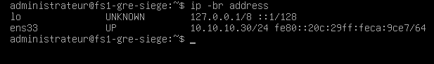

### Test de communication avec pfSense

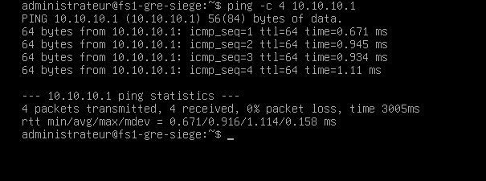

### Test de communication avec DC1

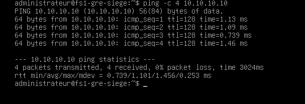

### Incident DNS : ancienne configuration héritée de VMnet8

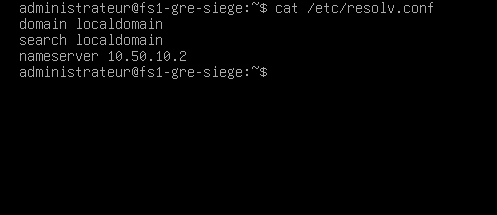

### DNS corrigé vers Active Directory

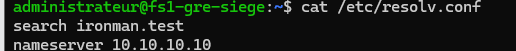

### Résolution du nom du contrôleur de domaine

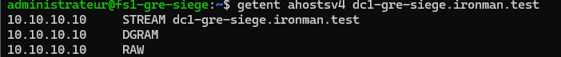

### DNS conservé après redémarrage Debian

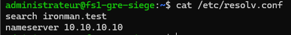

### Première jonction au domaine Active Directory

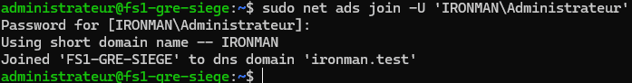

### Utilisateurs Active Directory reconnus par Winbind

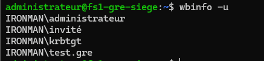

### Groupe AD, permissions Linux et partage Windows 11

**Compte AD test.gre résolu en UID 11108 / GID 10513**

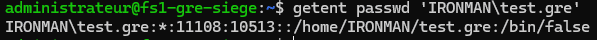

**Groupe de sécurité global GG_FS1_COMMUN_RW dans Active Directory**

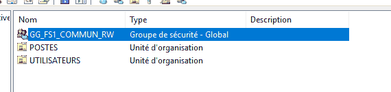

**Utilisateur fictif Test Grenoble membre du groupe AD**

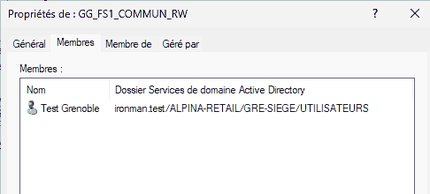

**Groupe AD reconnu par Debian avec GID 11110**

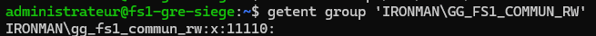

**Droits drwxrws--- (2770) et groupe AD sur /srv/samba/commun**

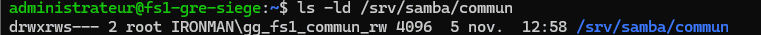

**Configuration interprétée de la section Samba [COMMUN]**

![Configuration interprétée de la section Samba [COMMUN]](19-testparm-partage-commun.png)

**Explorateur Windows 11 ouvre le partage SMB de FS1 (dossier vide)**

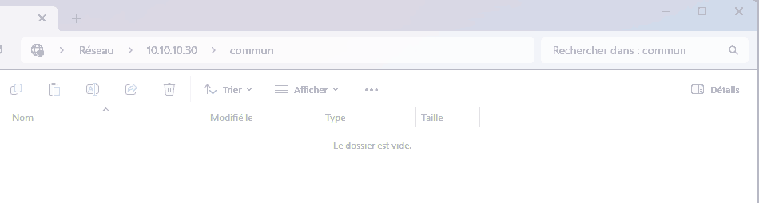

### Validation des droits d'écriture et de refus (09 novembre 2026)

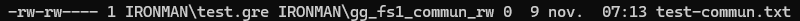

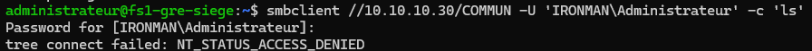

**Précautions d'interprétation :** ces contrôles attestent une configuration réseau et une résolution de nom au moment des tests, pas la disponibilité des services AD/Kerberos, un contrôle exhaustif des conflits d'adresses, ni une validation de sécurité exhaustive. La création et lecture du contenu sont confirmées par l'auteur ; la capture de permissions montre le fichier encore vide avant enregistrement, et celle de `smbclient` prouve le refus de connexion pour le compte testé. La jonction AD, le test de confiance et l'énumération Winbind ont été réalisés. La connexion SSH a été observée en session, mais aucun audit de sécurisation SSH n'a encore été effectué.

[Retour à l'épisode 05](../README.md)
