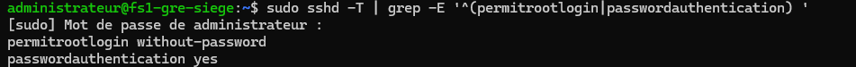
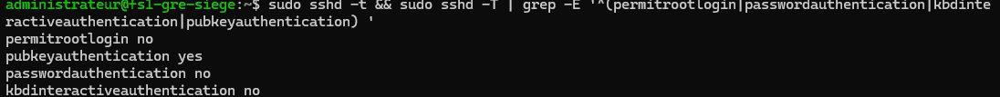

# ALPINA RETAIL — Épisode 06 : durcissement de l'infrastructure du siège

> **Ouverture du chantier :** 09 novembre 2026  
> **Statut :** durcissement SSH de `FS1-GRE-SIEGE` terminé et testé ; sécurisation de Samba, de Windows Server et du pare-feu à poursuivre.  
> **Périmètre :** laboratoire de l'entreprise fictive ALPINA RETAIL, siège de Grenoble.

## Besoin métier

Le serveur de fichiers Debian 12 (`10.10.10.30`) est déjà opérationnel et joint au domaine `ironman.test`, avec un partage Samba `COMMUN` documenté dans [l'épisode 05](../episode-05/README.md). L'administration à distance SSH doit être protégée contre l'utilisation d'un mot de passe ou la connexion directe du compte `root`.

Objectif du premier jalon : **conserver l'accès distant pour l'administrateur via une clé privée protégée, tout en supprimant les accès SSH par mot de passe et par root**.

## 1. État initial observé

Dans une session SSH connectée sur `FS1-GRE-SIEGE` :

```bash
sudo sshd -T | grep -E '^(permitrootlogin|passwordauthentication) '
```

Résultat :

```text
permitrootlogin without-password
passwordauthentication yes
```

Le compte `root` n'était pas autorisé par mot de passe mais pouvait encore être authentifié par une autre méthode, notamment une clé publique ; les mots de passe SSH étaient acceptés pour d'autres comptes.



## 2. Configuration du service OpenSSH sur Debian

Fichier dédié : `/etc/ssh/sshd_config.d/00-alpina-ssh.conf`.

```text
PermitRootLogin no
PasswordAuthentication no
KbdInteractiveAuthentication no
```

- `PermitRootLogin no` : interdit toute connexion SSH directe en tant que `root`.
- `PasswordAuthentication no` et `KbdInteractiveAuthentication no` : désactivent les deux méthodes de connexion SSH fondées sur le mot de passe dans ce scénario.
- `PubkeyAuthentication yes` est resté activé dans la configuration effective.

Une commande `sudo sshd -t` a contrôlé la syntaxe avant chaque rechargement.

## 3. Clé ED25519 et droits d'accès

Sur `DC1-GRE-SIEGE` (PowerShell), une paire de clés ED25519 dédiée à FS1 a été créée dans le profil de l'administrateur Windows.

- **Clé privée :** conservée sur DC1 ; **jamais publiée** dans ce dépôt.
- **Clé publique :** copiée dans `~/.ssh/authorized_keys` pour le compte Debian `administrateur`.
- Droits préparés avec `umask 077` et `chmod 600 ~/.ssh/authorized_keys`.
- La clé privée a été protégée par une **passphrase**, non stockée sur GitHub.
- Un premier essai n'avait pas trouvé le fichier `.pub` dans le profil Windows ; la paire a été régénérée au bon emplacement avant de poursuivre.

**Précaution :** la seule copie connue de la clé privée est sur DC1. Prévoir une conservation sécurisée et une procédure de récupération avant d'en dépendre pour un service de production ; la console VMware reste l'accès local de secours du laboratoire.

## 4. Validation de la configuration et de l'accès

Configuration effective vérifiée avec :

```bash
sudo sshd -t && sudo sshd -T | grep -E '^(permitrootlogin|passwordauthentication|kbdinteractiveauthentication|pubkeyauthentication) '
```

Sortie observée :

```text
permitrootlogin no
pubkeyauthentication yes
passwordauthentication no
kbdinteractiveauthentication no
```



La configuration a été appliquée avec `sudo systemctl reload ssh`.

**Contrôle fonctionnel final :** depuis une **nouvelle** fenêtre PowerShell de DC1, l'auteur a établi une nouvelle session sur FS1 avec la clé privée ED25519 et une passphrase ; la connexion a réussi **après** le rechargement. L'ancienne session SSH était restée ouverte comme précaution.

**Conclusion :** la configuration SSH est valide et la connexion distante par clé fonctionne ; cela ne constitue pas un audit exhaustif du système (ACL de clés, journalisation, mises à jour, règles de filtrage SSH, rotation des clés et PRA restent hors périmètre de ce jalon).

## 5. Prochaines tâches

- [x] Empêcher la connexion SSH directe de `root`.
- [x] Mettre en place une paire ED25519 dédiée, protégée par une passphrase.
- [x] Ajouter la clé publique au compte de gestion Debian et confirmer l'authentification par clé.
- [x] Désactiver les connexions par mot de passe et par clavier interactif.
- [x] Vérifier `sshd -t` et les valeurs effectives de `sshd -T`, recharger SSH puis **réussir une nouvelle connexion**.
- [ ] Contrôler les principaux paramètres de sécurité Samba/SMB du serveur de fichiers.
- [ ] Poursuivre la sécurisation de Windows Server, d'Active Directory et de pfSense.
- [ ] Préparer le chantier de sauvegarde et de restauration.

## Preuves

[Consulter les deux captures authentiques avant/après SSH](images/README.md).

**Méthode appliquée :** modification → contrôle indispensable → test fonctionnel → documentation. Pas de séries de commandes redondantes.

[Retour au README principal](../../README.md) · [Épisode 05 — Samba et partage de fichiers](../episode-05/README.md)
