# ALPINA RETAIL — Épisode 06 : durcissement de l'infrastructure du siège

> **Ouverture du chantier :** 09 novembre 2026  
> **Statut :** SSH et Samba renforcés sur FS1 ; profil de pare-feu de domaine de DC1 vérifié et politique de mots de passe AD renforcée (09/11/2026). Autres paramètres de Windows Server et pfSense à poursuivre.  
> **Périmètre :** laboratoire de l'entreprise fictive ALPINA RETAIL, siège de Grenoble.

## Besoin métier

Le serveur de fichiers Debian 12 (`10.10.10.30`) est déjà opérationnel et joint au domaine `ironman.test`, avec un partage Samba `COMMUN` documenté dans [l'épisode 05](../episode-05/README.md). L'administration à distance SSH doit être protégée contre l'utilisation d'un mot de passe ou la connexion directe du compte `root`.

Objectif du premier jalon : **conserver l'accès distant pour l'administrateur via une clé privée protégée, tout en supprimant les accès SSH par mot de passe et par root**.

## 1. État initial observé

Dans une session SSH connectée sur `FS1-GRE-SIEGE` :

```bash
sudo sshd -T | grep -E '^(permitrootlogin|passwordauthentication) '
```

Résultat :

```text
permitrootlogin without-password
passwordauthentication yes
```

Le compte `root` n'était pas autorisé par mot de passe mais pouvait encore être authentifié par une autre méthode, notamment une clé publique ; les mots de passe SSH étaient acceptés pour d'autres comptes.


## 2. Configuration du service OpenSSH sur Debian

Fichier dédié : `/etc/ssh/sshd_config.d/00-alpina-ssh.conf`.

```text
PermitRootLogin no
PasswordAuthentication no
KbdInteractiveAuthentication no
```

- `PermitRootLogin no` : interdit toute connexion SSH directe en tant que `root`.
- `PasswordAuthentication no` et `KbdInteractiveAuthentication no` : désactivent les deux méthodes de connexion SSH fondées sur le mot de passe dans ce scénario.
- `PubkeyAuthentication yes` est resté activé dans la configuration effective.

Une commande `sudo sshd -t` a contrôlé la syntaxe avant chaque rechargement.

## 3. Clé ED25519 et droits d'accès

Sur `DC1-GRE-SIEGE` (PowerShell), une paire de clés ED25519 dédiée à FS1 a été créée dans le profil de l'administrateur Windows.

- **Clé privée :** conservée sur DC1 ; **jamais publiée** dans ce dépôt.
- **Clé publique :** copiée dans `~/.ssh/authorized_keys` pour le compte Debian `administrateur`.
- Droits préparés avec `umask 077` et `chmod 600 ~/.ssh/authorized_keys`.
- La clé privée a été protégée par une **passphrase**, non stockée sur GitHub.
- Un premier essai n'avait pas trouvé le fichier `.pub` dans le profil Windows ; la paire a été régénérée au bon emplacement avant de poursuivre.

**Précaution :** la seule copie connue de la clé privée est sur DC1. Prévoir une conservation sécurisée et une procédure de récupération avant d'en dépendre pour un service de production ; la console VMware reste l'accès local de secours du laboratoire.

## 4. Validation de la configuration et de l'accès

Configuration effective vérifiée avec :

```bash
sudo sshd -t && sudo sshd -T | grep -E '^(permitrootlogin|passwordauthentication|kbdinteractiveauthentication|pubkeyauthentication) '
```

Sortie observée :

```text
permitrootlogin no
pubkeyauthentication yes
passwordauthentication no
kbdinteractiveauthentication no
```


La configuration a été appliquée avec `sudo systemctl reload ssh`.

**Contrôle fonctionnel final :** depuis une **nouvelle** fenêtre PowerShell de DC1, l'auteur a établi une nouvelle session sur FS1 avec la clé privée ED25519 et une passphrase ; la connexion a réussi **après** le rechargement. L'ancienne session SSH était restée ouverte comme précaution.

**Conclusion :** la configuration SSH est valide et la connexion distante par clé fonctionne ; cela ne constitue pas un audit exhaustif du système (ACL de clés, journalisation, mises à jour, règles de filtrage SSH, rotation des clés et PRA restent hors périmètre de ce jalon).

## 5. Durcissement Samba et vérification SMB 3.1.1

### Configuration avant modification

Sur FS1, la configuration interprétée par `testparm -sv` indiquait :

```text
map to guest = Never
server min protocol = SMB2_02
server signing = default
```

**Interprétation :** pas de basculement automatique en invité, SMB1 déjà exclu, mais signature serveur pas systématiquement requise.

### Paramètres appliqués sur FS1

Dans la section `[global]` de `/etc/samba/smb.conf`, l'auteur a défini :

```ini
server signing = mandatory
usershare allow guests = no
```

Dans la section `[COMMUN]` :

```ini
server smb encrypt = required
```

Une sauvegarde préalable du fichier a été conservée localement sous `/etc/samba/smb.conf.bak-securite`.

`testparm -s` a interprété `server signing = required` et `server smb encrypt = required`. Le résultat de `testparm -s >/dev/null && systemctl restart smbd` confirme « Loaded services file OK » et « ROLE_DOMAIN_MEMBER ». Le diagnostic mentionne aussi `Weak crypto is allowed by GnuTLS` : c'est un avertissement de compatibilité qui ne prouve pas une exploitation de cryptographie faible dans la connexion SMB 3.1.1 testée ; il pourra être revu lors du durcissement complémentaire.

**Attention aux captures :** la capture de la section `[global]` ci-dessous précède la correction de `usershare allow guests` à `no` : elle montre encore `Yes`. Le changement a été ensuite effectué et la configuration rechargée, mais une nouvelle capture de ce seul paramètre n'a pas été fournie.

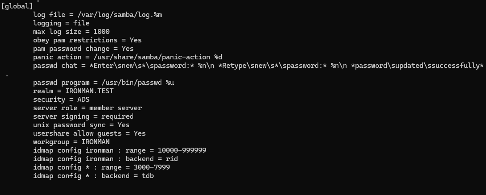

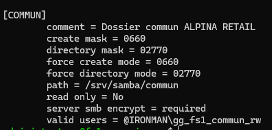

### Recette côté Windows 11

Sur `PC-TEST-GRE`, le fichier `test-commun.txt` s'ouvre toujours dans `\\10.10.10.30\COMMUN` après le redémarrage du service Samba.

Depuis PowerShell **exécuté en administrateur**, l'utilisateur a relevé la session avec `Get-SmbConnection | Select-Object ServerName, ShareName, Dialect, Signed, Encrypted` :

```text
ServerName : 10.10.10.30
ShareName  : COMMUN
Dialect    : 3.1.1
Signed     : False
Encrypted  : True
```

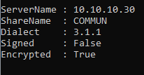

**Interprétation de `Signed=False` :** avec le chiffrement SMB3 requis et actif, le trafic n'utilise pas nécessairement la signature SMB distincte. Le chiffrement SMB fournit lui-même les garanties d'intégrité attendues ; ce résultat n'invalide pas le test. Cette particularité est documentée par Microsoft : https://github.com/MicrosoftDocs/SupportArticles-docs/blob/main/support/windows-server/networking/reduced-performance-after-smb-encryption-signing.md.

### Conclusion du jalon

**Validé :** connexion de Windows 11 au partage, négociation SMB 3.1.1 et chiffrement réellement observé par le client ; la signature obligatoire est configurée dans Samba. Aucune modification supplémentaire n'est nécessaire pour conclure ce test ciblé.

**À poursuivre :** politiques de sécurité Windows Server et contrôles du pare-feu pfSense ; ces sujets constituent des chantiers distincts.


## 6. Sécurisation de DC1 : pare-feu et comptes Active Directory

### Pare-feu Windows Defender — profil Domaine

Sur `DC1-GRE-SIEGE` (Windows Server 2025), les trois profils du pare-feu sont indiqués **activés** via `Get-NetFirewallProfile`. Les champs `DefaultInboundAction` ressortent `NotConfigured` dans cette commande ; cette seule valeur ne signifie pas que toutes les connexions entrantes sont permises.

La commande suivante a montré la politique active du **profil de domaine** :

```powershell
netsh advfirewall show currentprofile
```

Résumé des résultats :

```text
Profil de domaine
État : Actif
Stratégie de pare-feu : BlockInbound,AllowOutbound
LogAllowedConnections : Désactiver
LogDroppedConnections : Désactiver
```

La politique autorise les connexions sortantes par défaut et bloque les entrantes non couvertes par une règle d'autorisation. Aucune modification n'a été requise. La journalisation des connexions bloquées est désactivée : à reconsidérer au besoin pour le diagnostic.

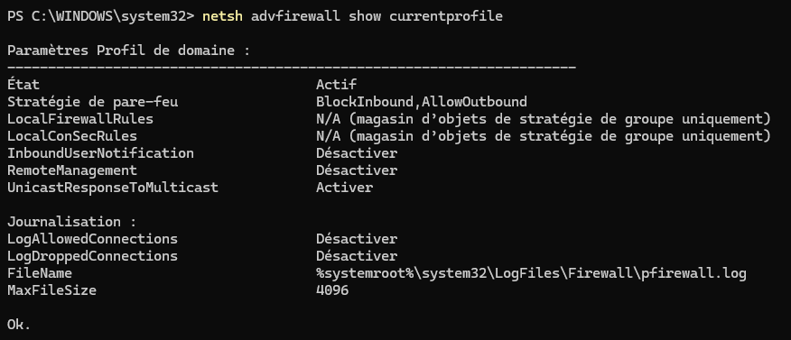

### Politique de mot de passe avant durcissement

Commande :

```powershell
Get-ADDefaultDomainPasswordPolicy | Select-Object MinPasswordLength, ComplexityEnabled, LockoutThreshold, LockoutDuration, MaxPasswordAge
```

Résultat observé :

| Paramètre | Avant |
|---|---|
| Longueur minimale | 7 |
| Complexité | `True` |
| Seuil de verrouillage | 0 (désactivé) |
| Durée de verrouillage | 10 min (sans effet puisque seuil à 0) |
| Durée maximale du mot de passe | 42 jours |

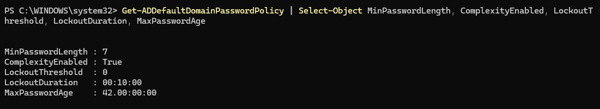

### Renforcement et validation

Modification effectuée depuis PowerShell administrateur sur DC1 :

```powershell
Set-ADDefaultDomainPasswordPolicy -Identity "ironman.test" -MinPasswordLength 14 -LockoutThreshold 10 -LockoutDuration "00:15:00" -LockoutObservationWindow "00:15:00"
```

Commande de vérification :

```powershell
Get-ADDefaultDomainPasswordPolicy | Select-Object MinPasswordLength, ComplexityEnabled, LockoutThreshold, LockoutDuration, LockoutObservationWindow
```

Paramètres **vérifiés sur capture le 09/11/2026** :

| Paramètre | Après |
|---|---|
| `MinPasswordLength` | **14** |
| `ComplexityEnabled` | **True** |
| `LockoutThreshold` | **10** |
| `LockoutDuration` | **00:15:00** |
| `LockoutObservationWindow` | **00:15:00** |

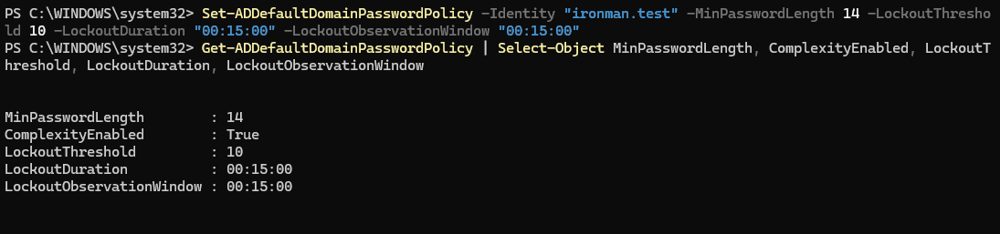

**Interprétation :** les nouveaux mots de passe devront respecter les règles du domaine. Les comptes répondant à cette politique peuvent être verrouillés après dix échecs dans la fenêtre prévue. Les mots de passe existants n'ont pas été changés automatiquement par cette commande. La durée maximale de 42 jours n'a pas été modifiée à ce stade.

**Limite :** la capture prouve la configuration de la politique AD par défaut, mais pas un test réel de verrouillage de compte ou l'absence de politiques de mot de passe fines (FGPP) pouvant prendre le pas pour certains utilisateurs. La connexion et l'utilisation des principaux services AD/DNS/DHCP ne sont pas de nouveau testées ici, conformément au principe d'éviter les contrôles répétitifs.


## 7. Sécurisation réseau pfSense, NTP et diagnostic DNS

### 7.1 Architecture et règles pfSense — 10 novembre 2026

- Pare-feu `pfSense-GRE-SIEGE` : LAN `10.10.10.1`, WAN `10.50.10.128` sur VMware NAT (VMnet8).
- WAN privé : option `Block private networks and loopback addresses` désactivée pour le WAN sur adresse RFC 1918, `Block bogon networks` conservée. Pas de règle d'autorisation WAN explicite visible lors du contrôle.
- SSH pfSense désactivé après rétablissement de l'accès Web ; accès HTTPS conservé.
- Sauvegarde XML complète chiffrée téléchargée par l'auteur, **non publiée** dans ce dépôt (document sensible).
- Alias `ALPINA_DC1` → `10.10.10.10` ; alias `ALPINA_WEB_PORTS` → `80`, `443`.
- Sur LAN, de haut en bas : autorisation NTP `UDP/123` depuis DC1 ; autorisation DNS `TCP/UDP 53` depuis DC1 ; blocage DNS classique `TCP/UDP 53` depuis `LAN subnets` ; autorisation Web `TCP 80/443` depuis `LAN subnets` ; règle générale IPv4 `Default allow LAN to any` encore **active** ; règle IPv6 par défaut **désactivée**.
- L'ordre est essentiel : l'autorisation DNS DC1 doit être **au-dessus** du blocage DNS visant le LAN.

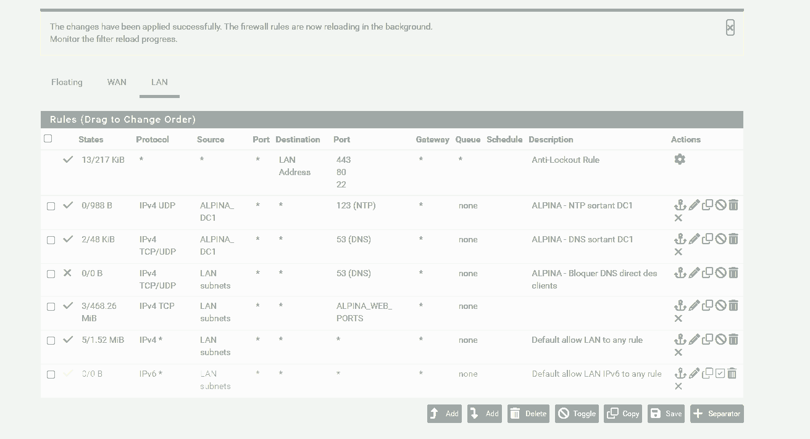

**Portée et limites :** les règles filtrent les paquets traversant pfSense. Les communications entre postes du même sous-réseau, comme PC-TEST et DC1, ne passent normalement pas par lui. Le blocage DNS classique ne couvre pas le DNS over HTTPS ou des méthodes de contournement. **La règle générale IPv4 reste permissive** ; la politique « deny by default » du LAN n'est pas encore atteinte. La règle de blocage DNS externe pour les clients devra encore faire l'objet d'un test négatif dédié.

### 7.2 Référence horaire du domaine

- `Get-ADDomain | Select-Object PDCEmulator` a identifié `DC1-GRE-SIEGE.ironman.test` comme titulaire du rôle PDC Emulator.
- `w32tm /query /source` retournait `Local CMOS Clock`.
- Le service Windows Time a été configuré sur DC1 avec trois pairs `0.fr.pool.ntp.org`, `1.fr.pool.ntp.org`, `2.fr.pool.ntp.org` en mode client (`0x8`) et `/reliable:yes`.
- `w32tm /resync /rediscover` a réussi ; `w32tm /query /source` a ensuite retourné `0.fr.pool.ntp.org,0x8`.
- Une règle pfSense autorise explicitement la sortie de `ALPINA_DC1` en `UDP/123`.

**Contrôle effectué :** la nouvelle source est identifiée ; cette observation ne suffit pas à elle seule à auditer la précision horaire ni la synchronisation de tous les postes du domaine.

### 7.3 Incident : résolution DNS externe impossible depuis DC1

**Symptôme :** `nslookup www.microsoft.com` lancé sur PC-TEST vers `10.10.10.10` échouait par dépassement du délai d'attente. Le même échec était observé directement sur DC1.

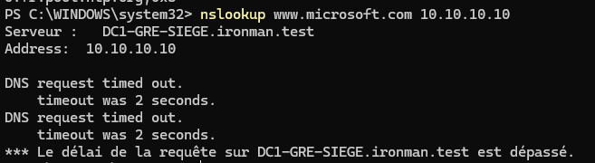

**Diagnostic successif :**

1. `nslookup dc1-gre-siege.ironman.test 10.10.10.10` fonctionnait : le service DNS interne et l'enregistrement de DC1 répondaient.
2. `Get-DnsServerForwarder | Format-List IPAddress,UseRootHint,Timeout` montrait **aucun redirecteur**, `UseRootHint=True`, `Timeout=3`.
3. `nslookup www.microsoft.com 1.1.1.1` échouait ; `Test-NetConnection 1.1.1.1 -Port 53` indiquait l'échec TCP/53.
4. `Test-NetConnection 1.1.1.1 -Port 443` indiquait `TcpTestSucceeded : True` : la connectivité sortante n'était pas intégralement coupée.
5. `nslookup www.microsoft.com 10.50.10.2` échouait également depuis DC1.
6. **pfSense**, depuis `Diagnostics > DNS Lookup`, résolvait `www.microsoft.com` : une adresse IPv4 était reçue, et le serveur amont `10.50.10.2` répondait en 7 ms.
7. `nslookup www.microsoft.com 10.10.10.1` depuis DC1 **réussissait**, établissant un chemin de résolution fonctionnel via le résolveur pfSense.

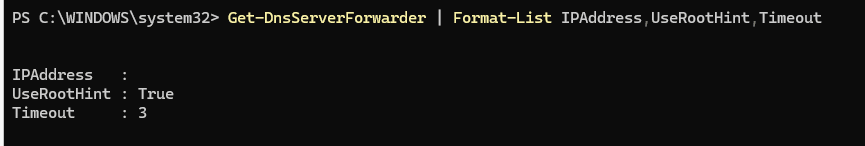

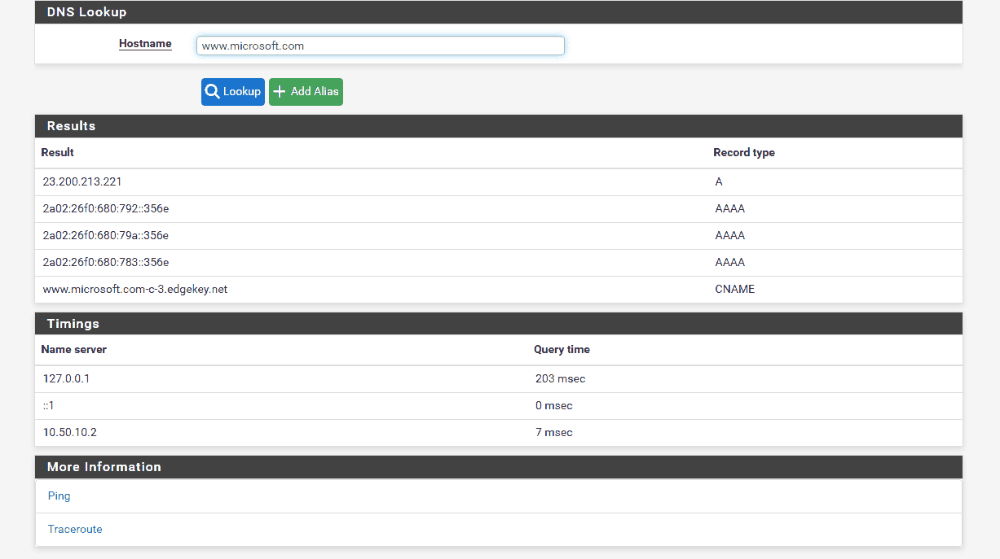

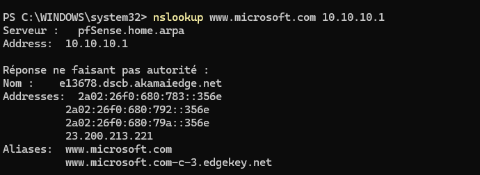

### 7.4 Correctif appliqué et validation de bout en bout

Sur DC1, dans PowerShell administrateur :

```powershell
Add-DnsServerForwarder -IPAddress 10.10.10.1
```

Cette modification fait de pfSense un **redirecteur DNS externe** pour DC1, tout en conservant le service DNS du contrôleur de domaine pour `ironman.test`. Elle a été acceptée sans erreur.

**Vérifications positives :**

- Depuis **DC1** : `nslookup www.microsoft.com 10.10.10.10` a renvoyé des adresses, dont `23.200.213.221`.
- Depuis **PC-TEST-GRE** : `nslookup www.microsoft.com` a utilisé `DC1-GRE-SIEGE.ironman.test` (`10.10.10.10`) et renvoyé des adresses IPv4/IPv6 sans délai d'attente.

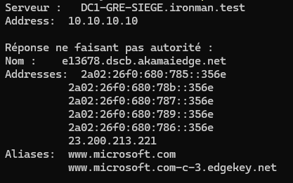

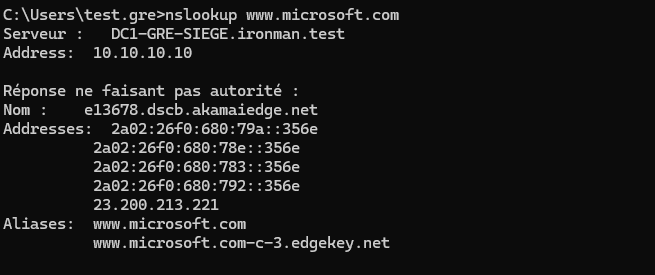

**Conclusion :** incident de résolution externe **résolu dans le laboratoire** grâce au chemin `PC-TEST → DC1 → pfSense → DNS en amont`. Le mécanisme précis empêchant les requêtes directes aux serveurs externes avant le correctif **n'a pas été démontré** : ne pas attribuer sans preuve la panne à une règle pfSense, à VMware NAT ou aux serveurs racines. La configuration actuelle fonctionne, mais ne constitue pas encore une politique réseau entièrement restrictive.


## 8. Prochaines tâches

- [x] Empêcher la connexion SSH directe de `root`.
- [x] Mettre en place une paire ED25519 dédiée, protégée par une passphrase.
- [x] Ajouter la clé publique au compte de gestion Debian et confirmer l'authentification par clé.
- [x] Désactiver les connexions par mot de passe et par clavier interactif.
- [x] Vérifier `sshd -t` et les valeurs effectives de `sshd -T`, recharger SSH puis **réussir une nouvelle connexion**.
- [x] Vérifier et renforcer les paramètres Samba, puis valider une session chiffrée SMB 3.1.1 (`Encrypted=True`) depuis Windows 11.
- [x] Vérifier le profil Domaine du pare-feu de DC1 (`BlockInbound,AllowOutbound`) sans modifier les règles existantes.
- [x] Renforcer et contrôler la politique de mots de passe par défaut d'Active Directory (14 caractères, 10 échecs, 15 minutes).
- [x] Vérifier Microsoft Defender en temps réel sur DC1 (`True` pour le service, l'antivirus et la protection temps réel).
- [x] Adapter le WAN privé de pfSense à VMware NAT, conserver la protection WAN, désactiver SSH et sauvegarder la configuration hors GitHub.
- [x] Préparer les règles LAN DNS, NTP et Web ; désactiver l'autorisation IPv6 générale ; positionner l'autorisation DNS DC1 avant le blocage DNS des autres clients.
- [x] Configurer une source NTP externe sur le PDC Emulator et constater sa sélection par Windows Time.
- [x] Diagnostiquer et corriger la résolution DNS externe via le redirecteur pfSense, puis valider sur DC1 et PC-TEST.
- [ ] Tester le refus du DNS direct depuis PC-TEST vers `1.1.1.1` sur le port 53.
- [ ] Poursuivre le filtrage LAN avec les flux autorisés nécessaires avant de supprimer la règle générale IPv4 ; éviter de couper les services.
- [ ] Préparer le chantier de sauvegarde et de restauration.

## Preuves

[Consulter les quinze captures authentiques SSH, SMB, Windows Server, pfSense et résolution DNS](images/README.md).

**Méthode appliquée :** modification → contrôle indispensable → test fonctionnel → documentation. Pas de séries de commandes redondantes.

[Retour au README principal](../../README.md) · [Épisode 05 — Samba et partage de fichiers](../episode-05/README.md)
