# ALPINA RETAIL — Épisode 06 — Preuves visuelles SSH, Samba, pare-feu et Active Directory

**09–10 novembre 2026.** Seize captures authentiques transmises par l'auteur, liées au [compte rendu de l'épisode 06](../README.md).

| Capture | Ce qu'elle montre |
|---|---|
| [01 — Configuration initiale SSH](01-ssh-avant-durcissement.png) | `PermitRootLogin without-password` et `PasswordAuthentication yes` avant la modification |
| [02 — Configuration OpenSSH validée](02-ssh-parametres-valides.png) | `sshd -t` sans erreur, `PermitRootLogin no`, `PubkeyAuthentication yes`, `PasswordAuthentication no`, `KbdInteractiveAuthentication no` |
| [03 — Chiffrement Samba requis](03-samba-partage-chiffrement-obligatoire.png) | Section `[COMMUN]` avec `server smb encrypt = required` |
| [04 — Signature serveur Samba requise](04-samba-signature-obligatoire.png) | Section `[global]` avec `server signing = required` ; capture **antérieure** à la correction `usershare allow guests = no` |
| [05 — Chiffrement SMB3 observé côté Windows](05-client-smb3-chiffre.png) | `Get-SmbConnection` : dialecte `3.1.1`, `Encrypted=True`, `Signed=False` cohérent avec le chiffrement actif |
| [06 — Politique AD initiale](06-ad-policy-initial.png) | Longueur minimale 7 et seuil de verrouillage 0 avant durcissement |
| [07 — Politique AD renforcée](07-ad-policy-renforcee.png) | Longueur minimale 14, complexité activée, verrouillage 10 tentatives / 15 minutes |
| [08 — Pare-feu DC1 profil Domaine](08-dc1-firewall-domaine.png) | État actif ; politique `BlockInbound,AllowOutbound` |
| [09 — Ordre des règles LAN pfSense](09-lan-regles-dns-ntp.png) | DNS/NTP autorisés pour DC1 ; blocage DNS clients ; Web ; IPv4 générale encore active |
| [10 — Échec DNS externe sur DC1](10-dc1-dns-externe-echec.png) | `nslookup www.microsoft.com 10.10.10.10` en timeout |
| [11 — Aucun redirecteur DNS configuré](11-dc1-sans-redirecteur.png) | `Get-DnsServerForwarder` : IPAddress vide et root hints actifs |
| [12 — Résolution DNS sur pfSense](12-pfsense-dns-lookup-ok.png) | Réponse A/AAAA/CNAME avec délais du résolveur et du DNS VMware |
| [13 — DC1 interroge pfSense](13-dc1-resout-via-pfsense.png) | `nslookup www.microsoft.com 10.10.10.1` réussit |
| [14 — DC1 résout via le redirecteur](14-dc1-resout-via-redirecteur.png) | Résolution externe sur DC1 après `Add-DnsServerForwarder` |
| [15 — PC-TEST résout via DC1](15-client-resout-via-dc1.png) | `nslookup www.microsoft.com` : serveur `10.10.10.10`, réponse IPv4 et IPv6 |
| [16 — PC-TEST : accès DNS direct à pfSense refusé](16-client-dns-direct-pfsense-refuse.png) | `nslookup www.microsoft.com 10.10.10.1` aboutit à des timeouts, conformément au comportement attendu |

## Avant

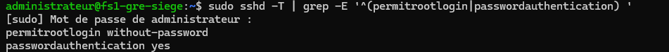

## Après

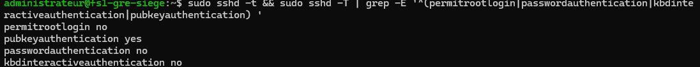

## Sécurisation et validation Samba/SMB

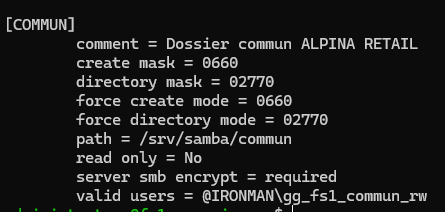

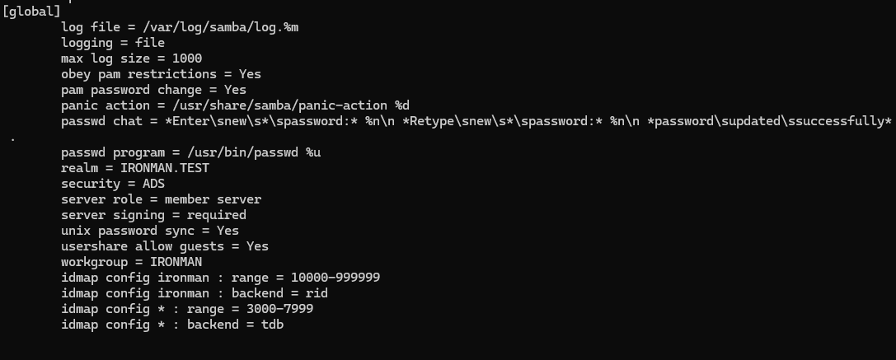

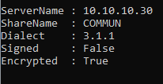

## Contrôles Windows Server et Active Directory

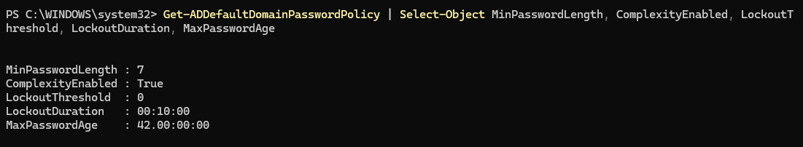

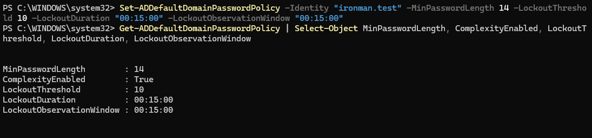

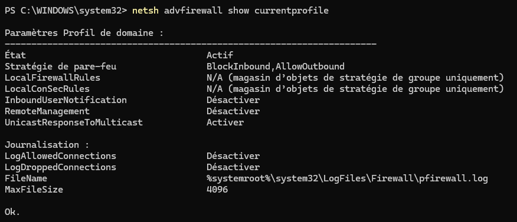

## Règles pfSense et résolution de la panne DNS

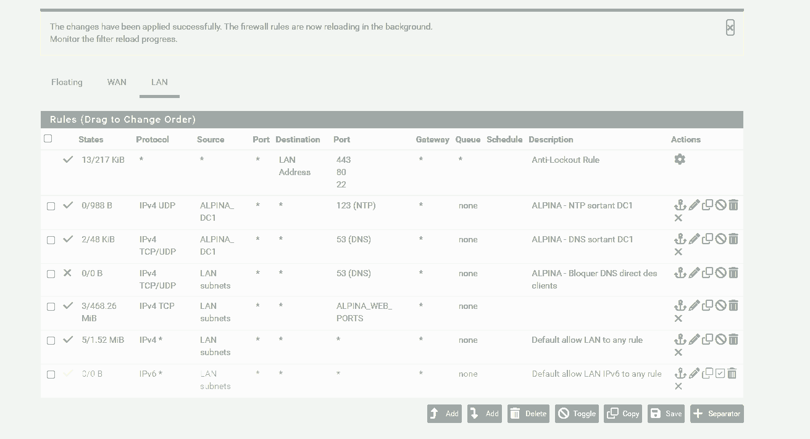

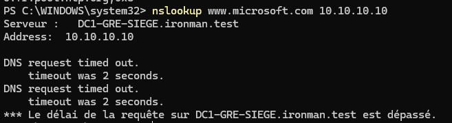

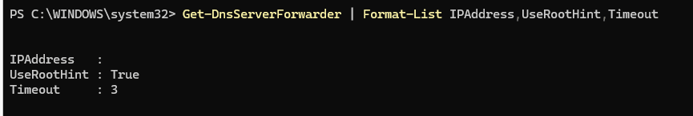

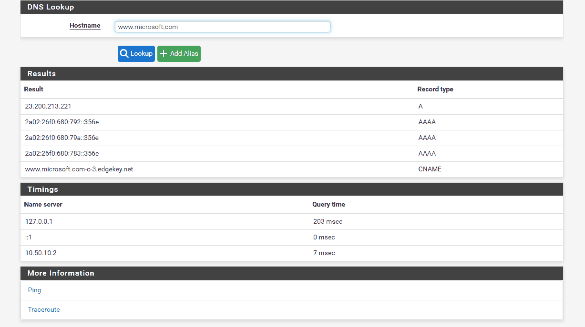

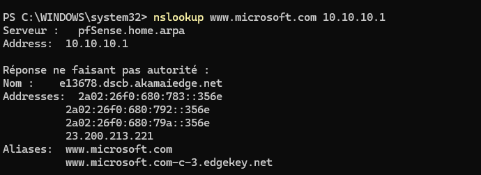

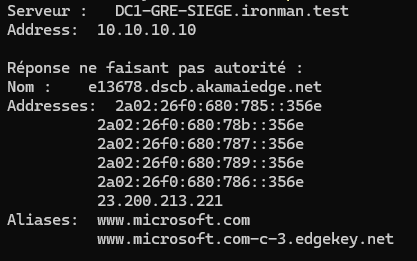

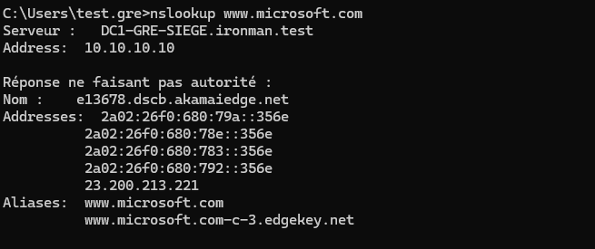

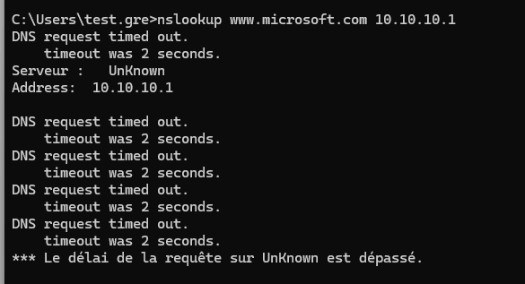

**Limites :** la connexion SSH par clé a été confirmée par l'auteur après rechargement, mais n'a pas fait l'objet d'une capture dédiée. Aucune clé privée ni passphrase n'est incluse. La deuxième capture est compressée pour le dépôt sans changement des valeurs affichées. La capture 04 précède la dernière modification de la configuration des partages invités. Les quatorze captures ajoutées après la mise en place de SSH proviennent des séances authentiques et ont été compressées pour le dépôt. La capture 09 a une palette réduite pour respecter une taille raisonnable.
