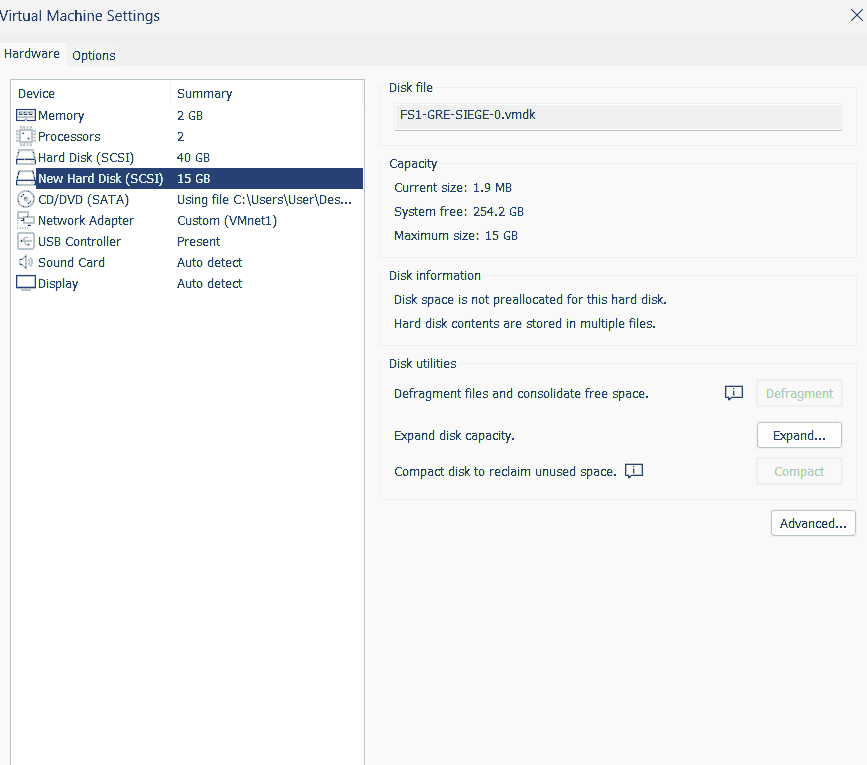
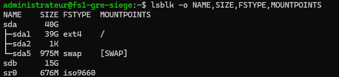
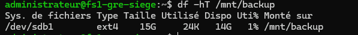
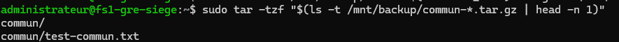

# ALPINA RETAIL — Épisode 07 : sauvegarde et restauration du serveur FS1

**Date : 10 novembre 2026**  
**Environnement :** laboratoire personnel TSSR, entreprise fictive ALPINA RETAIL, siège de Grenoble.  
**Serveur concerné :** `FS1-GRE-SIEGE` — Debian 12, `10.10.10.30`, partage Samba `COMMUN`.

## 1. Objectif du chantier

Protéger le partage `/srv/samba/commun` contre une suppression accidentelle, puis **vérifier que les données sauvegardées peuvent être restaurées**. La réalisation reste volontairement adaptée à un niveau TSSR : opérations sur les disques, système de fichiers ext4, `fstab`, `tar` et comparaison `cmp`.

**Périmètre de validation :** le contenu d'un fichier test a été restauré et comparé octet par octet. Ce résultat ne constitue pas un test de restauration complète de FS1 ni une preuve de résilience à la perte de la VM.

## 2. Stockage séparé : ajout d'un disque virtuel

Le premier contrôle montrait un seul disque de stockage (`/dev/sda` de 40 Gio), hébergeant Debian et les données du partage. Depuis VMware Workstation, la VM a été arrêtée proprement, puis un second disque SCSI **15 Gio** a été ajouté sans modification du disque système.



Après démarrage, depuis une session SSH sécurisée ouverte sur DC1 :

```bash
lsblk -o NAME,SIZE,FSTYPE,MOUNTPOINTS
```

Résultats observés :

- `/dev/sda` : 40 Gio, avec `/dev/sda1` en ext4 monté sur `/` et une partition swap.
- `/dev/sdb` : 15 Gio, nouveau disque vierge, non monté.
- `sr0` : lecteur CD/DVD virtuel.



## 3. Partitionnement, formatage et montage

Après vérification du nom et de la taille du **nouveau** disque, les opérations suivantes ont été réalisées :

```bash
sudo fdisk /dev/sdb
```

Dans `fdisk` : `n` (nouvelle partition), `p` (primaire), numéro `1`, premier et dernier secteurs par défaut, `p` (contrôle), puis `w` (écriture). Cette étape a créé `/dev/sdb1` sur 15 Gio. **Ne jamais exécuter ces actions sur `/dev/sda` dans cette maquette.**

Formatage en ext4 et création du point de montage :

```bash
sudo mkfs.ext4 -L ALPINA_BACKUP /dev/sdb1
sudo mkdir -p /mnt/backup
sudo mount /dev/sdb1 /mnt/backup
df -hT /mnt/backup
```

La vérification `df` a montré :

```text
Sys. de fichiers  Type  Taille  Utilisé  Dispo  Uti%  Monté sur
/dev/sdb1         ext4    15G     24K    14G    1%  /mnt/backup
```



### Montage automatique dans /etc/fstab

Le disque a reçu le label `ALPINA_BACKUP` et l'UUID suivant (relevé par `sudo blkid /dev/sdb1`) :

```text
76eaaa35-082c-48f1-b8bb-62d463954c09
```

Avant modification, copie de sécurité de `fstab` :

```bash
sudo cp /etc/fstab /etc/fstab.bak
```

Ligne ajoutée dans `/etc/fstab` :

```text
UUID=76eaaa35-082c-48f1-b8bb-62d463954c09 /mnt/backup ext4 defaults,nofail 0 2
```

`nofail` évite qu'un disque de sauvegarde absent ne bloque le démarrage. Cette option impose **une précaution complémentaire** lors des sauvegardes automatisées : vérifier que `/mnt/backup` est un montage actif, pour ne pas écrire l'archive sur `/` en cas d'absence du disque.

La vérification `sudo findmnt --verify --verbose` a reconnu correctement l'UUID et le type ext4 sur `/mnt/backup` ; elle a aussi signalé une incohérence **distincte** sur le CD/DVD virtuel et recommandé de recharger systemd. `sudo systemctl daemon-reload` a ensuite été exécutée sans erreur.

**Non encore testé :** persistance du montage après un redémarrage réel de FS1. La ligne `fstab` est configurée et le disque était bien monté lors de la séance.

## 4. Sauvegarde manuelle du partage COMMUN

Depuis la session SSH de l'administrateur :

```bash
sudo tar -czf /mnt/backup/commun-$(date +%F_%H%M).tar.gz -C /srv/samba commun
```

- `-c` : création d'une archive ;
- `-z` : compression gzip ;
- `-f` : chemin du fichier de sauvegarde ;
- `-C /srv/samba commun` : inclusion du dossier `commun` avec une arborescence relative ;
- `$(date +%F_%H%M)` : horodatage du nom de l'archive.

La commande s'est terminée sans erreur.

### Contrôle du contenu

```bash
sudo tar -tzf "$(ls -t /mnt/backup/commun-*.tar.gz | head -n 1)"
```

Sortie observée :

```text
commun/
commun/test-commun.txt
```



Ce contrôle prouve la présence des entrées listées dans l'archive ; il ne démontre pas à lui seul qu'une restauration peut se faire.

## 5. Restauration isolée et vérification

Création d'un dossier distinct des données en production :

```bash
sudo mkdir -p /mnt/backup/restauration-test
```

Extraction de la dernière archive dans ce répertoire :

```bash
sudo tar -xzf "$(ls -t /mnt/backup/commun-*.tar.gz | head -n 1)" -C /mnt/backup/restauration-test
```

Les fichiers originaux dans `/srv/samba/commun` **n'ont pas été écrasés**.

Comparaison du fichier restauré au fichier original :

```bash
sudo cmp /srv/samba/commun/test-commun.txt /mnt/backup/restauration-test/commun/test-commun.txt && echo "Fichiers identiques"
```

Résultat observé :

```text
Fichiers identiques
```


**Validation acquise :** une archive a été créée sur le disque dédié, son contenu a été listé, elle a été extraite ailleurs et les deux versions du fichier `test-commun.txt` étaient identiques au moment du test.

## 6. Limites et prochaines tâches TSSR

- [x] Ajouter et identifier un disque dédié de 15 Gio.
- [x] Partitionner `/dev/sdb` sans toucher au disque système.
- [x] Formater `/dev/sdb1` en ext4 et le monter sur `/mnt/backup`.
- [x] Configurer le montage par UUID dans `/etc/fstab` et vérifier la référence du système de fichiers.
- [x] Réaliser une sauvegarde manuelle `tar.gz` du partage `COMMUN`.
- [x] Vérifier la présence du fichier de test dans l'archive.
- [x] Restaurer dans un dossier distinct et confirmer l'identité octet par octet avec `cmp`.
- [ ] Tester le montage automatique après redémarrage réel.
- [ ] Examiner les **permissions et propriétaires** du contenu restauré (important pour Samba et l'intégration AD).
- [ ] Automatiser une sauvegarde simple avec un contrôle préalable `mountpoint -q /mnt/backup` et une vérification minimale des erreurs.
- [ ] Prévoir une **copie indépendante de la VM et de son hôte** ; un autre disque virtuel dans la même VM ne remplace pas une sauvegarde externe.
- [ ] Préparer, à terme, une procédure de restauration plus complète et une politique de conservation.

> **Prudence :** le répertoire `/mnt/backup/restauration-test` contient les données d'un test de restauration, à ne pas confondre avec des sauvegardes historiques. Les archives et sauvegardes opérationnelles ne doivent pas être publiées sur GitHub.

## Preuves

[Voir les cinq captures authentiques de la manipulation](images/README.md).

[Retour au README principal](../../README.md) · [Épisode 06 — Sécurisation de l'infrastructure](../episode-06/README.md)
