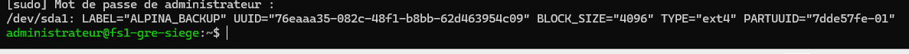
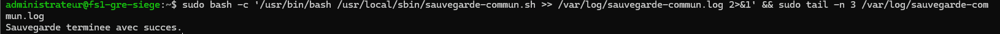
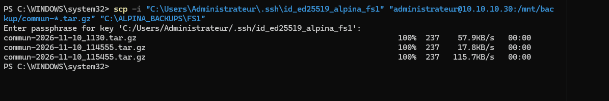
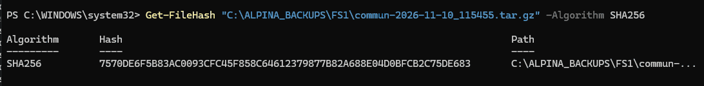
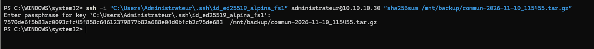

# ALPINA RETAIL — Épisode 07 : sauvegarde et restauration du serveur FS1

**Date : 10 novembre 2026**  
**Environnement :** laboratoire personnel TSSR, entreprise fictive ALPINA RETAIL, siège de Grenoble.  
**Serveur concerné :** `FS1-GRE-SIEGE` — Debian 12, `10.10.10.30`, partage Samba `COMMUN`.

## 1. Objectif du chantier

Protéger le partage `/srv/samba/commun` contre une suppression accidentelle, puis **vérifier que les données sauvegardées peuvent être restaurées**. La réalisation reste volontairement adaptée à un niveau TSSR : opérations sur les disques, système de fichiers ext4, `fstab`, `tar` et comparaison `cmp`.

**Périmètre de validation :** le contenu d'un fichier test a été restauré et comparé octet par octet. Ce résultat ne constitue pas un test de restauration complète de FS1 ni une preuve de résilience à la perte de la VM.

## 2. Stockage séparé : ajout d'un disque virtuel

Le premier contrôle montrait un seul disque de stockage (`/dev/sda` de 40 Gio), hébergeant Debian et les données du partage. Depuis VMware Workstation, la VM a été arrêtée proprement, puis un second disque SCSI **15 Gio** a été ajouté sans modification du disque système.


Après démarrage, depuis une session SSH sécurisée ouverte sur DC1 :

```bash
lsblk -o NAME,SIZE,FSTYPE,MOUNTPOINTS
```

Résultats observés :

- `/dev/sda` : 40 Gio, avec `/dev/sda1` en ext4 monté sur `/` et une partition swap.
- `/dev/sdb` : 15 Gio, nouveau disque vierge, non monté.
- `sr0` : lecteur CD/DVD virtuel.


## 3. Partitionnement, formatage et montage

Après vérification du nom et de la taille du **nouveau** disque, les opérations historiques suivantes ont été réalisées **à cette étape précise du laboratoire** :

> **Avertissement de sécurité :** les noms `/dev/sda` et `/dev/sdb` peuvent changer d'un démarrage à l'autre. Lors du redémarrage du 10 novembre, le disque de sauvegarde est devenu `/dev/sda1` alors qu'il était `/dev/sdb1` initialement. **Ne jamais réexécuter les commandes `fdisk` ou `mkfs.ext4` ci-dessous sans identifier explicitement le disque cible avec `lsblk -o NAME,SIZE,FSTYPE,LABEL,UUID,MOUNTPOINTS`, `blkid` et `findmnt`.** Un mauvais choix effacerait des données. Le montage permanent s'appuie sur l'UUID, pas sur ces noms variables.

```bash
sudo fdisk /dev/sdb
```

Dans `fdisk` : `n` (nouvelle partition), `p` (primaire), numéro `1`, premier et dernier secteurs par défaut, `p` (contrôle), puis `w` (écriture). Cette étape a créé `/dev/sdb1` sur 15 Gio **au moment de la manipulation**. La lettre du disque n'est pas une garantie d'identité : voir l'avertissement ci-dessus avant toute réutilisation.

Formatage en ext4 et création du point de montage :

```bash
sudo mkfs.ext4 -L ALPINA_BACKUP /dev/sdb1
sudo mkdir -p /mnt/backup
sudo mount /dev/sdb1 /mnt/backup
df -hT /mnt/backup
```

La vérification `df` a montré :

```text
Sys. de fichiers  Type  Taille  Utilisé  Dispo  Uti%  Monté sur
/dev/sdb1         ext4    15G     24K    14G    1%  /mnt/backup
```


### Montage automatique dans /etc/fstab

Le disque a reçu le label `ALPINA_BACKUP` et l'UUID suivant (relevé par `sudo blkid /dev/sdb1`) :

```text
76eaaa35-082c-48f1-b8bb-62d463954c09
```

Avant modification, copie de sécurité de `fstab` :

```bash
sudo cp /etc/fstab /etc/fstab.bak
```

Ligne ajoutée dans `/etc/fstab` :

```text
UUID=76eaaa35-082c-48f1-b8bb-62d463954c09 /mnt/backup ext4 defaults,nofail 0 2
```

`nofail` évite qu'un disque de sauvegarde absent ne bloque le démarrage. Cette option impose **une précaution complémentaire** lors des sauvegardes automatisées : vérifier que `/mnt/backup` est un montage actif, pour ne pas écrire l'archive sur `/` en cas d'absence du disque.

La vérification `sudo findmnt --verify --verbose` a reconnu correctement l'UUID et le type ext4 sur `/mnt/backup` ; elle a aussi signalé une incohérence **distincte** sur le CD/DVD virtuel et recommandé de recharger systemd. `sudo systemctl daemon-reload` a ensuite été exécutée sans erreur.

**Test après redémarrage du 10 novembre 2026 :** `df -hT /mnt/backup` montre `/dev/sda1`, ext4, 15 Gio, monté sur `/mnt/backup`, alors que le disque s'appelait `/dev/sdb1` avant le redémarrage. `sudo blkid /dev/sda1` confirme le même label `ALPINA_BACKUP` et exactement le même UUID `76eaaa35-082c-48f1-b8bb-62d463954c09`. Le montage automatique par UUID est donc **validé**, indépendamment du changement de nom du périphérique.



## 4. Sauvegarde manuelle du partage COMMUN

Depuis la session SSH de l'administrateur :

```bash
sudo tar -czf /mnt/backup/commun-$(date +%F_%H%M).tar.gz -C /srv/samba commun
```

- `-c` : création d'une archive ;
- `-z` : compression gzip ;
- `-f` : chemin du fichier de sauvegarde ;
- `-C /srv/samba commun` : inclusion du dossier `commun` avec une arborescence relative ;
- `$(date +%F_%H%M)` : horodatage du nom de l'archive.

La commande s'est terminée sans erreur.

### Contrôle du contenu

```bash
sudo tar -tzf "$(ls -t /mnt/backup/commun-*.tar.gz | head -n 1)"
```

Sortie observée :

```text
commun/
commun/test-commun.txt
```


Ce contrôle prouve la présence des entrées listées dans l'archive ; il ne démontre pas à lui seul qu'une restauration peut se faire.

## 5. Restauration isolée et vérification

Création d'un dossier distinct des données en production :

```bash
sudo mkdir -p /mnt/backup/restauration-test
```

Extraction de la dernière archive dans ce répertoire :

```bash
sudo tar -xzf "$(ls -t /mnt/backup/commun-*.tar.gz | head -n 1)" -C /mnt/backup/restauration-test
```

Les fichiers originaux dans `/srv/samba/commun` **n'ont pas été écrasés**.

Comparaison du fichier restauré au fichier original :

```bash
sudo cmp /srv/samba/commun/test-commun.txt /mnt/backup/restauration-test/commun/test-commun.txt && echo "Fichiers identiques"
```

Résultat observé :

```text
Fichiers identiques
```


**Validation acquise :** une archive a été créée sur le disque dédié, son contenu a été listé, elle a été extraite ailleurs et les deux versions du fichier `test-commun.txt` étaient identiques au moment du test.

## 6. Sauvegarde automatique avec cron — 10 novembre 2026

Pour automatiser la procédure manuelle validée, un script Bash simple a été créé dans `/usr/local/sbin/sauvegarde-commun.sh` :

```bash
#!/bin/bash

# Arreter le script si une commande echoue
set -e

# Verifier que le disque de sauvegarde est monte
if ! mountpoint -q /mnt/backup; then
    echo "ERREUR : disque de sauvegarde non monte."
    exit 1
fi

# Sauvegarder le partage Samba COMMUN
tar -czf "/mnt/backup/commun-$(date +%F_%H%M%S).tar.gz" -C /srv/samba commun

echo "Sauvegarde terminee avec succes."
```

**Précision :** le contrôle `mountpoint` évite d'écrire sur la partition système si le montage est absent ; il ne garantit pas à lui seul que le volume monté est le bon disque en cas d'erreur d'administration. Une vérification plus stricte par UUID pourrait être ajoutée dans une version ultérieure.

**Vérifications réalisées :**

- `sudo bash -n /usr/local/sbin/sauvegarde-commun.sh` : aucune erreur de syntaxe détectée.
- `sudo bash /usr/local/sbin/sauvegarde-commun.sh` : message `Sauvegarde terminee avec succes.`
- `ls -lh /mnt/backup/commun-*.tar.gz` : présence de deux archives (manuelle et script), chacune de 237 octets dans ce laboratoire de test.
- `systemctl is-active cron` : service déclaré actif.

**Planification ajoutée à la crontab de `root`** avec `sudo crontab -e`, puis vérifiée avec `sudo crontab -l` :

```cron
0 2 * * * /usr/bin/bash /usr/local/sbin/sauvegarde-commun.sh >> /var/log/sauvegarde-commun.log 2>&1
```

Cela programme l'exécution du script tous les jours à **02 h (heure système de la VM)** et collecte sa sortie standard ainsi que ses erreurs dans un journal. La VM doit être en fonctionnement à cette heure. **L'exécution réelle par cron à 02 h n'a pas encore été observée.**

Pour tester la même commande de journalisation sans attendre le déclenchement planifié :

```bash
sudo bash -c '/usr/bin/bash /usr/local/sbin/sauvegarde-commun.sh >> /var/log/sauvegarde-commun.log 2>&1' && sudo tail -n 3 /var/log/sauvegarde-commun.log
```

Résultat observé :

```text
Sauvegarde terminee avec succes.
```



**Limites :** ce test confirme la bonne exécution manuelle et l'écriture du journal, pas le déclenchement automatique de cron. La sauvegarde est effectuée sans dispositif de cohérence applicative et aucun mécanisme de rétention/nettoyage des archives n'est encore défini. Le volume étant dans la même VM, une copie indépendante reste nécessaire.

## 7. Copie des archives vers Windows Server via SCP et contrôle SHA-256

**Objectif de l'exercice TSSR :** conserver une seconde copie des archives sur une autre VM et confirmer l'intégrité des fichiers transférés.

**Destination de laboratoire :** `DC1-GRE-SIEGE` (Windows Server 2025), `C:\ALPINA_BACKUPS\FS1`. L'usage d'un contrôleur de domaine comme dépôt de sauvegardes est réservé à cet exercice : ce n'est **pas** la solution à retenir en production.

### Préparer et transférer les archives

Dossier créé sur DC1 avec PowerShell administrateur :

```powershell
New-Item -ItemType Directory -Path "C:\ALPINA_BACKUPS\FS1" -Force
```

Récupération des archives depuis DC1 en SSH, avec la clé privée déjà configurée pour accéder à FS1 :

```powershell
scp -i "C:\Users\Administrateur\.ssh\id_ed25519_alpina_fs1" "administrateur@10.10.10.30:/mnt/backup/commun-*.tar.gz" "C:\ALPINA_BACKUPS\FS1"
```

La clé protégée par une passphrase a été utilisée ; **ni clé privée ni passphrase ne sont publiées**.

Trois transferts indiqués à **100 %**. Vérification de la présence des archives sur DC1 :

```powershell
Get-ChildItem "C:\ALPINA_BACKUPS\FS1" | Select-Object Name, Length, LastWriteTime
```

Trois fichiers reçus, de 237 octets chacun :

- `commun-2026-11-10_1130.tar.gz`
- `commun-2026-11-10_114555.tar.gz`
- `commun-2026-11-10_115455.tar.gz`



### Comparer les empreintes SHA-256

Sur **DC1** :

```powershell
Get-FileHash "C:\ALPINA_BACKUPS\FS1\commun-2026-11-10_115455.tar.gz" -Algorithm SHA256
```



Sur **FS1**, commande exécutée à distance depuis PowerShell de DC1 :

```powershell
ssh -i "C:\Users\Administrateur\.ssh\id_ed25519_alpina_fs1" administrateur@10.10.10.30 "sha256sum /mnt/backup/commun-2026-11-10_115455.tar.gz"
```



**Empreintes comparées :**

```text
DC1 : 7570DE6F5B83AC0093CFC45F858C64612379877B82A688E04D0BFCB2C75DE683
FS1 : 7570de6f5b83ac0093cfc45f858c64612379877b82a688e04d0bfcb2c75de683
```

**Résultat :** les empreintes correspondent (la casse des caractères hexadécimaux ne change pas leur valeur). Le fichier reçu sur DC1 correspond donc, avec une très forte assurance, au fichier source de FS1.

**Limites :** seules les empreintes d'une des trois archives copiées ont été comparées. Cette opération ne démontre ni une restauration à partir de DC1 ni une protection contre une perte de l'hôte VMware : les deux VM restent sur le même ordinateur physique. Aucune copie hors de cet hôte n'a encore été mise en place.


## 8. Limites et prochaines tâches TSSR

- [x] Ajouter et identifier un disque dédié de 15 Gio.
- [x] Partitionner `/dev/sdb` sans toucher au disque système.
- [x] Formater `/dev/sdb1` en ext4 et le monter sur `/mnt/backup`.
- [x] Configurer le montage par UUID dans `/etc/fstab` et vérifier la référence du système de fichiers.
- [x] Réaliser une sauvegarde manuelle `tar.gz` du partage `COMMUN`.
- [x] Vérifier la présence du fichier de test dans l'archive.
- [x] Restaurer dans un dossier distinct et confirmer l'identité octet par octet avec `cmp`.
- [x] Tester le montage automatique après redémarrage réel : `/mnt/backup` est remonté sur `/dev/sda1`, **UUID inchangé** (`76eaaa35-082c-48f1-b8bb-62d463954c09`) et label `ALPINA_BACKUP`. La variation de nom `/dev/sdb1` → `/dev/sda1` illustre l'intérêt du montage par UUID.
- [x] Comparer les **permissions et propriétaires** du fichier restauré et de l'original : `-rw-rw----`, propriétaire `IRONMAN\test.gre`, groupe `IRONMAN\gg_fs1_commun_rw`, taille 28 octets, identiques dans la capture de la séance.
- [x] Créer le script Bash, vérifier sa syntaxe et exécuter une sauvegarde réussie.
- [x] Ajouter la tâche quotidienne à 02 h à la crontab de `root`, vérifier son enregistrement et la journalisation en exécution manuelle.
- [ ] Observer le déclenchement automatique effectif par cron à 02 h lorsque la VM est allumée.
- [x] Copier les trois archives par SCP de FS1 vers DC1 et confirmer la présence des trois fichiers côté Windows Server.
- [x] Comparer les empreintes SHA-256 de l'archive `commun-2026-11-10_115455.tar.gz` sur DC1 et FS1 : **identiques**.
- [ ] Prévoir une **copie indépendante de l'hôte physique VMware** (support ou destination externe) ; le transfert vers DC1 reste une démonstration TSSR, pas une sauvegarde hors site.
- [ ] Préparer, à terme, une procédure de restauration plus complète et une politique de conservation.

> **Prudence :** le répertoire `/mnt/backup/restauration-test` contient les données d'un test de restauration, à ne pas confondre avec des sauvegardes historiques. Les archives et sauvegardes opérationnelles ne doivent pas être publiées sur GitHub.

## Preuves

[Voir les dix captures authentiques de la manipulation](images/README.md).

[Retour au README principal](../../README.md) · [Épisode 06 — Sécurisation de l'infrastructure](../episode-06/README.md)
