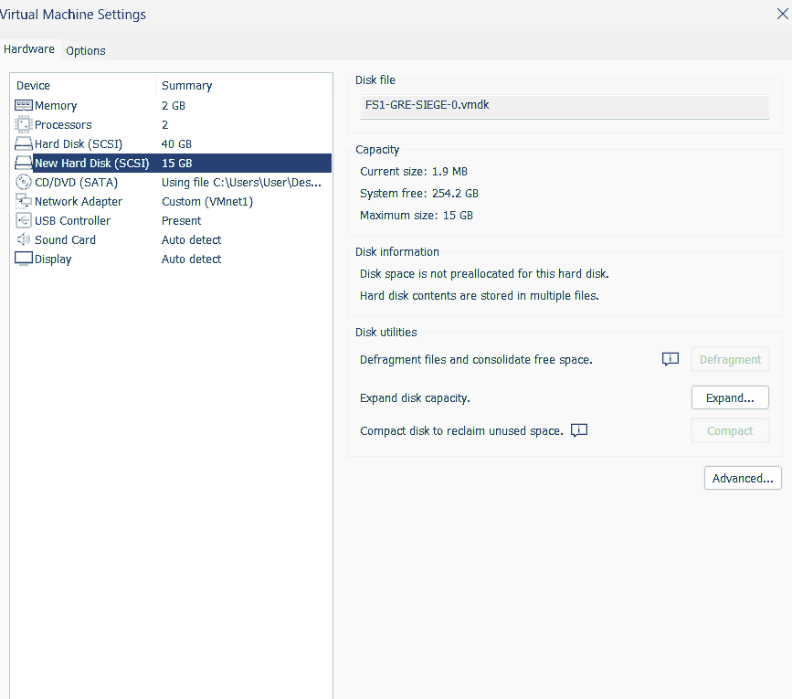
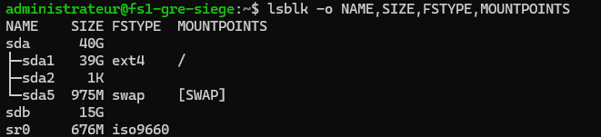
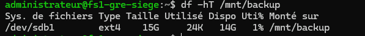
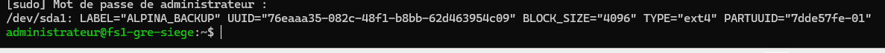
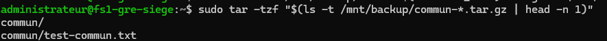
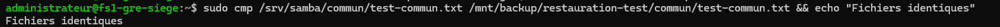
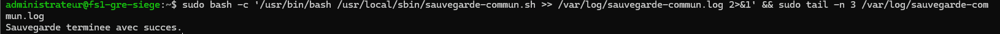
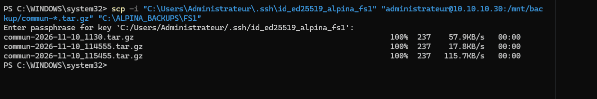
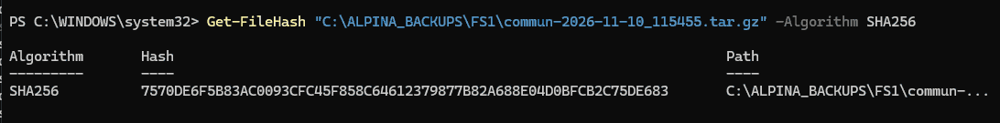
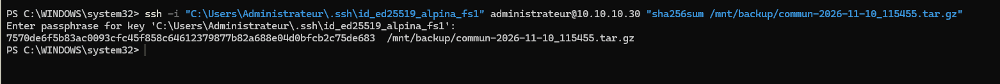

# ALPINA RETAIL — Épisode 07 — Captures de sauvegarde et restauration

**10 novembre 2026.** Dix captures authentiques fournies au cours de la séance ; images compressées pour le dépôt.

| Capture | Information vérifiée |
|---|---|
| [01 — Deux disques dans VMware](01-vmware-disques.png) | Disque système SCSI de 40 Gio et second disque SCSI de 15 Gio non préalloué |
| [02 — Détection du disque dans Debian](02-lsblk-nouveau-disque.png) | `lsblk` montre `/dev/sda` (40 Go) et `/dev/sdb` (15 Go) |
| [03 — Montage ext4 confirmé](03-stockage-monte.png) | `df -hT /mnt/backup` → `/dev/sdb1`, ext4, 15 Go |
| [04 — Liste de l'archive tar](04-archive-liste.png) | `commun/` et `commun/test-commun.txt` présents |
| [05 — Restauration validée par cmp](05-fichier-restaure-identique.png) | Message `Fichiers identiques` après comparaison de l'original et de la copie restaurée |
| [06 — Journal de sauvegarde](06-journal-sauvegarde.png) | Script lancé manuellement avec redirection vers le journal, message de succès consulté avec `tail` |
| [07 — Montage automatique vérifié après redémarrage](07-montage-auto-uuid-verifie.png) | `blkid /dev/sda1` retrouve le label et l'UUID du disque d'abord détecté comme `/dev/sdb1` |
| [08 — Transfert SCP vers DC1](08-scp-archives-100pc.png) | Copies chiffrées des archives de FS1 vers Windows Server, progression à 100 % |
| [09 — SHA-256 sur DC1](09-sha256-dc1.png) | `Get-FileHash` calcule l'empreinte d'une archive reçue |
| [10 — SHA-256 sur FS1](10-sha256-fs1.png) | `sha256sum` via SSH renvoie la même empreinte que sur Windows Server |

## Disque et stockage

## Sauvegarde et restauration

## Automatisation et journal

## Copie SCP et contrôle d'intégrité

**Limites :** la vérification `cmp` porte sur un fichier de test ; elle ne vaut pas restauration après perte totale de VM. Les propriétaires et permissions du fichier restauré ont été comparés dans la séance, mais n'ont pas fait l'objet d'une capture déposée ici. La crontab a été vérifiée en conversation ; le déclenchement automatique de 02 h n'a pas été observé. Le montage automatique a été testé après redémarrage, le périphérique s'étant renommé en `/dev/sda1` sans changement d'UUID.

[Revenir au compte rendu de l'épisode 07](../README.md)
