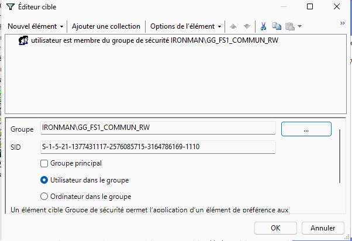
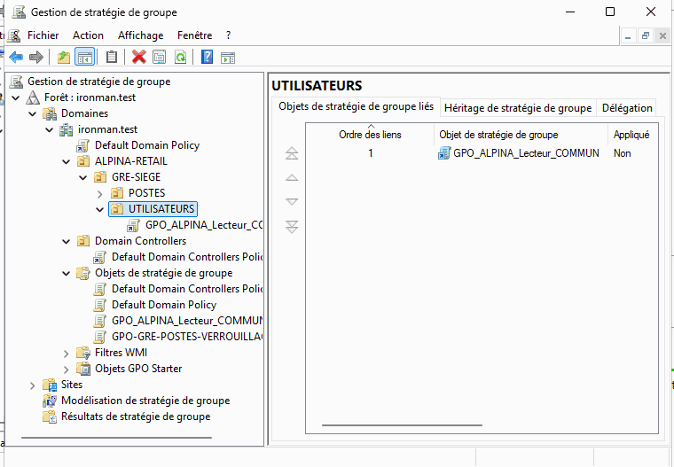
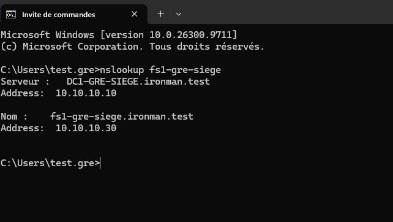
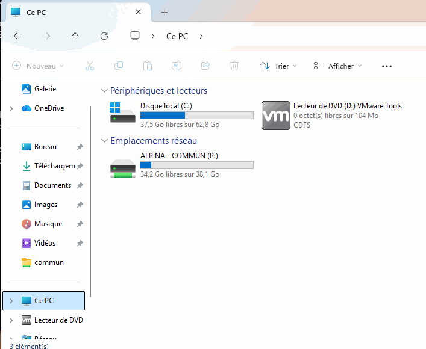
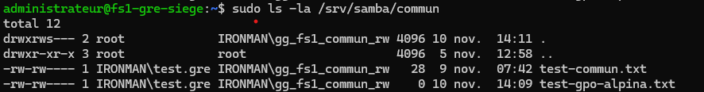

# ALPINA RETAIL — Épisode 08 : déploiement du lecteur réseau COMMUN par GPO

**Date : 10 novembre 2026**  
**Contexte :** laboratoire TSSR, entreprise fictive ALPINA RETAIL, siège Grenoble.  
**Machines :** `DC1-GRE-SIEGE` (Windows Server 2025 / AD DS), `PC-TEST-GRE` (Windows 11), `FS1-GRE-SIEGE` (Debian 12 / Samba).

## 1. Besoin et objectif

Donner automatiquement un lecteur réseau `P:` aux salariés autorisés, sans devoir saisir à chaque session le chemin UNC du partage. Les autorisations d'accès aux fichiers restent appliquées par Samba et Linux : la GPO **ne remplace pas** le contrôle d'accès du serveur.

- Domaine AD : `ironman.test`.
- Groupe de sécurité : `IRONMAN\GG_FS1_COMMUN_RW`.
- Partage : `\\fs1-gre-siege\COMMUN`.
- Répertoire Linux : `/srv/samba/commun`.
- OU utilisateur : `ALPINA-RETAIL / GRE-SIEGE / UTILISATEURS`.

## 2. Configuration de la stratégie

Depuis `gpmc.msc`, création d'une GPO dédiée, **`GPO_ALPINA_Lecteur_COMMUN`**, sans modifier la Default Domain Policy.

Parcours : **Configuration utilisateur → Préférences → Paramètres Windows → Mappages de lecteurs**.

| Propriété | Valeur configurée |
|---|---|
| Action | Mettre à jour |
| Emplacement | `\\fs1-gre-siege\COMMUN` |
| Reconnecter | Activé |
| Libellé | `ALPINA - COMMUN` |
| Lettre | `P:` |
| Identifiants supplémentaires | Aucun ; session AD de l'utilisateur |

Dans l'onglet **Commun**, activation du **ciblage au niveau de l'élément** avec la condition **l'utilisateur est membre de `IRONMAN\GG_FS1_COMMUN_RW`**.



Le compte `test.gre` a été vérifié membre de ce groupe dans Utilisateurs et ordinateurs Active Directory. Il est situé dans l'OU `ALPINA-RETAIL / GRE-SIEGE / UTILISATEURS`. La GPO a été liée à **cette OU**, qui contient le compte utilisateur ; le poste client n'a pas besoin d'être placé dans la même OU pour appliquer ce paramètre utilisateur dans notre scénario.



La colonne « Appliqué : Non » de GPMC indique ici que le lien n'est **pas imposé / Enforced** ; elle ne signifie pas que le lien est désactivé.

## 3. Vérifications côté poste Windows

**Résolution DNS du serveur Samba** sur `PC-TEST-GRE` connecté en `IRONMAN\test.gre` :

```cmd
nslookup fs1-gre-siege
```

Résultat constaté : le DNS `DC1-GRE-SIEGE.ironman.test` (`10.10.10.10`) résout `fs1-gre-siege.ironman.test` en **`10.10.10.30`**.



La commande `gpupdate /force` s'est terminée **sans erreur** selon le retour du test. Dans **Ce PC**, le lecteur **`ALPINA - COMMUN (P:)`** apparaît sous les emplacements réseau.



Un fichier texte créé dans le lecteur depuis Windows a ensuite été retrouvé sur Linux. Initialement, Windows a masqué l'extension et produit `test-gpo-alpina.txt.txt` ; l'affichage des extensions a permis de corriger le nom en `test-gpo-alpina.txt`.

## 4. Vérification côté serveur Debian

L'utilisateur SSH `administrateur` a d'abord reçu « Permission non accordée » lors d'un `ls` sans `sudo` ; le dossier est volontairement protégé. Une recherche avec `sudo` sous le nom attendu a alors montré « Aucun fichier » : le vrai nom comportait deux extensions. Après correction depuis Windows :

```bash
sudo ls -la /srv/samba/commun
```

Le fichier est visible avec :
- propriétaire `IRONMAN\test.gre` ;
- groupe `IRONMAN\gg_fs1_commun_rw` ;
- droits **`-rw-rw----` (660)** ;
- taille **0 octet** (document vide créé pour le test).



**Validation :** le mappage par GPO est visible sur Windows, l'écriture dans le partage fonctionne et le fichier est présent sur FS1 avec les identités et permissions attendues.

## 5. Limites et suite

- Le **ciblage par groupe** est configuré et un membre du groupe a réussi le test. Un **contre-test avec un utilisateur hors du groupe pour vérifier l'absence du lecteur P:** n'a pas encore été réalisé pour cette GPO.
- La création du fichier valide l'écriture mais pas toutes les opérations de modification, suppression ou de montée en charge.
- La protection effective des données dépend à la fois du partage Samba et des permissions Linux, pas de l'affichage du lecteur.

**Épisode suivant :** [supervision Bash et préparation de Centreon](../episode-09/README.md).
