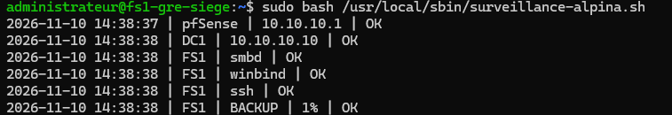
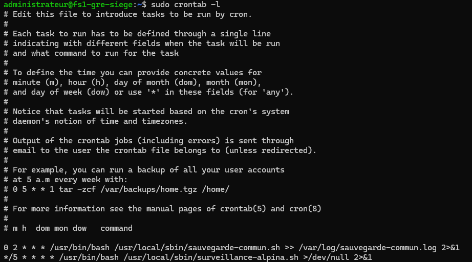
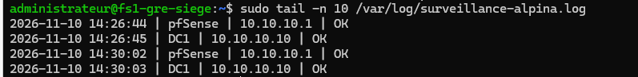
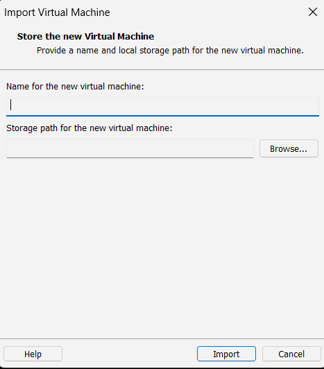

# ALPINA RETAIL — Épisode 09 : supervision Bash, planification cron et préparation de Centreon

**Date : 10 novembre 2026**  
**État :** surveillance légère Bash testée ; **Centreon importé dans VMware mais pas encore démarré ni configuré**.  
**Laboratoire :** VMware Workstation Pro 17 sur hôte Windows 11 avec 16 Go de RAM.

## 1. Objectif et contraintes

Superviser les équipements du siège Grenoble avec les ressources disponibles sur le PC hôte : `pfSense-GRE-SIEGE`, `DC1-GRE-SIEGE` et `FS1-GRE-SIEGE`. Une VM Centreon dédiée était initialement exclue faute de RAM, puis retenue après arrêt temporaire d'autres VM.

### Diagnostics manuels sur FS1 (Debian 12)

| Contrôle | Commande | Résultat observé |
|---|---|---|
| Services en échec | `systemctl --failed` | 0 unité listée |
| Services essentiels | `systemctl is-active smbd winbind ssh` | `active` pour les trois |
| Mémoire | `free -h` | 1,9 Gio total, 343 Mio utilisés, 1,6 Gio disponibles, swap non utilisée |
| Charge | `uptime` | moyennes 1/5/15 min : 0,00 / 0,00 / 0,00 |
| Système et disque backup | `df -h / /mnt/backup` | racine 6 % ; sauvegarde 1 % |
| pfSense | `ping -c 2 10.10.10.1` | 2/2 réponses, 0 % de perte |
| DC1 | `ping -c 2 10.10.10.10` | 2/2 réponses, 0 % de perte |

Ces constats sont **ponctuels**. Un ping positif ne prouve pas la disponibilité des services applicatifs.

## 2. Script de supervision sur FS1

Script créé dans `/usr/local/sbin/surveillance-alpina.sh`. Une version **reconstituée à partir des commandes effectivement mises en œuvre et testées** est publiée dans ce dépôt : [surveillance-alpina.sh](surveillance-alpina.sh).

> **Correctif logiciel ajouté au dépôt après audit :** la version publiée vérifie aussi les erreurs de lecture `df` ainsi que la validité numérique du pourcentage, pour éviter un faux état `OK`. **Ce correctif n'a pas encore été copié, exécuté ni validé sur la VM FS1** ; les captures et tests ci-dessous concernent la version effectivement installée le 10 novembre 2026.

Le script s'exécute en `root` et consigne ses observations dans `/var/log/surveillance-alpina.log` :

- **ICMP :** pfSense `10.10.10.1` et DC1 `10.10.10.10`, 2 paquets avec attente maximale de 2 secondes par requête.
- **Services locaux :** `smbd`, `winbind`, `ssh`, testés via `systemctl is-active --quiet`.
- **Stockage :** `mountpoint -q /mnt/backup` avant toute mesure ; pourcentage extrait de `df -P`, alerte prévue à partir de **80 %**.
- **Journal :** horodatage et statut `OK` / `ALERTE` à l'aide de `tee -a`.

Le seuil de 80 % est un **choix de laboratoire**, pas une norme universelle.

### Tests réellement effectués

- `bash -n /usr/local/sbin/surveillance-alpina.sh` : aucune erreur de syntaxe signalée après les ajouts successifs.
- `sudo bash /usr/local/sbin/surveillance-alpina.sh` : première exécution manuelle avec 2 contrôles `OK`, puis 5 après ajout des services, enfin **6** après ajout du disque.
- Contrôle complet final observé le 10/11/2026 vers **14:38** (heure affichée dans la VM) :

```text
pfSense | 10.10.10.1 | OK
DC1     | 10.10.10.10 | OK
FS1     | smbd | OK
FS1     | winbind | OK
FS1     | ssh | OK
FS1     | BACKUP | 1% | OK
```



## 3. Exécution automatique avec cron

La crontab de `root` contient **deux tâches distinctes** :

```cron
0 2 * * * /usr/bin/bash /usr/local/sbin/sauvegarde-commun.sh >> /var/log/sauvegarde-commun.log 2>&1
*/5 * * * * /usr/bin/bash /usr/local/sbin/surveillance-alpina.sh >/dev/null 2>&1
```

La première est la sauvegarde quotidienne de l'[épisode 07](../episode-07/README.md). La seconde lance la surveillance **toutes les 5 minutes** ; les résultats sont écrits par le script dans son propre journal.



Le journal de surveillance a été vérifié via :

```bash
sudo tail -n 10 /var/log/surveillance-alpina.log
```

Deux entrées automatiques à **14:30:02** pour pfSense et **14:30:03** pour DC1 succèdent aux résultats manuels de 14:26. **L'exécution réelle par cron est donc démontrée pour la version initiale (2 cibles).** La prise en charge des ajouts ultérieurs (services et disque) par un déclenchement cron n'a pas été constatée séparément sur capture, bien que la version enrichie ait réussi le test manuel.



### Test des alertes : limite

Le script opérationnel a été copié en sauvegarde `.bak`, puis une copie de test a été préparée dans `/tmp/surveillance-alpina-test.sh` avec un journal distinct. **La simulation d'une panne et l'observation effective d'un statut ALERTE n'ont pas été réalisées.** Les règles d'alerte n'ont donc pas encore été validées par un test négatif.

Ce système journalise les états mais **n'envoie aucune notification** et ne propose pas encore de tableau de bord.

## 4. RAM de l'hôte et changement d'orientation vers Centreon

Avec les VM initialement démarrées, le PC hôte affichait **14,6 / 15,9 Go (92 %) de RAM utilisée**, soit 1,3 Go disponibles. Après l'arrêt propre de `PC-TEST-GRE`, le Gestionnaire des tâches indiquait **10,0 Go utilisés (63 %)** et **5,9 Go disponibles**. Cette comparaison confirme que l'arrêt de VM permet de libérer des ressources, mais ne constitue pas un dimensionnement de Centreon.

Pour installer Centreon, `FS1-GRE-SIEGE` a ensuite été arrêté proprement à l'aide de :

```bash
sudo shutdown -h now
```

**Conséquence opérationnelle :** le partage Samba, le script de surveillance et la sauvegarde cron de FS1 ne tournent pas tant que FS1 est arrêté. Une surveillance hébergée sur FS1 ne peut pas détecter sa propre extinction.

## 5. Appliance Centreon : importation VMware

Le téléchargement de l'appliance Centreon prévue pour VMware a été confirmé, puis l'assistant d'importation de VMware Workstation a été utilisé.

- **Nom de la VM annoncé après import :** `CENTREON-GRE-SIEGE`.
- **État confirmé par l'opérateur :** VM visible dans VMware à l'issue de l'import.
- **Version visée lors du téléchargement :** Centreon 26.10, appliance Debian 13, **à vérifier depuis la VM au premier démarrage**.
- **Configuration réseau prévue, non appliquée :** VMnet1 ; IP proposée `10.10.10.40/24`, passerelle `10.10.10.1`, DNS `10.10.10.10`.



**Attention aux preuves :** cette capture montre la **fenêtre d'importation**, pas le premier démarrage ni le fonctionnement de Centreon. L'import final est confirmé par le retour de l'utilisateur ; aucune capture de la VM démarrée n'a encore été fournie.

## 6. État final du chantier et prochaines étapes

| Composant | État au 10 novembre 2026 |
|---|---|
| Contrôles système et réseau de FS1 | Vérifiés ponctuellement |
| Script Bash à six contrôles | Test manuel réussi |
| Planification cron toutes les 5 minutes | Enregistrée ; déclenchement réel prouvé pour la version à 2 contrôles |
| Déclenchement du scénario `ALERTE` | Non testé |
| Notifications | Non configurées |
| `CENTREON-GRE-SIEGE` | VM importée, non démarrée / non configurée |
| `PC-TEST-GRE` et `FS1-GRE-SIEGE` | Arrêtés pour libérer de la RAM |
| pfSense et DC1 | Conservés pour la suite de l'infrastructure |

**À la reprise :** recopier le correctif de supervision dans FS1 et vérifier la syntaxe, le cas normal et une erreur de mesure simulée ; ensuite, contrôler les ressources de la VM Centreon, régler son interface réseau sur VMnet1, vérifier l'adresse `10.10.10.40` disponible, démarrer et identifier l'OS/la version, finaliser l'accès Web Centreon, puis ajouter pfSense, DC1 et FS1 avec des contrôles adaptés. Remettre FS1 en marche au moment de tester sa supervision, sous réserve de la RAM disponible.

**Précaution :** aucune configuration Centreon, aucun agent, aucune connexion à l'interface Web et aucun hôte Centreon supervisé ne sont encore validés.
